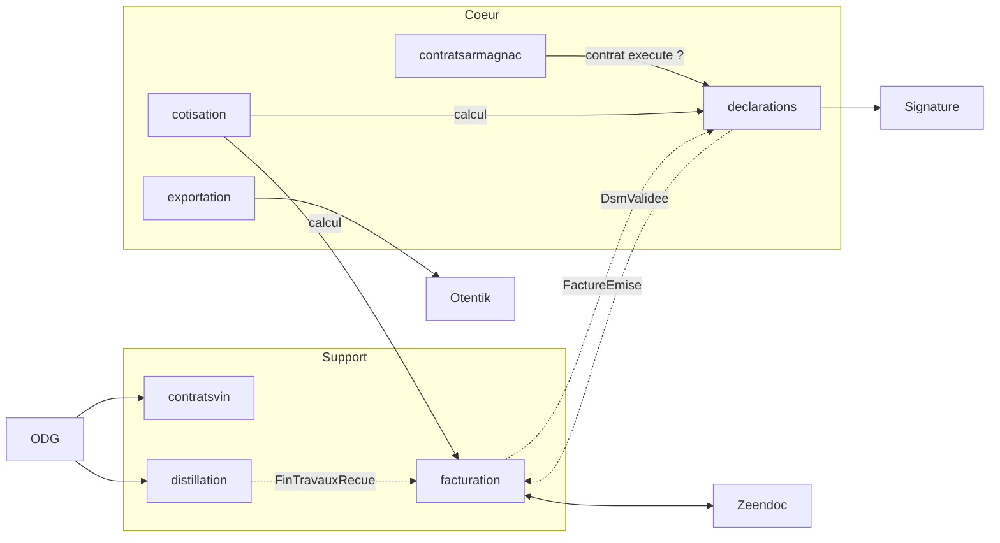

# Contextes : première analyse

> **Document provisoire.** Tout ce qui suit (contextes, descriptions, agrégats, relations, ordre) est une première lecture du CDC. Il **devra être réinterprété, raffiné, complété ou corrigé à chaque implémentation de contexte**.
>
> À chaque contexte, on procède ainsi :
> 1. avant de commencer : relire ses sources, contester la fiche ci-dessous ;
> 2. à la fin : corriger la fiche, la context map et l'ordre, et noter la révision dans le journal en fin de fichier.
>
> Un package par contexte : `fr.bnia.<contexte>.<couche>` (ADR-002). Les chapitres « back-office » et « portail » du CDC sont des écrans sur ces contextes, pas des contextes.

Chemins : tous les liens sont relatifs à `docs/`. `BO` = chapitre 4 du CDC (back-office), `Portail` = chapitre 5, `C.n` = annexe C, `AGI` = spec de reprise de données.

## 1. Ordre d'implémentation (révisé)

**Principe.** Les zones d'ombre du CDC (voir [analyse-interfaces-externes.md](analyse-interfaces-externes.md)) se situent presque toutes à la **frontière** des contextes : un tiers, un format de fichier, un document modèle. Le **noyau** d'un contexte (agrégats, règles de gestion, états, contrôles) est presque toujours spécifiable avec le CDC seul. L'architecture hexagonale permet donc de :

- démarrer un contexte par son **noyau**, ses ports de sortie étant branchés sur des adapters simulés ;
- reporter sa **bordure** (adapter réel, format exact, mise en page fidèle) à l'arrivée de la réponse du BNIA, sans toucher au noyau.

Statut : **A** = démarrable sans aucune réponse ; **B** = noyau démarrable, bordure en attente.
« Parallélisable avec » : contextes indépendants l'un de l'autre, confiables à des agents différents en même temps.

| # | Contexte | Type | Statut | Dépend de | Parallélisable avec | Bordure en attente |
|---|---|---|---|---|---|---|
| 1 | `referentiels` | Générique | A | : | : | Valeurs initiales réelles (reprise AGI) |
| 2 | `operateurs` | Support | A | 1 | : | Alimentation de l'annuaire public (flux non décrit) |
| 3 | `acces` | Générique | A | 2 | : | Fournisseur d'e-mail (non précisé) |
| 4 | `cotisation` | Cœur | A | 1 | 5, 7 | Valeurs réelles des taux |
| 5 | `contratsarmagnac` | Cœur | A (contrat achat seul) | 2 | 4, 7 | Pluri-annuels et propositions : arbitrage BNIA |
| 6 | `declarations` | Cœur | B | 2, 4, 5 | 7 | Import Excel exact, signature, format XML/JSON |
| 7 | `exportation` | Cœur | B | 1, 2 | 4, 5, 6 | Otentik, mise en page des certificats, matrice ventes export |
| 8 | `facturation` | Support | B | 2, 4, 6 | : | Zeendoc (API, états) |
| 9 | `distillation` | Support | B | 2, 4, 8 | 10 | Transport ODG (TimeTonic) |
| 10 | `contratsvin` | Support | B | 2, passerelle ODG de 9 | 9 | Transport ODG ; pluri-annuels et propositions vin en arbitrage |
| 11 | `notifications` | Générique | A | événements de 5 à 10 | 12, 13, 14 | Canal e-mail |
| 12 | `statistiques` | Support | A | données de 5 à 8 | 11, 13, 14 | : |
| 13 | `boutique` | Générique | A | 1, 8 | 11, 12, 14 | : |
| 14 | `contenus` | Générique | A | : | à tout moment | Reprise armagnac.fr (agence) |

Les étapes 1 à 5 peuvent démarrer **maintenant**.

**Ce qui change par rapport à la première version**

- `exportation` ne dépend ni de `declarations` ni de `facturation` : les justificatifs d'une demande de certificat sont des pièces déposées avec la demande (C.7.1.2), pas des objets d'un autre contexte. Je l'avais lié à tort. Il peut démarrer dès `operateurs`, en parallèle de 4 à 6.
- `contratsarmagnac` ne démarre que par le contrat achat Armagnac ; pluri-annuels et propositions (en arbitrage) sont exclus tant que le BNIA n'a pas tranché.
- `distillation` et `contratsvin` restent tard : leur seule bordure est l'ODG, dont le calendrier est le moins maîtrisable (bascule Innovagro vers TimeTonic sans date).
- Les contextes A passent avant les contextes B quand leurs dépendances le permettent, pour laisser du temps aux réponses.

### 1.1 Bordures en attente

Chaque bordure est suivie à part, avec l'étape où elle devient nécessaire. **L'ordre des « étapes » est aussi l'ordre dans lequel il faut relancer le BNIA.**

| Bordure | Contexte | Nécessaire à l'étape | Ce qui la débloque | En attendant |
|---|---|---|---|---|
| Matrice d'import DSM | `declarations` | 6 | Annexe E (`ENVOI_DSM_*.xlsx`) | Colonnes décrites en C.3.2 |
| Signature électronique | `declarations` | 6 | Niveau de signature, signataire, fournisseur | Port `SignatureService`, adapter simulé |
| Format XML/JSON, logiciels opérateurs | `declarations`, `exportation` | Après 6 et 7 (différé §9.4) | Périmètre exact (format seul ou connecteurs ?) | Hors périmètre initial |
| Matrice ventes export | `exportation` | 7 | Annexe E (`ENVOI_VENTES_EXPORT.xlsx`) | Colonnes décrites en §4.7.3.1 |
| Mise en page des certificats | `exportation` | 7 | Annexe E (`CERTIF EXPORT*.pdf`) | Contenu décrit en §4.8.4, gabarit libre |
| Otentik / CEV | `exportation` | 7 | Contact douanes, documentation, environnement de test | Port `PlateformeCev`, adapter simulé |
| Zeendoc | `facturation` | 8 | API, compte de test, liste des états | Port de dépôt, adapter simulé ; dépôt manuel = repli (§9.1) |
| Mise en page des factures | `facturation` | 8 | Libre : un nouveau modèle est demandé (§4.9.8) | Gabarit libre |
| ODG | `distillation`, `contratsvin` | 9, 10 | TimeTonic ou intégrateur : canal, format, date | Endpoint d'ingestion interne, adapter simulé |
| Pluri-annuels et propositions | `contratsarmagnac`, `contratsvin` | 5, 10 | Arbitrage BNIA | Exclus |
| Taux réels de cotisation | `cotisation` | 4 | Factures exemples ou BNIA | Paramètres de démonstration |
| Vues AGI | tous | 2 puis chaque étape | Accès AGI, types de données | Champs de la spec AGI |
| Volumétrie, hébergement | transverse | Avant tout déploiement | BNIA | Hypothèses documentées |

Priorité de relance : annexe E et niveau de signature d'abord (étape 6, la plus proche), puis Otentik, Zeendoc, ODG. Les volumes (nombre de DSM par an) conditionnent le chiffrage de la signature.

## 2. Les contextes

### 1. `referentiels`
Données de référence stables, lues par tous les autres contextes : géographie (pays, régions, continents), qualification (titres, types tiers, labels, visites, langues, centres d'intérêt), présentation et commercialisation (marques, circuits de distribution, produits commercialisés, contenances), destinataires, classes et taux de TVA.
**Agrégats possibles :** une liste de valeurs administrable par référentiel ; `ClasseTva` avec ses taux datés (sans chevauchement de périodes).
**Sources :** [BO 4.11](source/cdc/4-back-office-bnia/11-parametrage-et-administration-generale.md) · [C.10](source/cdc/A-annexes/C10-parametrage-et-administration-generale.md) · [AGI 2.6](source/agi/2-vues-attendues-donnees-integraal/06-parametrage.md)

### 2. `operateurs`
Référentiel des producteurs, négociants et autres structures : identité, codification automatique, identifiants administratifs (CVI, SIRET, accises), périodicité déclarative, production, diffusion des millésimes, marques, œnotourisme, autorisation statistique ; contacts de chaque structure.
**Agrégats possibles :** `Operateur`, `Contact` ; le groupe d'opérateurs est peut-être un simple attribut.
**Sources :** [BO 4.3](source/cdc/4-back-office-bnia/03-gestion-des-operateurs.md) · [Portail 5.13](source/cdc/5-portail-operateur/13-gestion-des-contacts.md) · [C.1](source/cdc/A-annexes/C01-gestion-des-operateurs.md) · [AGI 2.1](source/agi/2-vues-attendues-donnees-integraal/01-referentiel-des-professionnels.md)

### 3. `acces`
Authentification et habilitations : utilisateurs BNIA, rôles composés à partir d'un catalogue de droits (module × action), comptes portail rattachables à plusieurs opérateurs, double authentification, blocage temporaire, journal des accès.
**Agrégats possibles :** `UtilisateurBnia`, `Role`, `ComptePortail` (avec ses rattachements), événements du journal d'accès.
**Sources :** [BO 4.2](source/cdc/4-back-office-bnia/02-gestion-des-acces.md) · [Portail 5.1](source/cdc/5-portail-operateur/01-acces-authentification-et-gestion-du-compte.md) · [C.2](source/cdc/A-annexes/C02-gestion-des-acces-et-habilitations.md) · [C.13](source/cdc/A-annexes/C13-comptes-et-acces-operateur.md) · [AGI 3 §3.8](source/agi/3-vues-attendues-donnees-pro-armagnac-fr/01-vues-attendues-donnees-pro-armagnac-fr.md)

### 4. `cotisation`
Dit combien un volume déclaré doit de cotisation : paramètres datés (CVO en €/hlAP, fin de travaux en €/hl de vin distillé, pourcentage exonéré de TVA), définition de l'assiette par type d'opérateur et par colonne de DSM, calcul.
**Agrégats possibles :** `ParametreCotisation` (historique de valeurs), règles d'assiette ; le décompte calculé est un objet-valeur.
**Sources :** [BO 4.4 §4.4.9](source/cdc/4-back-office-bnia/04-declarations-des-stocks-et-mouvements.md) · [BO 4.9 §4.9.3-4.9.4](source/cdc/4-back-office-bnia/09-facturation-et-cotisations.md) · [BO 4.11 §4.11.2](source/cdc/4-back-office-bnia/11-parametrage-et-administration-generale.md) · [C.10 §C.10.3](source/cdc/A-annexes/C10-parametrage-et-administration-generale.md) · [AGI 2.6 §2.6.7](source/agi/2-vues-attendues-donnees-integraal/06-parametrage.md)

### 5. `contratsarmagnac`
Achats et ventes d'Armagnac entre opérateurs : saisie par le BNIA ou un opérateur, validation par l'acheteur, le vendeur et le BNIA, notion de contrat « exécuté » (couvre les volumes déclarés en DSM). Inclut les pluri-annuels et propositions d'engagement Armagnac, dont le maintien est en arbitrage au BNIA.
**Agrégats possibles :** `ContratAchatArmagnac` ; `PluriAnnuelArmagnac`, `PropositionEngagementArmagnac` (si maintenus).
**Sources :** [BO 4.5 §4.5.1, 4.5.3, 4.5.4](source/cdc/4-back-office-bnia/05-contrats-d-achat-a-la-propriete.md) · [Portail 5.5](source/cdc/5-portail-operateur/05-contrats-armagnac.md) · [C.4](source/cdc/A-annexes/C04-contrats-d-achat-a-la-propriete.md) · [AGI 3 §3.1-3.3](source/agi/3-vues-attendues-donnees-pro-armagnac-fr/01-vues-attendues-donnees-pro-armagnac-fr.md) · [AGI 2.4](source/agi/2-vues-attendues-donnees-integraal/04-contrats-france.md) (rôle à clarifier)

### 6. `declarations`
Déclarations de stocks et mouvements : génération par le BNIA pour une période, saisie (5 onglets, 26 colonnes, colonnes grisées pour les producteurs), import Excel, justificatifs, DRM des producteurs, contrôles de cohérence bloquants, validation et signature, passage à la facturation.
**Agrégats possibles :** `DeclarationStocksMouvements` (lignes, justificatifs, DRM attendues) ; la signature est peut-être un objet de ce même agrégat.
**Sources :** [BO 4.4](source/cdc/4-back-office-bnia/04-declarations-des-stocks-et-mouvements.md) · [Portail 5.4](source/cdc/5-portail-operateur/04-declarations-de-stocks-et-mouvements.md) · [C.3](source/cdc/A-annexes/C03-declarations-de-stocks-et-mouvements.md) · [Annexe E](source/cdc/A-annexes/E-exemples-de-fichiers.md) · [AGI 2.2](source/agi/2-vues-attendues-donnees-integraal/02-declarations-de-stocks-et-mouvements.md)

### 7. `exportation`
Suivi des sorties export (saisie ou import Excel contrôlé) et certification de l'âge : demande depuis le portail, traitement par le BNIA, certificat PDF multilingue (simplifié ou détaillé selon le pays), raccordement CEV / Otentik. Les justificatifs d'une demande (facture, DRM, DAE) sont des pièces déposées avec la demande ; le pays porte le modèle de certificat et l'âge minimum autorisé.
**Agrégats possibles :** `SuiviSortieExport` (lignes), `DemandeCertificat`, `CertificatExport`.
**Sources :** [BO 4.7](source/cdc/4-back-office-bnia/07-suivi-des-sorties-export.md) · [BO 4.8](source/cdc/4-back-office-bnia/08-certification-export.md) · [Portail 5.7](source/cdc/5-portail-operateur/07-ventes-export.md) · [Portail 5.8](source/cdc/5-portail-operateur/08-certificats-export.md) · [C.6](source/cdc/A-annexes/C06-suivi-des-sorties-export.md) · [C.7](source/cdc/A-annexes/C07-certification-export.md) · [Annexe E](source/cdc/A-annexes/E-exemples-de-fichiers.md) · [AGI 2.5](source/agi/2-vues-attendues-donnees-integraal/05-contrats-export.md)

### 8. `facturation`
Émission, diffusion et suivi des factures et avoirs : factures de cotisation (DSM, fin de travaux), factures de commande boutique, factures manuelles, avoirs, PDF, dépôt dans Zeendoc et retour d'état de règlement.
**Agrégats possibles :** `Facture`, `Avoir`, produits de facturation ; l'état de transmission à Zeendoc est un état de la facture.
**Sources :** [BO 4.9](source/cdc/4-back-office-bnia/09-facturation-et-cotisations.md) · [Portail 5.10](source/cdc/5-portail-operateur/10-factures-et-paiements.md) · [Passerelles 6 §6.2](source/cdc/6-passerelles-et-interfaces/01-passerelles-et-interfaces.md) · [C.8](source/cdc/A-annexes/C08-facturation-et-cotisations.md) · [Annexe D](source/cdc/A-annexes/D-cartographie-des-interfaces-et-flux.md) · [AGI 2.3](source/agi/2-vues-attendues-donnees-integraal/03-factures.md)

### 9. `distillation`
Fins de travaux de distillation reçues de l'ODG, sans doublon en cas de retransmission, non modifiables côté BNIA et portail, rendues facturables. Porte la première passerelle ODG.
**Agrégats possibles :** `DeclarationFinTravaux`.
**Sources :** [BO 4.6](source/cdc/4-back-office-bnia/06-declarations-de-fin-de-travaux-de-distillation.md) · [Passerelles 6 §6.1](source/cdc/6-passerelles-et-interfaces/01-passerelles-et-interfaces.md) · [C.5](source/cdc/A-annexes/C05-declarations-de-fin-de-travaux-de-distillation.md) · [AGI 3 §3.7](source/agi/3-vues-attendues-donnees-pro-armagnac-fr/01-vues-attendues-donnees-pro-armagnac-fr.md)

### 10. `contratsvin`
Contrats d'achat de vin de distillation reçus de l'ODG, consultés en lecture seule. Réutilise la passerelle ODG de `distillation`. Les pluri-annuels et propositions d'engagement vin, eux, sont **saisis dans le portail** (§5.6.2-5.6.3) et leur maintien est en arbitrage.
**Agrégats possibles :** `ContratVin` (reçu, immuable) ; `PluriAnnuelVin`, `PropositionEngagementVin` (saisis, si maintenus).
**Sources :** [BO 4.5 §4.5.2, 4.5.5, 4.5.6](source/cdc/4-back-office-bnia/05-contrats-d-achat-a-la-propriete.md) · [Portail 5.6](source/cdc/5-portail-operateur/06-contrats-vin.md) · [Passerelles 6 §6.1](source/cdc/6-passerelles-et-interfaces/01-passerelles-et-interfaces.md) · [C.4](source/cdc/A-annexes/C04-contrats-d-achat-a-la-propriete.md) · [AGI 3 §3.4-3.6](source/agi/3-vues-attendues-donnees-pro-armagnac-fr/01-vues-attendues-donnees-pro-armagnac-fr.md)

### 11. `notifications`
Centre de notifications du portail, messages aux contacts, relances, règles de destinataires.
**Agrégats possibles :** `Notification`, règles de destinataires.
**Sources :** [Portail 5.12](source/cdc/5-portail-operateur/12-notifications-et-relances.md) · [C.14](source/cdc/A-annexes/C14-notifications-et-relances.md)

### 12. `statistiques`
Restitutions en lecture seule : consolidation du marché, suivi des opérateurs, achats à la propriété, exportations par pays, classement des ventes. Accès nominatif réservé au BNIA ; le portail ne donne que des statistiques globalisées ou propres à la structure.
**Agrégats possibles :** aucun, des modèles de lecture.
**Sources :** [BO 4.10](source/cdc/4-back-office-bnia/10-statistiques-et-restitutions.md) · [Portail 5.11](source/cdc/5-portail-operateur/11-statistiques.md) · [C.9](source/cdc/A-annexes/C09-statistiques-et-restitutions.md)

### 13. `boutique`
Offre de produits aux opérateurs, commandes passées depuis le portail, traitement jusqu'à la facturation.
**Agrégats possibles :** `Produit` (et catégories), `Commande`.
**Sources :** [BO 4.13](source/cdc/4-back-office-bnia/13-boutique-et-gestion-des-commandes.md) · [Portail 5.9](source/cdc/5-portail-operateur/09-boutique-et-commandes.md) · [C.12](source/cdc/A-annexes/C12-boutique-et-commandes.md)

### 14. `contenus`
Contenus diffusés dans le portail : actualités et catégories, ressources documentaires, photothèque, interlocuteurs et horaires du BNIA.
**Agrégats possibles :** `Actualite`, `Ressource`, `Photo`, avec leurs catégories.
**Sources :** [BO 4.12](source/cdc/4-back-office-bnia/12-gestion-des-contenus-portail.md) · [Portail 5.3](source/cdc/5-portail-operateur/03-contenus-portail-et-ressources.md) · [C.11](source/cdc/A-annexes/C11-gestion-des-contenus.md)

## 3. Éléments transverses (non contextes)

- **Tableaux de bord** : [BO 4.1](source/cdc/4-back-office-bnia/01-accueil-dashboard-bnia.md), [Portail 5.2](source/cdc/5-portail-operateur/02-tableau-de-bord-portail.md). Compositions de lecture sur plusieurs contextes ; à traiter une fois les contextes agrégés disponibles.
- **Reprise de données** : [CDC 7](source/cdc/7-recuperation-de-donnees/01-recuperation-de-donnees.md) et la spec AGI. Piste : analyser la correspondance des vues AGI **pendant l'implémentation de chaque contexte** plutôt qu'à la fin.
- **Passerelles** : [CDC 6](source/cdc/6-passerelles-et-interfaces/01-passerelles-et-interfaces.md) et [annexe D](source/cdc/A-annexes/D-cartographie-des-interfaces-et-flux.md). ODG, Zeendoc, Otentik et signature sont vus comme des adapters derrière des ports, dans le contexte qui les utilise.

## 4. Ébauche de context map

À lire comme une hypothèse de départ. `operateurs` et `referentiels` sont consultés par presque tous (non dessinés), et `notifications` comme `statistiques` écoutent ou lisent les autres.

## 5. Interrogations laissées ouvertes

À trancher à l'étape indiquée, pas avant. Celles marquées **(nous)** peuvent être tranchées sans le BNIA, par hypothèse de travail.

- **TVA** : classes et taux dans `referentiels` ou dans `facturation` ? `cotisation` a besoin d'un TTC pour l'affichage en saisie de DSM. *(étapes 1 et 4)* **(nous)**
- **Taux de cotisation** : le CDC cible décrit un montant unique par type de cotisation, l'ancien système avait des taux par colonne. *(étape 4)*
- **Pays** : la vue AGI porte des champs inexpliqués (CA, CA1 à CA5, Âge) ; la cible porte un modèle de certificat et un âge minimum autorisé. *(étape 1)*
- **Pluri-annuels et propositions d'engagement** : maintien en arbitrage au BNIA. *(étapes 5 et 10)*
- **États de la DSM** : deux versions dans le CDC (§4.4.2 et C.3.1.1). *(étape 6)* **(nous)**
- **Contrôles de la DSM** : C.3.2.4 donne des contrôles croisés visibles (assemblages/coupes, passage sous bois/sous verre), mais la formule complète du stock de fin n'est pas écrite. *(étape 6)* **(nous)**
- **Niveaux de détail du certificat** : deux niveaux en §4.8.5 (simplifié, détaillé), trois valeurs en C.7.2.1 (cumul par degré, détail comptes d'âge, affichage millésime). *(étape 7)* **(nous)**
- **Volumes export** présents à deux endroits (colonnes 22 à 25 de la DSM et suivis sortie export) : pas de rapprochement demandé par le CDC. *(étapes 7 et 12)* **(nous)**

## Journal des révisions

| Date | Contexte | Changement |
|---|---|---|
| 2026-10-05 | : | Première analyse, avant toute implémentation. |
| 2026-10-05 | ordre | Ordre révisé à la lumière des zones d'ombre : distinction noyau / bordure, statuts A et B, backlog des bordures. `exportation` remonté en 7 (indépendant de `declarations` et `facturation`). `contratsarmagnac` limité au contrat achat. `contratsvin` corrigé (pluri-annuels et propositions saisis dans le portail). |
