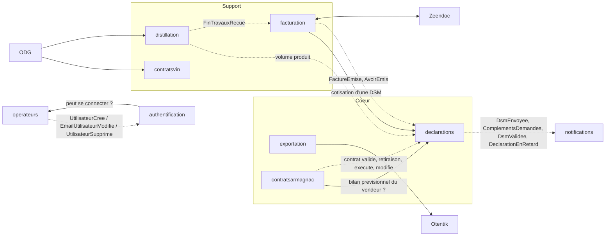

# Contextes : première analyse

> **Document provisoire.** Tout ce qui suit (contextes, descriptions, agrégats, relations, ordre) est une première lecture du CDC. Il **devra être réinterprété, raffiné, complété ou corrigé à chaque implémentation de contexte**.
>
> À chaque contexte, on procède ainsi :
> 1. avant de commencer : relire ses sources, contester la fiche ci-dessous ;
> 2. à la fin : corriger la fiche, la context map et l'ordre, et noter la révision dans le journal en fin de fichier.
>
> Un package par contexte : `fr.bnia.<contexte>.<couche>` (ADR-002). Les chapitres « back-office » et « portail » du CDC sont des écrans sur ces contextes, pas des contextes.

Chemins : tous les liens sont relatifs à `docs/`. `BO` = chapitre 4 du CDC (back-office), `Portail` = chapitre 5, `C.n` = annexe C, `AGI` = spec de reprise de données.

## 1. Ordre d'implémentation (révisé)

**Principe.** Les zones d'ombre du CDC (voir [analyse-interfaces-externes.md](analyse-interfaces-externes.md)) se situent presque toutes à la **frontière** des contextes : un tiers, un format de fichier, un document modèle. Le **noyau** d'un contexte (agrégats, règles de gestion, états, contrôles) est presque toujours spécifiable avec le CDC seul. L'architecture hexagonale permet donc de :

- démarrer un contexte par son **noyau**, ses ports de sortie étant branchés sur des adapters simulés ;
- reporter sa **bordure** (adapter réel, format exact, mise en page fidèle) à l'arrivée de la réponse du BNIA, sans toucher au noyau.

Statut : **A** = démarrable sans aucune réponse ; **B** = noyau démarrable, bordure en attente.
« Parallélisable avec » : contextes indépendants l'un de l'autre, confiables à des agents différents en même temps.

| # | Contexte | Type | Statut | Dépend de | Parallélisable avec | Bordure en attente |
|---|---|---|---|---|---|---|
| 1 | `referentiels` | Générique | A | : | : | Valeurs initiales réelles (reprise AGI) |
| 2 | `operateurs` | Support | A | 1 | : | Dérogations -40 % vol (Q-OPE-2) ; valeurs réelles des types tiers (Q-REF-1) |
| 3 | `authentification` (ex-`acces`) | Générique | A | 2 (« l'utilisateur peut-il se connecter ? ») | : | Fournisseur d'e-mail (SMTP ; Mailpit en dev) |
| 4 | ~~`cotisation`~~ | : | : | : | : | Supprimé le 2026-10-12, réparti entre 5, 8 et 9 (voir §2) |
| 5 | `declarations` | Cœur | B | 2 | 7 | Validation des hypothèses par le BNIA (Q-DEC-1 à 22) ; format XML/JSON (différé) |
| 6 | `contratsarmagnac` | Cœur | A (contrat achat seul) | 2, 5 (bilan prévisionnel) | 7 | Pluri-annuels et propositions : arbitrage BNIA ; contrôle du stock du vendeur à confirmer |
| 7 | `exportation` | Cœur | B | 1, 2 | 5, 6 | Otentik, mise en page des certificats, matrice ventes export |
| 8 | `facturation` | Support | B | 2, 5 | : | Zeendoc (API, états) |
| 9 | `distillation` | Support | B | 2, 8 | 10 | Transport ODG (TimeTonic) |
| 10 | `contratsvin` | Support | B | 2, passerelle ODG de 9 | 9 | Transport ODG ; pluri-annuels et propositions vin en arbitrage |
| 11 | `notifications` | Générique | A | événements de 5 à 10 | 12, 13, 14 | Canal e-mail |
| 12 | `statistiques` | Support | A | données de 5 à 8 | 11, 13, 14 | : |
| 13 | `boutique` | Générique | A | 1, 8 | 11, 12, 14 | : |
| 14 | `contenus` | Générique | A | : | à tout moment | Reprise armagnac.fr (agence) |

Les étapes 1 à 5 peuvent démarrer **maintenant**.

**Ce qui change par rapport à la première version**

- `exportation` ne dépend ni de `declarations` ni de `facturation` : les justificatifs d'une demande de certificat sont des pièces déposées avec la demande (C.7.1.2), pas des objets d'un autre contexte. Je l'avais lié à tort. Il peut démarrer dès `operateurs`, en parallèle de 4 à 6.
- `declarations` passe avant `contratsarmagnac` (décision du 2026-10-12) : il porte l'estimation des stocks, dont le contrat lit le bilan prévisionnel du vendeur avant validation ; le contrat l'informe par événements. Le contexte `stocks` envisagé le même jour n'a pas été retenu : l'estimation n'a pas de donnée propre, elle se calcule depuis les DSM, les contrats et les fins de travaux.
- `contratsarmagnac` ne démarre que par le contrat achat Armagnac ; pluri-annuels et propositions (en arbitrage) sont exclus tant que le BNIA n'a pas tranché.
- `distillation` et `contratsvin` restent tard : leur seule bordure est l'ODG, dont le calendrier est le moins maîtrisable (bascule Innovagro vers TimeTonic sans date).
- Les contextes A passent avant les contextes B quand leurs dépendances le permettent, pour laisser du temps aux réponses.

### 1.1 Bordures en attente

Chaque bordure est suivie à part, avec l'étape où elle devient nécessaire. **L'ordre des « étapes » est aussi l'ordre dans lequel il faut relancer le BNIA.**

| Bordure | Contexte | Nécessaire à l'étape | Ce qui la débloque | En attendant |
|---|---|---|---|---|
| ~~Matrice d'import DSM~~ | `declarations` | 5 | Levée le 2026-10-13 : la matrice négociant sert pour tous (§4.4.10 p.28), colonnes producteur grisées (§4.4.3.2 p.25) ; le modèle producteur reçu, à 14 colonnes, est distinct du format unique (spec 05, H-DEC-2) | — |
| Signature électronique | `declarations` | Hors périmètre du prototype (décision du 2026-10-12) | Niveau de signature, signataire, fournisseur | Validation de la DSM sans signature |
| Contrôle du stock du vendeur à la validation d'un contrat | `declarations`, `contratsarmagnac` | 5, 6 | Confirmation du BNIA (absent du CDC) | Bilan prévisionnel, refus du contrat non couvert (décision du 2026-10-12) |
| Format XML/JSON, logiciels opérateurs | `declarations`, `exportation` | Après 5 et 7 (différé §9.4) | Périmètre exact (format seul ou connecteurs ?) | Hors périmètre initial |
| Matrice ventes export | `exportation` | 7 | Annexe E (`ENVOI_VENTES_EXPORT.xlsx`) | Colonnes décrites en §4.7.3.1 |
| Mise en page des certificats | `exportation` | 7 | Annexe E (`CERTIF EXPORT*.pdf`) | Contenu décrit en §4.8.4, gabarit libre |
| Otentik / CEV | `exportation` | 7 | Contact douanes, documentation, environnement de test | Port `PlateformeCev`, adapter simulé |
| Zeendoc | `facturation` | 8 | API, compte de test, liste des états | Port de dépôt, adapter simulé ; dépôt manuel = repli (§9.1) |
| Mise en page des factures | `facturation` | 8 | Libre : un nouveau modèle est demandé (§4.9.8) | Gabarit libre |
| ODG | `distillation`, `contratsvin` | 9, 10 | TimeTonic ou intégrateur : canal, format, date | Endpoint d'ingestion interne, adapter simulé |
| Pluri-annuels et propositions | `contratsarmagnac`, `contratsvin` | 6, 10 | Arbitrage BNIA | Exclus |
| Taux réels de cotisation | `distillation` | 9 | Facture exemple de fin de travaux (reçue le 2026-10-12, à exploiter) ou BNIA ; levée pour `declarations` le 2026-10-13 (60 €/hlAP, 20 % non assujettis, facture `FACTURE-CVO-Armagnac_2026000700.pdf`) | Paramètres de démonstration |
| Questions au BNIA de la spec 05 | `declarations` | 5 | Réponses du BNIA à Q-DEC-1 à 22 | Hypothèses H-DEC-1 à 21 |
| Vues AGI | tous | 2 puis chaque étape | Accès AGI, types de données | Champs de la spec AGI |
| Vues AGI manquantes (marques, circuits, produits commercialisés, médailles, membres BNIA) | `referentiels`, `operateurs` | Reprise | AGI (Q-REF-6, Q-OPE-4) | Identifiants InteGraal non traduits |
| Dérogations Armagnac -40 % vol | `operateurs` | 2 (reprise) | Réponse du BNIA (Q-OPE-2) | Non construites |
| Fournisseur d'e-mail (invitations, codes de connexion, réinitialisations, changements d'e-mail) | `operateurs`, `authentification` | 3 | Choix du fournisseur par le BNIA | SMTP ; Mailpit en dev |
| Volumétrie, hébergement | transverse | Avant tout déploiement | BNIA | Hypothèses documentées |

Priorité de relance : matrice producteur au format unique et contrôle du stock du vendeur d'abord (étapes 5 et 6, les plus proches), puis Otentik, Zeendoc, ODG.
## 2. Les contextes

### 1. `referentiels`
Données de référence stables, administrées par le BNIA, lues par les autres contextes : géographie (zones commerciales, pays, régions), qualification (titres, labels, types de visite, langues, centres d'intérêt), présentation et commercialisation (marques, circuits de distribution, produits commercialisés, contenances), classes et taux de TVA, membres BNIA (ajout du 2026-10-06, spec 02). Une valeur inutilisée se supprime, une valeur utilisée se désactive (ADR-011).
Le **pays** porte sa zone commerciale (continent), un indicateur « membre de l'UE », la langue (`FR_EN`, `FR_ES`, `FR_IT`) et le niveau de détail (`CUMUL_DEGRE`, `DETAIL_COMPTE_AGE`, `DETAIL_MILLESIME`) du certificat export, et l'âge minimum à l'export. La **région** porte un indicateur « en région délimitée ». La **contenance** est un volume en litres.
Hors du contexte : taux de cotisation (`declarations` et `distillation`), destinataires export et types tiers (`exportation`), produits de la facturation manuelle (`boutique`, à raffiner), type d'opérateur (`operateurs`).
**Agrégats possibles :** `ClasseTva` avec ses `TauxTva` (sans chevauchement de périodes) ; une classe par liste de valeurs.
**Relations :** seul contexte lu directement par tous les autres, à travers une **partie publiée en lecture seule** (`..referentiels.domain.partage`, `..referentiels.application.partage`) ; référence par identifiant technique ; le code se corrige (ADR-011).
**Spec :** [specs/01-referentiels](specs/01-referentiels/spec.md) (terminée, implémentée ; rouverte le 2026-10-06 pour `MembreBnia`, à implémenter)
**Sources :** [BO 4.11](source/cdc/4-back-office-bnia/11-parametrage-et-administration-generale.md) · [C.10](source/cdc/A-annexes/C10-parametrage-et-administration-generale.md) · [AGI 2.6](source/agi/2-vues-attendues-donnees-integraal/06-parametrage.md)

### 2. `operateurs`
Référentiel des producteurs, négociants et autres structures : identité, codification automatique, identifiants administratifs (CVI, SIRET, accise, identifiant ODG), périodicité et statut déclaratifs, production (région, appellations, alambics), diffusion des millésimes, autorisation statistique, présentation (marques, visites, labels, œnotourisme, médailles) ; contacts de chaque structure, avec leurs droits au portail.
Le **type d'opérateur** est une liste fermée propre au contexte (`PRODUCTEUR`, `NEGOCIANT`, `AUTRE`) : il pilote la forme du code, la périodicité, les colonnes de DSM et l'assiette de cotisation (C.1.1.1). Un `AUTRE` ne déclare pas. Les « types tiers » d'InteGraal en sont probablement l'ancien nom (Q-REF-1). Le code se corrige et n'est pas partagé avec l'ODG, qui rattache ses flux par l'identifiant ODG, puis par CVI ou SIRET. Un opérateur se supprime s'il n'est pas référencé, se désactive sinon. Une marque peut être créée dans `referentiels` depuis la fiche, au back-office comme au portail (§4.3.2.3). La région de l'opérateur donne la distinction « région Armagnac / hors région » (C.1.1.2).
**Personnes et accès** (révision du 2026-10-08, vision `specs/02-operateurs/Spécification fonctionnelle gestion des opérateurs, contacts et accès.md`) : dans un opérateur, une personne est soit un **contact** (sans compte), soit un **membre** : un **utilisateur** (identité dont il est propriétaire, e-mail unique) **rattaché** à l'opérateur avec un rôle fixe, `OBSERVATEUR`, `AGENT` ou `ADMIN`. Ses informations professionnelles sont dans une **fiche professionnelle** de l'opérateur, qui le suit de contact à membre. On devient membre en acceptant une **invitation**, qui prouve l'e-mail. Trois modules : Contacts (avec la fiche de l'opérateur), Accès, Paramétrage. Le **BNIA est un opérateur** de type `BNIA` ; un rôle tenu chez lui vaut pour tous les opérateurs. Les droits sont évalués à chaque requête. Un journal trace toutes les actions sur les personnes et les accès. Le portail offre une recherche restreinte des autres opérateurs (autre partie d'un contrat). Les données de présentation sont saisies sans flux vers l'annuaire public, hors périmètre (§1.4).
Hors du contexte : mot de passe, double authentification, sessions, journal des connexions (`authentification`) ; dernières déclarations et historique de la fiche (assemblés par l'écran) ; export « plus d'1 hl » (`statistiques`) ; dérogations -40 % vol (en attente, Q-OPE-2) ; reprise des données (hors périmètre du prototype).
**Agrégats :** `Operateur` (avec alambics, millésimes diffusables, appellations), `PresentationOperateur` (marques, circuits, visites, labels, œnotourisme, médailles) ; `Contact`, `FicheProfessionnelle`, `Rattachement`, `Invitation`, `Utilisateur`, un agrégat chacun, règles collectives dans les cas d'usage avec index uniques et verrou sur l'opérateur (A-OPE-6) ; journal hors agrégat.
**Relations :** lu par presque tous à travers une **partie publiée en lecture seule** (`..operateurs.domain.partage`, `..operateurs.application.partage.OperateursLecture`), comme `referentiels` (A-OPE-1) ; fournit à tous les droits d'un utilisateur sur un opérateur, et à `authentification` l'état de connexion d'un utilisateur ; publie `UtilisateurCree`, `EmailUtilisateurModifie`, `UtilisateurSupprime`, écoutés par `authentification` dans la même transaction (A-AUT-1). Droits vérifiés dans les cas d'usage (A-OPE-7).
**Spec :** [specs/02-operateurs](specs/02-operateurs/spec.md) (terminée, implémentée ; révisée le 2026-10-08, réimplémentée)
**Sources :** [BO 4.3](source/cdc/4-back-office-bnia/03-gestion-des-operateurs.md) · [Portail 5.13](source/cdc/5-portail-operateur/13-gestion-des-contacts.md) · [C.1](source/cdc/A-annexes/C01-gestion-des-operateurs.md) · [AGI 2.1](source/agi/2-vues-attendues-donnees-integraal/01-referentiel-des-professionnels.md) · [AGI 3 §3.8](source/agi/3-vues-attendues-donnees-pro-armagnac-fr/01-vues-attendues-donnees-pro-armagnac-fr.md)
**Révisions demandées par la spec 05**, faites le 2026-10-13 dans la spec 02 : colonne « Déclarations » du tableau rôles × modules (`Module.DECLARATIONS`) ; onglet « Déclarations » de la fiche opérateur, fourni par `declarations` ; champ « périodicité » sans effet sur les DSM (à garder ou à retirer de l'écran) ; un producteur au statut `SOMMEIL` dans les données de démonstration.

### 3. `authentification` (ex-`acces`)
Preuve d'identité, sans métier (décision du 2026-10-08) : compte de connexion (identifiant = e-mail de l'utilisateur, mot de passe haché), double authentification par code e-mail pour tous (`000000` en dev et démo), navigateur de confiance 30 jours, mot de passe oublié, blocage de 30 min après 3 échecs, session, journal des connexions. Ni nom, ni droit, ni opérateur : utilisateurs, rattachements, rôles et invitations sont dans `operateurs`. Spring Security seul ; remplaçable (Keycloak…) sans toucher au métier.
Écarts assumés au CDC : pas de rôles composés ni de catalogue de droits (§4.2.1, §4.2.5), pas de population distincte d'utilisateurs BNIA (§4.2.2), pas de TOTP (§4.2.7).
**Agrégats possibles :** `CompteConnexion` ; code de vérification, réinitialisation et navigateur de confiance (attachés au compte) ; journal des connexions hors agrégat.
**Relations :** demande à `operateurs` si un utilisateur peut se connecter, à la connexion et à chaque requête ; il écoute ses événements pour créer (sans mot de passe), renommer et supprimer le compte (A-AUT-1) ; le premier mot de passe est posé par un second appel du formulaire d'acceptation (A-AUT-2). Session serveur Spring Session JDBC (A-AUT-3). Aucune clé étrangère vers `operateurs`.
**Spec :** [specs/03-authentification](specs/03-authentification/spec.md) (terminée, implémentée)
**Sources :** vision (spec 02) · [BO 4.2](source/cdc/4-back-office-bnia/02-gestion-des-acces.md) · [Portail 5.1](source/cdc/5-portail-operateur/01-acces-authentification-et-gestion-du-compte.md) · [C.2](source/cdc/A-annexes/C02-gestion-des-acces-et-habilitations.md) · [C.13](source/cdc/A-annexes/C13-comptes-et-acces-operateur.md) · [AGI 3 §3.8](source/agi/3-vues-attendues-donnees-pro-armagnac-fr/01-vues-attendues-donnees-pro-armagnac-fr.md)

### 4. ~~`cotisation`~~
Supprimé le 2026-10-12 (analyse du contexte, option B) : une fois l'affichage et la facturation de la cotisation rendus à leurs contextes, il ne restait qu'une table de paramètres et un calcul. Chaque élément va à son propriétaire naturel : l'assiette et le montant `CVO` à `declarations`, le montant fin de travaux à `distillation`, l'application de la TVA à `facturation`. Le CDC n'en fait pas un module à part (§4.4.9, §4.6.2, §4.9). `CVE` et `CVO` sont synonymes, interchangeables dans le CDC (décision du 2026-10-12).

### 5. `declarations`
Déclarations de stocks et mouvements. L'opérateur **initie** la DSM de la période qui suit sa dernière DSM validée (ou son **point de départ**, fixé par le BNIA), la remplit au format unique (5 onglets, 26 colonnes, colonnes grisées pour les producteurs) par saisie ou import Excel, y joint justificatifs et DRM, et l'envoie ; le BNIA l'**instruit** (commentaires, compléments demandés) et la **valide**, ce qui la fige (amendements, analyse du 2026-10-13). Les calculs bloquent l'envoi, les pièces la validation. Sans signature électronique (hors périmètre du prototype, décision du 2026-10-12). Les douanes ont confié au BNIA le suivi des stocks de chaque opérateur et peuvent lui en demander à tout moment un état des lieux (dire de l'utilisateur du 2026-10-12, absent du CDC).
Lit dans `operateurs` le type et le statut de déclaration de stock : seul `OUI` permet d'initier et rend une DSM attendue (H-DEC-10 ; sens des valeurs : Q-OPE-7). La périodicité découle du type, annuelle (1er avril - 31 mars) pour le producteur, mensuelle pour le négociant ; la périodicité de la fiche opérateur n'est pas lue, trimestre, semestre et changement de périodicité sont hors périmètre du prototype (décision du 2026-10-13). Un traitement planifié détecte les retards. Auteurs : identifiant de l'utilisateur et copie de son nom (§3) ; journal des actions en ajout seul.
Porte la **cotisation sur DSM** (reprise de `cotisation`, décision du 2026-10-12) : grille des taux `CVO` (€/hlAP, pourcentage exonéré de TVA, chaîne datée sans trou), administrée dans le menu Paramétrage ; assiette par colonne (14, 16 à 19, 21 à 25, colonnes grisées exclues) ; taux en vigueur à la fin de la période ; **détail** par ligne de facture (sorties France, sorties export, EDV pour un autre produit au marché intérieur et à l'export), calculé à la volée et figé par la facture.
Porte enfin le **suivi des stocks** : le **stock déclaré** (fin de la dernière DSM validée, par ligne), livré avec le contexte ; le **stock estimé**, les engagements, le stock disponible et le **bilan prévisionnel** lu par `contratsarmagnac`, décrits comme contrat d'interface (spec 05 §5.2 : définitions, grain, événements reçus) et livrés avec `contratsarmagnac` et `distillation`, qui l'informent par événements dont les types sont dans sa partie publiée (ADR-013).
Publie `DsmEnvoyee`, `ComplementsDemandes`, `DsmValidee`, `DeclarationEnRetard` ; une partie en lecture (cotisation d'une DSM pour `facturation`, dernière DSM et stock déclaré pour la fiche opérateur). Tient une projection locale des factures de DSM, alimentée par `FactureEmise` et `AvoirEmis` de `facturation` (types dans sa partie publiée) ; calcule la TVA indicative avec les taux de `referentiels` (spec 05, A-DEC-4).
**Agrégats :** `DeclarationStocksMouvements` (lignes, justificatifs, DRM, commentaires), `PointDeDepartDeclaratif`, `GrilleCotisation` ; le stock estimé est un modèle de lecture.
**Analyse :** [specs/05-declarations/analyse.md](specs/05-declarations/analyse.md) (terminée) · **Spec :** [specs/05-declarations/spec.md](specs/05-declarations/spec.md) (terminée)
**Sources :** [BO 4.4](source/cdc/4-back-office-bnia/04-declarations-des-stocks-et-mouvements.md) · [Portail 5.4](source/cdc/5-portail-operateur/04-declarations-de-stocks-et-mouvements.md) · [C.3](source/cdc/A-annexes/C03-declarations-de-stocks-et-mouvements.md) · [Annexe B](source/cdc/A-annexes/B-comptes-d-age-et-mentions-de-vieillissement.md) · [Annexe E](source/cdc/A-annexes/E-exemples-de-fichiers.md) et [matrices DSM](source/fichiers-example/) · [AGI 2.2](source/agi/2-vues-attendues-donnees-integraal/02-declarations-de-stocks-et-mouvements.md)

### 6. `contratsarmagnac`
Achats et ventes d'Armagnac entre opérateurs : saisie par le BNIA ou un opérateur, validation par l'acheteur, le vendeur et le BNIA. Un contrat est **exécuté** quand toutes ses retiraisons ont été effectuées ; **validé** veut seulement dire que le BNIA a donné son accord (décision du 2026-10-12, au lieu du sens de §4.4.7). Inclut les pluri-annuels et propositions d'engagement Armagnac, dont le maintien est en arbitrage au BNIA.
Avant la validation, lit dans `declarations` le **bilan prévisionnel** du vendeur (stock estimé, engagements existants sur ce compte d'âge et millésime, stock restant). Pour le prototype : il alerte sur les contrats validés non exécutés, refuse un contrat que le stock disponible ne couvre pas, et permet de modifier un contrat, par exemple pour baisser son volume (décision du 2026-10-12, à confirmer par le BNIA). Informe `declarations` par les événements `ContratValide`, `ContratModifie` et `RetiraisonEffectuee`, dont les types sont dans la partie publiée de `declarations` (contrat d'interface de la spec 05 §5.2, à confirmer par la spec 06). La règle de la DSM sur les lignes d'achat et de vente (rattachement aux retiraisons de la période) est livrée avec ce contexte, et la spec 06 révisera la spec 05.
Au portail, l'autre partie d'un contrat se désigne par la recherche restreinte de `operateurs` (code, raison sociale, nom commercial, ville ; spec 02). Validateur BNIA : identifiant de l'utilisateur et copie de son nom (§3).
**Agrégats possibles :** `ContratAchatArmagnac` (avec ses retiraisons) ; `PluriAnnuelArmagnac`, `PropositionEngagementArmagnac` (si maintenus).
**Sources :** [BO 4.5 §4.5.1, 4.5.3, 4.5.4](source/cdc/4-back-office-bnia/05-contrats-d-achat-a-la-propriete.md) · [Portail 5.5](source/cdc/5-portail-operateur/05-contrats-armagnac.md) · [C.4](source/cdc/A-annexes/C04-contrats-d-achat-a-la-propriete.md) · [AGI 3 §3.1-3.3](source/agi/3-vues-attendues-donnees-pro-armagnac-fr/01-vues-attendues-donnees-pro-armagnac-fr.md) · [AGI 2.4](source/agi/2-vues-attendues-donnees-integraal/04-contrats-france.md) (rôle à clarifier)

### 7. `exportation`
Suivi des sorties export (saisie ou import Excel contrôlé) et certification de l'âge : demande depuis le portail, traitement par le BNIA, certificat PDF multilingue (simplifié ou détaillé selon le pays), raccordement CEV / Otentik. Les justificatifs d'une demande (facture, DRM, DAE) sont des pièces déposées avec la demande. Le pays (`referentiels`) donne la langue et le niveau de détail du certificat, ainsi que l'âge minimum autorisé (alerte non bloquante à la saisie, à l'import et au certificat : décision du 2026-10-06) ; la contenance (`referentiels`) entre dans le calcul du volume d'alcool pur.
Le contexte porte aussi les **destinataires export** (C.10.7) et leur qualification par **type tiers** (C.10.8.2), retirés de `referentiels` : tiers avec adresse et pays, fournis par l'opérateur dans sa demande et créés à l'import.
Le vendeur est retrouvé par son code opérateur à l'import ; la raison sociale et l'adresse de l'expéditeur sont lues dans `operateurs` et figées sur le certificat. Créateur d'un suivi, agent traitant : identifiant de l'utilisateur et copie de son nom (§3).
**Agrégats possibles :** `SuiviSortieExport` (lignes), `DemandeCertificat`, `CertificatExport`, `Destinataire`.
**Sources :** [BO 4.7](source/cdc/4-back-office-bnia/07-suivi-des-sorties-export.md) · [BO 4.8](source/cdc/4-back-office-bnia/08-certification-export.md) · [Portail 5.7](source/cdc/5-portail-operateur/07-ventes-export.md) · [Portail 5.8](source/cdc/5-portail-operateur/08-certificats-export.md) · [C.6](source/cdc/A-annexes/C06-suivi-des-sorties-export.md) · [C.7](source/cdc/A-annexes/C07-certification-export.md) · [C.10.7](source/cdc/A-annexes/C10-parametrage-et-administration-generale.md) · [Annexe E](source/cdc/A-annexes/E-exemples-de-fichiers.md) · [AGI 2.5](source/agi/2-vues-attendues-donnees-integraal/05-contrats-export.md) · [AGI 2.6.10](source/agi/2-vues-attendues-donnees-integraal/06-parametrage.md)

### 8. `facturation`
Émission, diffusion et suivi des factures et avoirs : factures de cotisation (DSM, fin de travaux), factures de commande boutique, factures manuelles, avoirs, PDF, dépôt dans Zeendoc et retour d'état de règlement.
Le taux de TVA vient de `referentiels` et il est figé sur la facture et l'avoir. Une facture de cotisation sur DSM lit dans la partie publiée de `declarations` le **détail** de la cotisation (une ligne de facture par ligne de détail, facture d'exemple) et applique la TVA ; `facturation` porte le déclenchement depuis la DSM (UC-DEC-10, une facture par DSM) et publie `FactureEmise` et `AvoirEmis`, types dans la partie publiée de `declarations`, qui en tient une projection (spec 05, A-DEC-4). Une facture de fin de travaux reçoit de `distillation` le montant, le taux et le pourcentage exonéré (§4.9.3-4.9.4, §4.9.7 pour l'avoir). Les produits de la facturation manuelle sont décrits ici par le CDC (§4.9.2, C.8.2) mais placés dans `boutique` (décision du 2026-10-06, à raffiner : voir §5).
L'adresse et le destinataire des factures (une personne de l'annuaire de l'opérateur ou une adresse saisie) sont lus dans `operateurs` et figés sur la facture (C.8.1.1, spec 02).
**Agrégats possibles :** `Facture`, `Avoir` ; l'état de transmission à Zeendoc est un état de la facture.
**Sources :** [BO 4.9](source/cdc/4-back-office-bnia/09-facturation-et-cotisations.md) · [Portail 5.10](source/cdc/5-portail-operateur/10-factures-et-paiements.md) · [Passerelles 6 §6.2](source/cdc/6-passerelles-et-interfaces/01-passerelles-et-interfaces.md) · [C.8](source/cdc/A-annexes/C08-facturation-et-cotisations.md) · [Annexe D](source/cdc/A-annexes/D-cartographie-des-interfaces-et-flux.md) · [AGI 2.3](source/agi/2-vues-attendues-donnees-integraal/03-factures.md)

### 9. `distillation`
Fins de travaux de distillation reçues de l'ODG, sans doublon en cas de retransmission, non modifiables côté BNIA et portail, rendues facturables. Porte la première passerelle ODG.
Porte aussi la **cotisation sur fin de travaux** (reprise de `cotisation`, décision du 2026-10-12) : montant en €/hl de vin distillé et pourcentage exonéré de TVA, datés (§4.11.2, C.10.3), et calcul de la cotisation de la déclaration (§4.6.2, §4.9.4).
La passerelle rattache chaque flux à une fiche par l'identifiant tiers ODG, puis par CVI ou SIRET, lus dans `operateurs` (le code BNIA n'est pas partagé avec l'ODG, spec 02).
Informe `declarations` du volume d'alcool pur produit pour le propriétaire, qui entre dans son stock estimé (décision du 2026-10-12), par l'événement `FinTravauxRecue`, type dans la partie publiée de `declarations` (spec 05 §5.2).
**Agrégats possibles :** `DeclarationFinTravaux`.
**Sources :** [BO 4.6](source/cdc/4-back-office-bnia/06-declarations-de-fin-de-travaux-de-distillation.md) · [Passerelles 6 §6.1](source/cdc/6-passerelles-et-interfaces/01-passerelles-et-interfaces.md) · [C.5](source/cdc/A-annexes/C05-declarations-de-fin-de-travaux-de-distillation.md) · [AGI 3 §3.7](source/agi/3-vues-attendues-donnees-pro-armagnac-fr/01-vues-attendues-donnees-pro-armagnac-fr.md)

### 10. `contratsvin`
Contrats d'achat de vin de distillation reçus de l'ODG, consultés en lecture seule. Réutilise la passerelle ODG de `distillation`. Les pluri-annuels et propositions d'engagement vin, eux, sont **saisis dans le portail** (§5.6.2-5.6.3) et leur maintien est en arbitrage.
**Agrégats possibles :** `ContratVin` (reçu, immuable) ; `PluriAnnuelVin`, `PropositionEngagementVin` (saisis, si maintenus).
**Sources :** [BO 4.5 §4.5.2, 4.5.5, 4.5.6](source/cdc/4-back-office-bnia/05-contrats-d-achat-a-la-propriete.md) · [Portail 5.6](source/cdc/5-portail-operateur/06-contrats-vin.md) · [Passerelles 6 §6.1](source/cdc/6-passerelles-et-interfaces/01-passerelles-et-interfaces.md) · [C.4](source/cdc/A-annexes/C04-contrats-d-achat-a-la-propriete.md) · [AGI 3 §3.4-3.6](source/agi/3-vues-attendues-donnees-pro-armagnac-fr/01-vues-attendues-donnees-pro-armagnac-fr.md)

### 11. `notifications`
Centre de notifications du portail, messages aux contacts, relances, règles de destinataires.
Cible les personnes de `operateurs` (contacts et membres) par centre d'intérêt et par rôle (C.14).
Écoute `DsmEnvoyee`, `ComplementsDemandes`, `DsmValidee` et `DeclarationEnRetard` de `declarations` (analyse UC-DEC-11).
**Agrégats possibles :** `Notification`, règles de destinataires.
**Sources :** [Portail 5.12](source/cdc/5-portail-operateur/12-notifications-et-relances.md) · [C.14](source/cdc/A-annexes/C14-notifications-et-relances.md)

### 12. `statistiques`
Restitutions en lecture seule : consolidation du marché, suivi des opérateurs, achats à la propriété, exportations par pays, classement des ventes. Accès nominatif réservé au BNIA ; le portail ne donne que des statistiques globalisées ou propres à la structure.
Porte l'export des opérateurs qui achètent ou vendent plus d'1 hl par an (§4.10.7). L'état des stocks à une date (§4.10.5) lit le stock déclaré, puis estimé, dans la partie publiée de `declarations`, que sa spec étendra (décision du 2026-10-13). Lit dans `operateurs` le type, la région, les appellations, la diffusion des millésimes (qui décide de l'usage des données d'un opérateur) et l'accès aux statistiques du portail.
**Agrégats possibles :** aucun, des modèles de lecture.
**Sources :** [BO 4.10](source/cdc/4-back-office-bnia/10-statistiques-et-restitutions.md) · [Portail 5.11](source/cdc/5-portail-operateur/11-statistiques.md) · [C.9](source/cdc/A-annexes/C09-statistiques-et-restitutions.md)

### 13. `boutique`
Offre de produits aux opérateurs, commandes passées depuis le portail, traitement jusqu'à la facturation. **Récupère les produits de la facturation manuelle** (décision du 2026-10-06, à raffiner) : PLV, goodies, ventes diverses, avec un code, une dénomination, un taux de TVA et un indicateur actif (§4.9.2, C.8.2.1). Le CDC les distingue des produits boutique (C.12.2) : un seul catalogue ou deux reste à décider, comme la place de ce catalogue dans l'ordre (voir §5).
**Agrégats possibles :** `Produit` (et catégories), `Commande` ; `ProduitFacturation` si les catalogues restent distincts.
**Sources :** [BO 4.13](source/cdc/4-back-office-bnia/13-boutique-et-gestion-des-commandes.md) · [Portail 5.9](source/cdc/5-portail-operateur/09-boutique-et-commandes.md) · [C.12](source/cdc/A-annexes/C12-boutique-et-commandes.md) · [BO 4.9.2](source/cdc/4-back-office-bnia/09-facturation-et-cotisations.md) · [C.8.2](source/cdc/A-annexes/C08-facturation-et-cotisations.md)

### 14. `contenus`
Contenus diffusés dans le portail : actualités et catégories, ressources documentaires, photothèque, interlocuteurs et horaires du BNIA.
**Agrégats possibles :** `Actualite`, `Ressource`, `Photo`, avec leurs catégories.
**Sources :** [BO 4.12](source/cdc/4-back-office-bnia/12-gestion-des-contenus-portail.md) · [Portail 5.3](source/cdc/5-portail-operateur/03-contenus-portail-et-ressources.md) · [C.11](source/cdc/A-annexes/C11-gestion-des-contenus.md)

## 3. Éléments transverses (non contextes)

- **Tableaux de bord** : [BO 4.1](source/cdc/4-back-office-bnia/01-accueil-dashboard-bnia.md), [Portail 5.2](source/cdc/5-portail-operateur/02-tableau-de-bord-portail.md). Compositions de lecture sur plusieurs contextes ; à traiter une fois les contextes agrégés disponibles. La fiche opérateur (dernière DSM, historique des DSM, factures, contrats, §4.3.3) est une composition du même type, enrichie à chaque étape (décision du 2026-10-06, spec 02) ; `declarations` y fournit l'onglet « Déclarations » (spec 05 §6.1).
- **Reprise de données** : [CDC 7](source/cdc/7-recuperation-de-donnees/01-recuperation-de-donnees.md) et la spec AGI. Piste : analyser la correspondance des vues AGI **pendant l'implémentation de chaque contexte** plutôt qu'à la fin.
- **Zones partagées** (décidé le 2026-10-06 avec la spec `referentiels`, [ADR-008](adr/008-referentiels-partie-publiee-en-lecture.md) et [ADR-009](adr/009-noyau-commun-du-domaine.md)) :
  - **`commun.domain`** : concepts et règles transverses du glossaire, pas des données : `CompteDAge` d'abord, puis `Millesime`, `Campagne`, `MentionCommerciale`, `VolumeAlcoolPur` (entré avec `declarations`, A-DEC-8) au fil des besoins. Import libre. `Millesime` et `Appellation` y entrent avec `operateurs` (A-OPE-4 de la spec 02).
  - **`referentiels`, partie publiée** : lecture seule des données administrées (vues, énumérations, `ReferentielsLecture`). Exception à l'isolement des contextes, étendue le 2026-10-06 à **`operateurs`** (`OperateursLecture`, ADR-012) ; les autres ne communiquent que par ports et événements.
  - **Événements entre contextes** : Spring `ApplicationEvent`, synchrones, écoutés dans la transaction de l'émetteur ; types définis dans la partie publiée du contexte dont l'autre dépend, pour éviter tout cycle ; adapters dans `adapter.evenement` (ADR-013). Ceux de `operateurs` avec `acces` n'ont plus d'objet (2026-10-08).
- **Droits** (décidé le 2026-10-08, spec 02 §3.2.7) : rôles fixes `OBSERVATEUR`, `AGENT`, `ADMIN`, portés par le rattachement d'un utilisateur à un opérateur et lus dans `operateurs` à chaque requête ; un rôle de l'opérateur BNIA vaut pour tous les opérateurs. Chaque nouveau contexte ajoute un module, c'est-à-dire une colonne au tableau rôles × modules, que sa spec déclare (lecture et gestion par rôle).
- **Auteur d'une action** (décidé le 2026-10-08) : un utilisateur est supprimé avec son dernier rattachement ; un contexte qui enregistre un auteur stocke son identifiant **sans clé étrangère** et une copie de son nom à l'instant de l'action. Exception à ADR-011 (A-OPE-8 de la spec 02).
- **Espaces** : une seule connexion ; l'opérateur actif décide de l'espace, back-office (opérateur BNIA) ou portail (autre opérateur).
  - **Référence entre contextes** : par identifiant technique, avec clé étrangère ; le code d'une valeur se corrige ([ADR-011](adr/011-referentiels-identifiant-technique-et-code-modifiable.md), qui remplace la référence par code métier du 2026-10-06).
- **Décidé en phase E de la spec 05** (2026-10-13, ADR à écrire) : **stockage de documents** commun, port `StockageDocuments` dans `bnia-commun-core`, `DocumentDepose` dans `commun.domain`, adapter PostgreSQL `bytea` (A-DEC-5) ; **traitement planifié** par un adapter `adapter.planification` qui n'appelle qu'un cas d'usage, horloge injectée, idempotence en base (A-DEC-7) ; **production de documents** : `fastexcel` pour l'Excel, OpenHTMLtoPDF et Thymeleaf pour le PDF, dans un adapter `adapter.document` (A-DEC-9) ; `VolumeAlcoolPur` dans `commun.domain` (A-DEC-8, amendement d'ADR-009). Pas de port implémenté par un contexte aval : `declarations` tient une projection des factures alimentée par événements (A-DEC-4).
- **Passerelles** : [CDC 6](source/cdc/6-passerelles-et-interfaces/01-passerelles-et-interfaces.md) et [annexe D](source/cdc/A-annexes/D-cartographie-des-interfaces-et-flux.md). ODG, Zeendoc, Otentik et signature sont vus comme des adapters derrière des ports, dans le contexte qui les utilise.

## 4. Ébauche de context map

À lire comme une hypothèse de départ. `operateurs` et `referentiels` sont consultés par presque tous (non dessinés), et `notifications` comme `statistiques` écoutent ou lisent les autres. Lectures principales de `referentiels` : `operateurs` (régions, titres, langues, marques…), `exportation` (pays, contenances), `facturation` et `boutique` (taux de TVA à une date). Ces lectures passent par la partie publiée de `referentiels`, sans port côté consommateur. Seule écriture venue d'ailleurs : la création d'une marque depuis la fiche opérateur, par l'écran. `operateurs` est lu par presque tous, par sa partie publiée en lecture seule (A-OPE-1), et fournit à tous les droits d'un utilisateur. `authentification` demande à `operateurs` si un utilisateur peut se connecter ; son compte est créé, renommé et supprimé par les événements de `operateurs` (A-AUT-1), sans dépendance inverse. `contratsarmagnac` et `distillation` dépendent de `declarations`, qui porte l'estimation des stocks : ils l'informent par événements, et le contrat y lit le bilan prévisionnel du vendeur ; `declarations` ne les lit pas (décision du 2026-10-12). `facturation` lit la cotisation d'une DSM dans la partie publiée de `declarations` et l'informe des factures et avoirs émis par événements (spec 05, A-DEC-4) ; `notifications` écoute les événements de `declarations`.

## 5. Interrogations laissées ouvertes

À trancher à l'étape indiquée, pas avant. Celles marquées **(nous)** peuvent être tranchées sans le BNIA, par hypothèse de travail.

- ~~**TVA** : classes et taux dans `referentiels` ou dans `facturation` ?~~ Tranché le 2026-10-06 : dans `referentiels`.
- **Produits de la facturation manuelle** : placés dans `boutique`, alors que le CDC les décrit en facturation (§4.9.2, C.8.2). Faut-il un seul catalogue (boutique et facturation manuelle) ou deux ? `facturation` (étape 8) en a besoin pour les factures manuelles : le catalogue doit-il exister avant, en avançant une partie de `boutique` ? *(étapes 8 et 13)* **(nous)**
- **Type tiers et type d'opérateur** : la liste « types tiers » est probablement l'ancien type de la fiche professionnel d'InteGraal (AGI 2.1.1). Le type d'opérateur est tranché (`PRODUCTEUR`, `NEGOCIANT`, `AUTRE`, spec 02) ; seule sa reprise reste suspendue à Q-REF-1. *(reprise, étape 7)*
- ~~**Lecture d'un opérateur par les autres contextes**~~ : tranché le 2026-10-06, partie publiée en lecture seule comme `referentiels` (A-OPE-1 de la spec 02).
- **Statut de déclaration de stock** : effet sur `declarations` fixé le 2026-10-13 (spec 05, H-DEC-10 : seul `OUI` initie ; reprise par un nouveau point de départ). Reste le sens de « sommeil » et « clôturé ». *(BNIA)* Q-OPE-7
- ~~**Taux de cotisation** : le CDC cible décrit un montant unique par type de cotisation, l'ancien système avait des taux par colonne.~~ Tranché le 2026-10-13 : un montant unique en €/hlAP, une assiette par colonne (spec 05, H-DEC-1 et H-DEC-2).
- **Pays** : la cible porte une langue et un niveau de détail de certificat, et un âge minimum (spec `referentiels`). Restent inexpliqués les champs CA et CA1 à CA5 de la vue AGI, sans doute les modèles de certificat autorisés. *(reprise)* Q-REF-2
- **Pluri-annuels et propositions d'engagement** : maintien en arbitrage au BNIA. *(étapes 6 et 10)*
- ~~**États de la DSM** : deux versions dans le CDC (§4.4.2 et C.3.1.1).~~ Tranché le 2026-10-13 : états d'instruction (`BROUILLON` à `VALIDEE`) ; « à facturer » et « facturée » lus dans `facturation` (analyse `declarations`).
- ~~**Contrôles de la DSM** : C.3.2.4 donne des contrôles croisés visibles (assemblages/coupes, passage sous bois/sous verre), mais la formule complète du stock de fin n'est pas écrite. *(étape 5)* **(nous)** La matrice négociant reçue le 2026-10-12 la donne, par ligne : `26 = 1 + 2 + 3 + Σ(4..9) − Σ(10..25)`, en rouge si négatif. Elle marque aussi l'assiette de cotisation par colonne (14, 16, 17, 18, 19, 21, 22, 23, 24), dont la colonne 14, absente du §4.4.9.~~ Tranché le 2026-10-13 : formule du stock de fin, contrôles croisés Σ6 = Σ12 et Σ5 = Σ11, stock de fin négatif bloquant l'envoi (spec 05, RG-DEC-17 et 18, H-DEC-7).
- **Rattachement des lignes d'achat et de vente à un contrat « exécuté »** (§4.4.7) : avec le nouveau sens d'« exécuté » (toutes les retiraisons effectuées), la règle de blocage de la DSM est à réécrire. Proposé par l'analyse `declarations` : rattacher la ligne aux retiraisons de la période. *(étape 6)* **(nous)**
- **Contrôle du stock du vendeur à la validation d'un contrat** : absent du CDC ; comportement du prototype décidé le 2026-10-12 (bilan prévisionnel, refus du contrat non couvert), à confirmer par le BNIA. Refus dès la saisie au portail ou seulement à la validation BNIA : à trancher. *(étape 6)*
- **Niveaux de détail du certificat** : deux niveaux en §4.8.5 (simplifié, détaillé), trois valeurs en C.7.2.1 (cumul par degré, détail comptes d'âge, affichage millésime). ~~*(étape 7)*~~ Tranché le 2026-10-06 : le pays porte les trois valeurs de C.7.2.1 (spec `referentiels`).
- **Périodicités trimestrielle et semestrielle, changement de périodicité** (§4.4.10, C.1.1) : hors périmètre du prototype (décision du 2026-10-13, spec 05 §2.2) ; à rouvrir avec le BNIA. *(après le prototype)*
- **Volumes export** présents à deux endroits (colonnes 22 à 25 de la DSM et suivis sortie export) : pas de rapprochement demandé par le CDC. *(étapes 7 et 12)* **(nous)**

## Journal des révisions

| Date | Contexte | Changement |
|---|---|---|
| 2026-10-05 | : | Première analyse, avant toute implémentation. |
| 2026-10-05 | ordre | Ordre révisé à la lumière des zones d'ombre : distinction noyau / bordure, statuts A et B, backlog des bordures. `exportation` remonté en 7 (indépendant de `declarations` et `facturation`). `contratsarmagnac` limité au contrat achat. `contratsvin` corrigé (pluri-annuels et propositions saisis dans le portail). |
| 2026-10-06 | `referentiels` | Spec 01 rédigée. Destinataires et types tiers déplacés vers `exportation` ; produits de la facturation manuelle vers `boutique` (à raffiner) ; TVA confirmée dans `referentiels`. Type d'opérateur : liste fermée de `operateurs`. Attributs du pays, de la région et de la contenance précisés. Zones partagées décidées (§3) : `commun.domain` pour les concepts transverses (`CompteDAge`…), partie publiée en lecture seule pour `referentiels`, référence par code métier. |
| 2026-10-06 | `referentiels` | Spec 01 terminée. ADR-008 et ADR-009 rédigés. Prochaine étape : implémentation de `referentiels`, puis spec de `operateurs`. |
| 2026-10-06 | : | ADR-010 : un module Maven par contexte (`bnia-<contexte>`), couches en packages vérifiées par ArchUnit ; plus de module d'intégration global, chaque intégration vit dans son contexte. Implémentation de `referentiels` commencée (lot 1 : zones commerciales). |
| 2026-10-06 | `referentiels` | Contexte implémenté (lots 1 à 7) : treize référentiels, partie publiée `ReferentielsLecture`, écrans du menu Paramétrage, données de démonstration (profil `demo`). Prochaine étape : spec de `operateurs`. |
| 2026-10-06 | `referentiels` | ADR-011 : référence par identifiant technique au lieu du code métier ; code (et volume des contenances) modifiable, toujours unique ; suppression d'une valeur inutilisée, désactivation sinon. Spec 01, ADR-008, glossaire et `CLAUDE.md` mis à jour. |
| 2026-10-06 | `operateurs` | Spec 02 rédigée (phases A à C). Type `PRODUCTEUR`, `NEGOCIANT`, `AUTRE`. Contact par opérateur, droits portail sur le contact, compte unique par e-mail dans `acces` (écart à C.13.2) ; événements entre `operateurs` et `acces`. Dernières déclarations et historique de la fiche : composition de lecture. Export « plus d'1 hl » vers `statistiques`. Annuaire public : hors périmètre, plus une bordure. Nouvelles bordures : dérogations -40 % vol, vues AGI manquantes. `MembreBnia` ajouté à `referentiels` (spec 01 rouverte). Fiches `acces`, `contratsarmagnac`, `declarations`, `exportation`, `facturation`, `distillation`, `notifications`, `statistiques` complétées. |
| 2026-10-06 | `operateurs` | Spec 02, phase E : partie publiée en lecture seule pour `operateurs` (extension de l'exception d'ADR-008) ; événements Spring synchrones, types dans la partie publiée du contexte dont l'autre dépend ; `Millesime` et `Appellation` dans `commun.domain`. |
| 2026-10-06 | `operateurs` | Spec 02 terminée (validée). Prochaine étape : ADR de la spec 02, puis implémentation de `MembreBnia` dans `referentiels` et de `operateurs`. |
| 2026-10-06 | `operateurs` | ADR-012 (partie publiée de `operateurs`, agrégats) et ADR-013 (événements entre contextes) ; ADR-008 et ADR-009 amendés ; CLAUDE.md mis à jour. |
| 2026-10-06 | `operateurs` | Contexte implémenté (lots 1 à 9) : `MembreBnia` dans `referentiels` ; `Millesime` et `Appellation` dans `commun.domain` ; agrégats `Operateur` (identité, déclaratif, production, diffusion, contacts et droits au portail) et `PresentationOperateur` ; journal des contacts ; événements publiés et écoutés (ADR-013), sans consommateur tant que `acces` n'existe pas ; partie publiée `OperateursLecture` ; export Excel ; écrans du back-office (menu Opérateurs) et du portail (« Mon entreprise », « Contacts », recherche d'opérateur) sur un opérateur de démonstration ; données de démonstration. Prochaine étape : spec de `acces`. |
| 2026-10-08 | : | ADR-014 : chaque contexte devient un module parent `bnia-<contexte>` avec deux sous-modules, `bnia-<contexte>-core` (`domain`, `application`, Java pur garanti à la compilation) et `bnia-<contexte>-infra` (adapters). Idem pour `bnia-commun` et `bnia-systeme`. |
| 2026-10-08 | `authentification`, `operateurs` | Spec 03 commencée d'après la vision du 2026-10-08 (phases A à C). `acces` remplacé par `authentification`, preuve d'identité sans métier (double authentification par e-mail pour tous, Spring Security seul). Personnes et accès dans `operateurs` (spec 02 en révision) : contact ou membre, utilisateur, fiche professionnelle, rattachement, invitation ; rôles fixes `OBSERVATEUR`, `AGENT`, `ADMIN` et modules ; BNIA opérateur de type `BNIA`, ses rôles valant partout ; l'opérateur actif décide de l'espace. Fiches `operateurs`, `authentification`, `declarations`, `contratsarmagnac`, `exportation`, `facturation`, `notifications` ; éléments transverses (droits, auteur d'une action, espaces) ; context map ; bordure e-mail. Reprise des données hors périmètre du prototype. |
| 2026-10-08 | `authentification`, `operateurs` | Spec 03 terminée (phases D à G : architecture A-AUT-1 à 4 et A-OPE-6 à 9 ; hypothèses et questions tranchées ; glossaire). Révision de la spec 02 validée, à réimplémenter. Prochaine étape : ADR, puis implémentation conjointe de `authentification` et de la révision de `operateurs`. |
| 2026-10-08 | `authentification`, `operateurs` | ADR-015 (authentification, contexte d'infrastructure) et ADR-016 (personnes et accès dans `operateurs`) ; ADR-011, 012 et 013 amendés ; `CLAUDE.md` mis à jour. Prochaine étape : implémentation (skill `implementation`) de `authentification` et de la révision de `operateurs`, dans ce worktree. |
| 2026-10-12 | `cotisation` | Analyse du contexte : `cotisation` supprimé (option B). Assiette et montant `CVO` à `declarations`, montant fin de travaux à `distillation`, application de la TVA à `facturation`. Dépendances vers 4 retirées. `CVE` et `CVO` synonymes. |
| 2026-10-12 | `declarations`, `contratsarmagnac` | Matrices DSM reçues (annexe E). Les douanes ont confié au BNIA le suivi des stocks par opérateur. Un contexte `stocks` est envisagé puis écarté : l'**estimation des stocks** (par compte d'âge et millésime ; stock estimé, engagements, stock disponible, bilan prévisionnel) va dans `declarations`, informé par événements de `contratsarmagnac` et `distillation`. « Exécuté » = toutes les retiraisons effectuées. `declarations` passe en 5, avant `contratsarmagnac` (6), qui lit le bilan prévisionnel du vendeur et refuse un contrat non couvert (à confirmer par le BNIA). Analyse `declarations` commencée (`specs/05-declarations`). |
| 2026-10-13 | `declarations` | Analyse terminée ; spec 05 rédigée jusqu'à la phase C (hypothèses H-DEC-1 à 21, chacune avec sa question au BNIA ; RG-DEC-01 à 42 ; huit lots incrémentaux). L'opérateur initie, le BNIA instruit et valide ; point de départ fixé par le BNIA ; périodicité tirée du type (trimestre, semestre et changement hors périmètre du prototype) ; cotisation détaillée par ligne de facture, lue par `facturation` ; stock déclaré livré, stock estimé en contrat d'interface avec 6 et 9. Fiches 2, 5, 6, 8, 9, 11, 12, bordures, éléments transverses, context map et interrogations mis à jour. |
| 2026-10-13 | `declarations` | Spec 05, phase E : décisions A-DEC-1 à 9. Factures des DSM en projection locale alimentée par `FactureEmise` et `AvoirEmis` (au lieu d'un port implémenté par `facturation`) ; stockage de documents commun (PostgreSQL) ; premier traitement planifié ; `VolumeAlcoolPur` dans `commun.domain` ; Excel `fastexcel`, PDF OpenHTMLtoPDF. Fiches 5 et 8, éléments transverses et context map mis à jour. ADR à écrire en phase H. |
| 2026-10-13 | `declarations` | Spec 05 terminée. Prochaine étape : ADR de la spec 05 (stockage de documents, traitement planifié, production de documents, amendement d'ADR-009), révision de la spec 02, puis implémentation par lots (skill `implementation`) dans ce worktree. |
