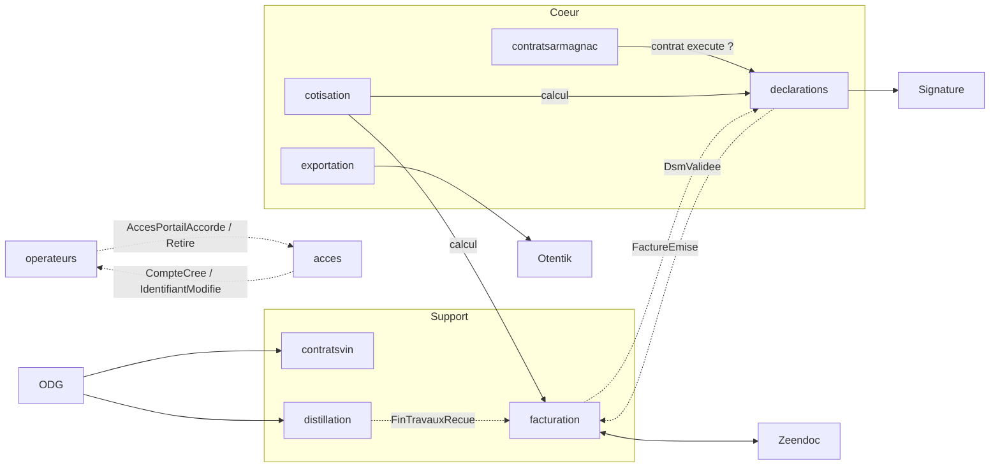

# Contextes : première analyse

> **Document provisoire.** Tout ce qui suit (contextes, descriptions, agrégats, relations, ordre) est une première lecture du CDC. Il **devra être réinterprété, raffiné, complété ou corrigé à chaque implémentation de contexte**.
>
> À chaque contexte, on procède ainsi :
> 1. avant de commencer : relire ses sources, contester la fiche ci-dessous ;
> 2. à la fin : corriger la fiche, la context map et l'ordre, et noter la révision dans le journal en fin de fichier.
>
> Un package par contexte : `fr.bnia.<contexte>.<couche>` (ADR-002). Les chapitres « back-office » et « portail » du CDC sont des écrans sur ces contextes, pas des contextes.

Chemins : tous les liens sont relatifs à `docs/`. `BO` = chapitre 4 du CDC (back-office), `Portail` = chapitre 5, `C.n` = annexe C, `AGI` = spec de reprise de données.

## 1. Ordre d'implémentation (révisé)

**Principe.** Les zones d'ombre du CDC (voir [analyse-interfaces-externes.md](analyse-interfaces-externes.md)) se situent presque toutes à la **frontière** des contextes : un tiers, un format de fichier, un document modèle. Le **noyau** d'un contexte (agrégats, règles de gestion, états, contrôles) est presque toujours spécifiable avec le CDC seul. L'architecture hexagonale permet donc de :

- démarrer un contexte par son **noyau**, ses ports de sortie étant branchés sur des adapters simulés ;
- reporter sa **bordure** (adapter réel, format exact, mise en page fidèle) à l'arrivée de la réponse du BNIA, sans toucher au noyau.

Statut : **A** = démarrable sans aucune réponse ; **B** = noyau démarrable, bordure en attente.
« Parallélisable avec » : contextes indépendants l'un de l'autre, confiables à des agents différents en même temps.

| # | Contexte | Type | Statut | Dépend de | Parallélisable avec | Bordure en attente |
|---|---|---|---|---|---|---|
| 1 | `referentiels` | Générique | A | : | : | Valeurs initiales réelles (reprise AGI) |
| 2 | `operateurs` | Support | A | 1 | : | Dérogations -40 % vol (Q-OPE-2) ; valeurs réelles des types tiers (Q-REF-1) |
| 3 | `acces` | Générique | A | 2 (lecture des contacts, événements d'accès) | : | Fournisseur d'e-mail (non précisé) |
| 4 | `cotisation` | Cœur | A | 1 | 5, 7 | Valeurs réelles des taux |
| 5 | `contratsarmagnac` | Cœur | A (contrat achat seul) | 2 | 4, 7 | Pluri-annuels et propositions : arbitrage BNIA |
| 6 | `declarations` | Cœur | B | 2, 4, 5 | 7 | Import Excel exact, signature, format XML/JSON |
| 7 | `exportation` | Cœur | B | 1, 2 | 4, 5, 6 | Otentik, mise en page des certificats, matrice ventes export |
| 8 | `facturation` | Support | B | 2, 4, 6 | : | Zeendoc (API, états) |
| 9 | `distillation` | Support | B | 2, 4, 8 | 10 | Transport ODG (TimeTonic) |
| 10 | `contratsvin` | Support | B | 2, passerelle ODG de 9 | 9 | Transport ODG ; pluri-annuels et propositions vin en arbitrage |
| 11 | `notifications` | Générique | A | événements de 5 à 10 | 12, 13, 14 | Canal e-mail |
| 12 | `statistiques` | Support | A | données de 5 à 8 | 11, 13, 14 | : |
| 13 | `boutique` | Générique | A | 1, 8 | 11, 12, 14 | : |
| 14 | `contenus` | Générique | A | : | à tout moment | Reprise armagnac.fr (agence) |

Les étapes 1 à 5 peuvent démarrer **maintenant**.

**Ce qui change par rapport à la première version**

- `exportation` ne dépend ni de `declarations` ni de `facturation` : les justificatifs d'une demande de certificat sont des pièces déposées avec la demande (C.7.1.2), pas des objets d'un autre contexte. Je l'avais lié à tort. Il peut démarrer dès `operateurs`, en parallèle de 4 à 6.
- `contratsarmagnac` ne démarre que par le contrat achat Armagnac ; pluri-annuels et propositions (en arbitrage) sont exclus tant que le BNIA n'a pas tranché.
- `distillation` et `contratsvin` restent tard : leur seule bordure est l'ODG, dont le calendrier est le moins maîtrisable (bascule Innovagro vers TimeTonic sans date).
- Les contextes A passent avant les contextes B quand leurs dépendances le permettent, pour laisser du temps aux réponses.

### 1.1 Bordures en attente

Chaque bordure est suivie à part, avec l'étape où elle devient nécessaire. **L'ordre des « étapes » est aussi l'ordre dans lequel il faut relancer le BNIA.**

| Bordure | Contexte | Nécessaire à l'étape | Ce qui la débloque | En attendant |
|---|---|---|---|---|
| Matrice d'import DSM | `declarations` | 6 | Annexe E (`ENVOI_DSM_*.xlsx`) | Colonnes décrites en C.3.2 |
| Signature électronique | `declarations` | 6 | Niveau de signature, signataire, fournisseur | Port `SignatureService`, adapter simulé |
| Format XML/JSON, logiciels opérateurs | `declarations`, `exportation` | Après 6 et 7 (différé §9.4) | Périmètre exact (format seul ou connecteurs ?) | Hors périmètre initial |
| Matrice ventes export | `exportation` | 7 | Annexe E (`ENVOI_VENTES_EXPORT.xlsx`) | Colonnes décrites en §4.7.3.1 |
| Mise en page des certificats | `exportation` | 7 | Annexe E (`CERTIF EXPORT*.pdf`) | Contenu décrit en §4.8.4, gabarit libre |
| Otentik / CEV | `exportation` | 7 | Contact douanes, documentation, environnement de test | Port `PlateformeCev`, adapter simulé |
| Zeendoc | `facturation` | 8 | API, compte de test, liste des états | Port de dépôt, adapter simulé ; dépôt manuel = repli (§9.1) |
| Mise en page des factures | `facturation` | 8 | Libre : un nouveau modèle est demandé (§4.9.8) | Gabarit libre |
| ODG | `distillation`, `contratsvin` | 9, 10 | TimeTonic ou intégrateur : canal, format, date | Endpoint d'ingestion interne, adapter simulé |
| Pluri-annuels et propositions | `contratsarmagnac`, `contratsvin` | 5, 10 | Arbitrage BNIA | Exclus |
| Taux réels de cotisation | `cotisation` | 4 | Factures exemples ou BNIA | Paramètres de démonstration |
| Vues AGI | tous | 2 puis chaque étape | Accès AGI, types de données | Champs de la spec AGI |
| Vues AGI manquantes (marques, circuits, produits commercialisés, médailles, membres BNIA) | `referentiels`, `operateurs` | Reprise | AGI (Q-REF-6, Q-OPE-4) | Identifiants InteGraal non traduits |
| Dérogations Armagnac -40 % vol | `operateurs` | 2 (reprise) | Réponse du BNIA (Q-OPE-2) | Non construites |
| Volumétrie, hébergement | transverse | Avant tout déploiement | BNIA | Hypothèses documentées |

Priorité de relance : annexe E et niveau de signature d'abord (étape 6, la plus proche), puis Otentik, Zeendoc, ODG. Les volumes (nombre de DSM par an) conditionnent le chiffrage de la signature.

## 2. Les contextes

### 1. `referentiels`
Données de référence stables, administrées par le BNIA, lues par les autres contextes : géographie (zones commerciales, pays, régions), qualification (titres, labels, types de visite, langues, centres d'intérêt), présentation et commercialisation (marques, circuits de distribution, produits commercialisés, contenances), classes et taux de TVA, membres BNIA (ajout du 2026-10-06, spec 02). Une valeur inutilisée se supprime, une valeur utilisée se désactive (ADR-011).
Le **pays** porte sa zone commerciale (continent), un indicateur « membre de l'UE », la langue (`FR_EN`, `FR_ES`, `FR_IT`) et le niveau de détail (`CUMUL_DEGRE`, `DETAIL_COMPTE_AGE`, `DETAIL_MILLESIME`) du certificat export, et l'âge minimum à l'export. La **région** porte un indicateur « en région délimitée ». La **contenance** est un volume en litres.
Hors du contexte : taux de cotisation (`cotisation`), destinataires export et types tiers (`exportation`), produits de la facturation manuelle (`boutique`, à raffiner), type d'opérateur (`operateurs`).
**Agrégats possibles :** `ClasseTva` avec ses `TauxTva` (sans chevauchement de périodes) ; une classe par liste de valeurs.
**Relations :** seul contexte lu directement par tous les autres, à travers une **partie publiée en lecture seule** (`..referentiels.domain.partage`, `..referentiels.application.partage`) ; référence par identifiant technique ; le code se corrige (ADR-011).
**Spec :** [specs/01-referentiels](specs/01-referentiels/spec.md) (terminée, implémentée ; rouverte le 2026-10-06 pour `MembreBnia`, à implémenter)
**Sources :** [BO 4.11](source/cdc/4-back-office-bnia/11-parametrage-et-administration-generale.md) · [C.10](source/cdc/A-annexes/C10-parametrage-et-administration-generale.md) · [AGI 2.6](source/agi/2-vues-attendues-donnees-integraal/06-parametrage.md)

### 2. `operateurs`
Référentiel des producteurs, négociants et autres structures : identité, codification automatique, identifiants administratifs (CVI, SIRET, accise, identifiant ODG), périodicité et statut déclaratifs, production (région, appellations, alambics), diffusion des millésimes, autorisation statistique, présentation (marques, visites, labels, œnotourisme, médailles) ; contacts de chaque structure, avec leurs droits au portail.
Le **type d'opérateur** est une liste fermée propre au contexte (`PRODUCTEUR`, `NEGOCIANT`, `AUTRE`) : il pilote la forme du code, la périodicité, les colonnes de DSM et l'assiette de cotisation (C.1.1.1). Un `AUTRE` ne déclare pas. Les « types tiers » d'InteGraal en sont probablement l'ancien nom (Q-REF-1). Le code se corrige et n'est pas partagé avec l'ODG, qui rattache ses flux par l'identifiant ODG, puis par CVI ou SIRET. Un opérateur se supprime s'il n'est pas référencé, se désactive sinon. Une marque peut être créée dans `referentiels` depuis la fiche, au back-office comme au portail (§4.3.2.3). La région de l'opérateur donne la distinction « région Armagnac / hors région » (C.1.1.2).
Le **contact** appartient à un opérateur et porte ses droits au portail : accès, administrateur, modules. Une personne = un e-mail = un compte portail (dans `acces`), avec un contact dans chaque opérateur (décision du 2026-10-06, écart à C.13.2). Les modifications des contacts sont journalisées ; accorder ou retirer un accès publie un événement vers `acces`. Le portail offre une recherche restreinte des autres opérateurs (autre partie d'un contrat). Les données de présentation sont saisies sans flux vers l'annuaire public, hors périmètre (§1.4).
Hors du contexte : compte portail (`acces`), dernières déclarations et historique de la fiche (assemblés par l'écran), export « plus d'1 hl » (`statistiques`), dérogations -40 % vol (en attente, Q-OPE-2).
**Agrégats :** `Operateur` (avec alambics, millésimes diffusables, appellations et ses **contacts**), `PresentationOperateur` (marques, circuits, visites, labels, œnotourisme, médailles) ; journal des contacts hors agrégat (A-OPE-3).
**Relations :** lu par presque tous à travers une **partie publiée en lecture seule** (`..operateurs.domain.partage`, `..operateurs.application.partage.OperateursLecture`), comme `referentiels` (A-OPE-1) ; événements Spring synchrones avec `acces`, types définis dans `operateurs.domain.partage` (A-OPE-2).
**Spec :** [specs/02-operateurs](specs/02-operateurs/spec.md) (terminée, **implémentée**)
**Sources :** [BO 4.3](source/cdc/4-back-office-bnia/03-gestion-des-operateurs.md) · [Portail 5.13](source/cdc/5-portail-operateur/13-gestion-des-contacts.md) · [C.1](source/cdc/A-annexes/C01-gestion-des-operateurs.md) · [AGI 2.1](source/agi/2-vues-attendues-donnees-integraal/01-referentiel-des-professionnels.md) · [AGI 3 §3.8](source/agi/3-vues-attendues-donnees-pro-armagnac-fr/01-vues-attendues-donnees-pro-armagnac-fr.md)

### 3. `acces`
Authentification et habilitations : utilisateurs BNIA, rôles composés à partir d'un catalogue de droits (module × action), comptes portail, double authentification, blocage temporaire, journal des accès.
Le compte portail ne porte ni rattachements ni droits (décision du 2026-10-06, spec 02) : il trouve les opérateurs accessibles par les contacts actifs, avec accès, de même e-mail, dont les droits sont dans `operateurs`. Il écoute « accès portail accordé / retiré » (création du compte, e-mail d'activation) et publie « compte créé » et « identifiant modifié » (« Mon compte », seul endroit où l'e-mail d'un compte change).
**Agrégats possibles :** `UtilisateurBnia`, `Role`, `ComptePortail` (sans rattachements), événements du journal d'accès.
**Sources :** [BO 4.2](source/cdc/4-back-office-bnia/02-gestion-des-acces.md) · [Portail 5.1](source/cdc/5-portail-operateur/01-acces-authentification-et-gestion-du-compte.md) · [C.2](source/cdc/A-annexes/C02-gestion-des-acces-et-habilitations.md) · [C.13](source/cdc/A-annexes/C13-comptes-et-acces-operateur.md) · [AGI 3 §3.8](source/agi/3-vues-attendues-donnees-pro-armagnac-fr/01-vues-attendues-donnees-pro-armagnac-fr.md)

### 4. `cotisation`
Dit combien un volume déclaré doit de cotisation : paramètres datés (CVO en €/hlAP, fin de travaux en €/hl de vin distillé, pourcentage exonéré de TVA), définition de l'assiette par type d'opérateur et par colonne de DSM, calcul.
**Agrégats possibles :** `ParametreCotisation` (historique de valeurs), règles d'assiette ; le décompte calculé est un objet-valeur.
**Sources :** [BO 4.4 §4.4.9](source/cdc/4-back-office-bnia/04-declarations-des-stocks-et-mouvements.md) · [BO 4.9 §4.9.3-4.9.4](source/cdc/4-back-office-bnia/09-facturation-et-cotisations.md) · [BO 4.11 §4.11.2](source/cdc/4-back-office-bnia/11-parametrage-et-administration-generale.md) · [C.10 §C.10.3](source/cdc/A-annexes/C10-parametrage-et-administration-generale.md) · [AGI 2.6 §2.6.7](source/agi/2-vues-attendues-donnees-integraal/06-parametrage.md)

### 5. `contratsarmagnac`
Achats et ventes d'Armagnac entre opérateurs : saisie par le BNIA ou un opérateur, validation par l'acheteur, le vendeur et le BNIA, notion de contrat « exécuté » (couvre les volumes déclarés en DSM). Inclut les pluri-annuels et propositions d'engagement Armagnac, dont le maintien est en arbitrage au BNIA.
Au portail, l'autre partie d'un contrat se désigne par la recherche restreinte de `operateurs` (code, raison sociale, nom commercial, ville ; spec 02).
**Agrégats possibles :** `ContratAchatArmagnac` ; `PluriAnnuelArmagnac`, `PropositionEngagementArmagnac` (si maintenus).
**Sources :** [BO 4.5 §4.5.1, 4.5.3, 4.5.4](source/cdc/4-back-office-bnia/05-contrats-d-achat-a-la-propriete.md) · [Portail 5.5](source/cdc/5-portail-operateur/05-contrats-armagnac.md) · [C.4](source/cdc/A-annexes/C04-contrats-d-achat-a-la-propriete.md) · [AGI 3 §3.1-3.3](source/agi/3-vues-attendues-donnees-pro-armagnac-fr/01-vues-attendues-donnees-pro-armagnac-fr.md) · [AGI 2.4](source/agi/2-vues-attendues-donnees-integraal/04-contrats-france.md) (rôle à clarifier)

### 6. `declarations`
Déclarations de stocks et mouvements : génération par le BNIA pour une période, saisie (5 onglets, 26 colonnes, colonnes grisées pour les producteurs), import Excel, justificatifs, DRM des producteurs, contrôles de cohérence bloquants, validation et signature, passage à la facturation.
Lit dans `operateurs` le type, la périodicité courante et le statut de déclaration de stock : seul `OUI` rend une DSM attendue (H-OPE-2, à confirmer, Q-OPE-7). Les incohérences de périodicité sont signalées à la génération (§4.4.2).
**Agrégats possibles :** `DeclarationStocksMouvements` (lignes, justificatifs, DRM attendues) ; la signature est peut-être un objet de ce même agrégat.
**Sources :** [BO 4.4](source/cdc/4-back-office-bnia/04-declarations-des-stocks-et-mouvements.md) · [Portail 5.4](source/cdc/5-portail-operateur/04-declarations-de-stocks-et-mouvements.md) · [C.3](source/cdc/A-annexes/C03-declarations-de-stocks-et-mouvements.md) · [Annexe E](source/cdc/A-annexes/E-exemples-de-fichiers.md) · [AGI 2.2](source/agi/2-vues-attendues-donnees-integraal/02-declarations-de-stocks-et-mouvements.md)

### 7. `exportation`
Suivi des sorties export (saisie ou import Excel contrôlé) et certification de l'âge : demande depuis le portail, traitement par le BNIA, certificat PDF multilingue (simplifié ou détaillé selon le pays), raccordement CEV / Otentik. Les justificatifs d'une demande (facture, DRM, DAE) sont des pièces déposées avec la demande. Le pays (`referentiels`) donne la langue et le niveau de détail du certificat, ainsi que l'âge minimum autorisé (alerte non bloquante à la saisie, à l'import et au certificat : décision du 2026-10-06) ; la contenance (`referentiels`) entre dans le calcul du volume d'alcool pur.
Le contexte porte aussi les **destinataires export** (C.10.7) et leur qualification par **type tiers** (C.10.8.2), retirés de `referentiels` : tiers avec adresse et pays, fournis par l'opérateur dans sa demande et créés à l'import.
Le vendeur est retrouvé par son code opérateur à l'import ; la raison sociale et l'adresse de l'expéditeur sont lues dans `operateurs` et figées sur le certificat.
**Agrégats possibles :** `SuiviSortieExport` (lignes), `DemandeCertificat`, `CertificatExport`, `Destinataire`.
**Sources :** [BO 4.7](source/cdc/4-back-office-bnia/07-suivi-des-sorties-export.md) · [BO 4.8](source/cdc/4-back-office-bnia/08-certification-export.md) · [Portail 5.7](source/cdc/5-portail-operateur/07-ventes-export.md) · [Portail 5.8](source/cdc/5-portail-operateur/08-certificats-export.md) · [C.6](source/cdc/A-annexes/C06-suivi-des-sorties-export.md) · [C.7](source/cdc/A-annexes/C07-certification-export.md) · [C.10.7](source/cdc/A-annexes/C10-parametrage-et-administration-generale.md) · [Annexe E](source/cdc/A-annexes/E-exemples-de-fichiers.md) · [AGI 2.5](source/agi/2-vues-attendues-donnees-integraal/05-contrats-export.md) · [AGI 2.6.10](source/agi/2-vues-attendues-donnees-integraal/06-parametrage.md)

### 8. `facturation`
Émission, diffusion et suivi des factures et avoirs : factures de cotisation (DSM, fin de travaux), factures de commande boutique, factures manuelles, avoirs, PDF, dépôt dans Zeendoc et retour d'état de règlement.
Le taux de TVA vient de `referentiels` et il est figé sur la facture et l'avoir. Les produits de la facturation manuelle sont décrits ici par le CDC (§4.9.2, C.8.2) mais placés dans `boutique` (décision du 2026-10-06, à raffiner : voir §5).
L'adresse et le destinataire des factures (un contact ou une adresse saisie) sont lus dans `operateurs` et figés sur la facture (C.8.1.1, spec 02).
**Agrégats possibles :** `Facture`, `Avoir` ; l'état de transmission à Zeendoc est un état de la facture.
**Sources :** [BO 4.9](source/cdc/4-back-office-bnia/09-facturation-et-cotisations.md) · [Portail 5.10](source/cdc/5-portail-operateur/10-factures-et-paiements.md) · [Passerelles 6 §6.2](source/cdc/6-passerelles-et-interfaces/01-passerelles-et-interfaces.md) · [C.8](source/cdc/A-annexes/C08-facturation-et-cotisations.md) · [Annexe D](source/cdc/A-annexes/D-cartographie-des-interfaces-et-flux.md) · [AGI 2.3](source/agi/2-vues-attendues-donnees-integraal/03-factures.md)

### 9. `distillation`
Fins de travaux de distillation reçues de l'ODG, sans doublon en cas de retransmission, non modifiables côté BNIA et portail, rendues facturables. Porte la première passerelle ODG.
La passerelle rattache chaque flux à une fiche par l'identifiant tiers ODG, puis par CVI ou SIRET, lus dans `operateurs` (le code BNIA n'est pas partagé avec l'ODG, spec 02).
**Agrégats possibles :** `DeclarationFinTravaux`.
**Sources :** [BO 4.6](source/cdc/4-back-office-bnia/06-declarations-de-fin-de-travaux-de-distillation.md) · [Passerelles 6 §6.1](source/cdc/6-passerelles-et-interfaces/01-passerelles-et-interfaces.md) · [C.5](source/cdc/A-annexes/C05-declarations-de-fin-de-travaux-de-distillation.md) · [AGI 3 §3.7](source/agi/3-vues-attendues-donnees-pro-armagnac-fr/01-vues-attendues-donnees-pro-armagnac-fr.md)

### 10. `contratsvin`
Contrats d'achat de vin de distillation reçus de l'ODG, consultés en lecture seule. Réutilise la passerelle ODG de `distillation`. Les pluri-annuels et propositions d'engagement vin, eux, sont **saisis dans le portail** (§5.6.2-5.6.3) et leur maintien est en arbitrage.
**Agrégats possibles :** `ContratVin` (reçu, immuable) ; `PluriAnnuelVin`, `PropositionEngagementVin` (saisis, si maintenus).
**Sources :** [BO 4.5 §4.5.2, 4.5.5, 4.5.6](source/cdc/4-back-office-bnia/05-contrats-d-achat-a-la-propriete.md) · [Portail 5.6](source/cdc/5-portail-operateur/06-contrats-vin.md) · [Passerelles 6 §6.1](source/cdc/6-passerelles-et-interfaces/01-passerelles-et-interfaces.md) · [C.4](source/cdc/A-annexes/C04-contrats-d-achat-a-la-propriete.md) · [AGI 3 §3.4-3.6](source/agi/3-vues-attendues-donnees-pro-armagnac-fr/01-vues-attendues-donnees-pro-armagnac-fr.md)

### 11. `notifications`
Centre de notifications du portail, messages aux contacts, relances, règles de destinataires.
Cible les contacts de `operateurs` par centre d'intérêt et par accès au portail (C.14).
**Agrégats possibles :** `Notification`, règles de destinataires.
**Sources :** [Portail 5.12](source/cdc/5-portail-operateur/12-notifications-et-relances.md) · [C.14](source/cdc/A-annexes/C14-notifications-et-relances.md)

### 12. `statistiques`
Restitutions en lecture seule : consolidation du marché, suivi des opérateurs, achats à la propriété, exportations par pays, classement des ventes. Accès nominatif réservé au BNIA ; le portail ne donne que des statistiques globalisées ou propres à la structure.
Porte l'export des opérateurs qui achètent ou vendent plus d'1 hl par an (§4.10.7). Lit dans `operateurs` le type, la région, les appellations, la diffusion des millésimes (qui décide de l'usage des données d'un opérateur) et l'accès aux statistiques du portail.
**Agrégats possibles :** aucun, des modèles de lecture.
**Sources :** [BO 4.10](source/cdc/4-back-office-bnia/10-statistiques-et-restitutions.md) · [Portail 5.11](source/cdc/5-portail-operateur/11-statistiques.md) · [C.9](source/cdc/A-annexes/C09-statistiques-et-restitutions.md)

### 13. `boutique`
Offre de produits aux opérateurs, commandes passées depuis le portail, traitement jusqu'à la facturation. **Récupère les produits de la facturation manuelle** (décision du 2026-10-06, à raffiner) : PLV, goodies, ventes diverses, avec un code, une dénomination, un taux de TVA et un indicateur actif (§4.9.2, C.8.2.1). Le CDC les distingue des produits boutique (C.12.2) : un seul catalogue ou deux reste à décider, comme la place de ce catalogue dans l'ordre (voir §5).
**Agrégats possibles :** `Produit` (et catégories), `Commande` ; `ProduitFacturation` si les catalogues restent distincts.
**Sources :** [BO 4.13](source/cdc/4-back-office-bnia/13-boutique-et-gestion-des-commandes.md) · [Portail 5.9](source/cdc/5-portail-operateur/09-boutique-et-commandes.md) · [C.12](source/cdc/A-annexes/C12-boutique-et-commandes.md) · [BO 4.9.2](source/cdc/4-back-office-bnia/09-facturation-et-cotisations.md) · [C.8.2](source/cdc/A-annexes/C08-facturation-et-cotisations.md)

### 14. `contenus`
Contenus diffusés dans le portail : actualités et catégories, ressources documentaires, photothèque, interlocuteurs et horaires du BNIA.
**Agrégats possibles :** `Actualite`, `Ressource`, `Photo`, avec leurs catégories.
**Sources :** [BO 4.12](source/cdc/4-back-office-bnia/12-gestion-des-contenus-portail.md) · [Portail 5.3](source/cdc/5-portail-operateur/03-contenus-portail-et-ressources.md) · [C.11](source/cdc/A-annexes/C11-gestion-des-contenus.md)

## 3. Éléments transverses (non contextes)

- **Tableaux de bord** : [BO 4.1](source/cdc/4-back-office-bnia/01-accueil-dashboard-bnia.md), [Portail 5.2](source/cdc/5-portail-operateur/02-tableau-de-bord-portail.md). Compositions de lecture sur plusieurs contextes ; à traiter une fois les contextes agrégés disponibles. La fiche opérateur (dernière DSM, historique des DSM, factures, contrats, §4.3.3) est une composition du même type, enrichie à chaque étape (décision du 2026-10-06, spec 02).
- **Reprise de données** : [CDC 7](source/cdc/7-recuperation-de-donnees/01-recuperation-de-donnees.md) et la spec AGI. Piste : analyser la correspondance des vues AGI **pendant l'implémentation de chaque contexte** plutôt qu'à la fin.
- **Zones partagées** (décidé le 2026-10-06 avec la spec `referentiels`, [ADR-008](adr/008-referentiels-partie-publiee-en-lecture.md) et [ADR-009](adr/009-noyau-commun-du-domaine.md)) :
  - **`commun.domain`** : concepts et règles transverses du glossaire, pas des données : `CompteDAge` d'abord, puis `Millesime`, `Campagne`, `MentionCommerciale`, `VolumeAlcoolPur` au fil des besoins. Import libre. `Millesime` et `Appellation` y entrent avec `operateurs` (A-OPE-4 de la spec 02).
  - **`referentiels`, partie publiée** : lecture seule des données administrées (vues, énumérations, `ReferentielsLecture`). Exception à l'isolement des contextes, étendue le 2026-10-06 à **`operateurs`** (`OperateursLecture`, ADR-012) ; les autres ne communiquent que par ports et événements.
  - **Événements entre contextes** : Spring `ApplicationEvent`, synchrones, écoutés dans la transaction de l'émetteur ; types définis dans la partie publiée du contexte dont l'autre dépend, pour éviter tout cycle ; adapters dans `adapter.evenement` (ADR-013).
  - **Référence entre contextes** : par identifiant technique, avec clé étrangère ; le code d'une valeur se corrige ([ADR-011](adr/011-referentiels-identifiant-technique-et-code-modifiable.md), qui remplace la référence par code métier du 2026-10-06).
- **Passerelles** : [CDC 6](source/cdc/6-passerelles-et-interfaces/01-passerelles-et-interfaces.md) et [annexe D](source/cdc/A-annexes/D-cartographie-des-interfaces-et-flux.md). ODG, Zeendoc, Otentik et signature sont vus comme des adapters derrière des ports, dans le contexte qui les utilise.

## 4. Ébauche de context map

À lire comme une hypothèse de départ. `operateurs` et `referentiels` sont consultés par presque tous (non dessinés), et `notifications` comme `statistiques` écoutent ou lisent les autres. Lectures principales de `referentiels` : `operateurs` (régions, titres, langues, marques…), `exportation` (pays, contenances), `cotisation`, `facturation` et `boutique` (taux de TVA à une date). Ces lectures passent par la partie publiée de `referentiels`, sans port côté consommateur. Seule écriture venue d'ailleurs : la création d'une marque depuis la fiche opérateur, par l'écran. `operateurs` est lu par presque tous, par sa partie publiée en lecture seule (A-OPE-1). `operateurs` et `acces` échangent des événements (accès accordé ou retiré ; compte créé, identifiant modifié).

## 5. Interrogations laissées ouvertes

À trancher à l'étape indiquée, pas avant. Celles marquées **(nous)** peuvent être tranchées sans le BNIA, par hypothèse de travail.

- ~~**TVA** : classes et taux dans `referentiels` ou dans `facturation` ?~~ Tranché le 2026-10-06 : dans `referentiels`.
- **Produits de la facturation manuelle** : placés dans `boutique`, alors que le CDC les décrit en facturation (§4.9.2, C.8.2). Faut-il un seul catalogue (boutique et facturation manuelle) ou deux ? `facturation` (étape 8) en a besoin pour les factures manuelles : le catalogue doit-il exister avant, en avançant une partie de `boutique` ? *(étapes 8 et 13)* **(nous)**
- **Type tiers et type d'opérateur** : la liste « types tiers » est probablement l'ancien type de la fiche professionnel d'InteGraal (AGI 2.1.1). Le type d'opérateur est tranché (`PRODUCTEUR`, `NEGOCIANT`, `AUTRE`, spec 02) ; seule sa reprise reste suspendue à Q-REF-1. *(reprise, étape 7)*
- ~~**Lecture d'un opérateur par les autres contextes**~~ : tranché le 2026-10-06, partie publiée en lecture seule comme `referentiels` (A-OPE-1 de la spec 02).
- **Statut de déclaration de stock** : sens de « sommeil » et « clôturé », effet sur la génération et sur la règle « pas de trou » entre deux DSM (§4.4.2). *(étape 6)* Q-OPE-7
- **Taux de cotisation** : le CDC cible décrit un montant unique par type de cotisation, l'ancien système avait des taux par colonne. *(étape 4)*
- **Pays** : la cible porte une langue et un niveau de détail de certificat, et un âge minimum (spec `referentiels`). Restent inexpliqués les champs CA et CA1 à CA5 de la vue AGI, sans doute les modèles de certificat autorisés. *(reprise)* Q-REF-2
- **Pluri-annuels et propositions d'engagement** : maintien en arbitrage au BNIA. *(étapes 5 et 10)*
- **États de la DSM** : deux versions dans le CDC (§4.4.2 et C.3.1.1). *(étape 6)* **(nous)**
- **Contrôles de la DSM** : C.3.2.4 donne des contrôles croisés visibles (assemblages/coupes, passage sous bois/sous verre), mais la formule complète du stock de fin n'est pas écrite. *(étape 6)* **(nous)**
- **Niveaux de détail du certificat** : deux niveaux en §4.8.5 (simplifié, détaillé), trois valeurs en C.7.2.1 (cumul par degré, détail comptes d'âge, affichage millésime). ~~*(étape 7)*~~ Tranché le 2026-10-06 : le pays porte les trois valeurs de C.7.2.1 (spec `referentiels`).
- **Volumes export** présents à deux endroits (colonnes 22 à 25 de la DSM et suivis sortie export) : pas de rapprochement demandé par le CDC. *(étapes 7 et 12)* **(nous)**

## Journal des révisions

| Date | Contexte | Changement |
|---|---|---|
| 2026-10-05 | : | Première analyse, avant toute implémentation. |
| 2026-10-05 | ordre | Ordre révisé à la lumière des zones d'ombre : distinction noyau / bordure, statuts A et B, backlog des bordures. `exportation` remonté en 7 (indépendant de `declarations` et `facturation`). `contratsarmagnac` limité au contrat achat. `contratsvin` corrigé (pluri-annuels et propositions saisis dans le portail). |
| 2026-10-06 | `referentiels` | Spec 01 rédigée. Destinataires et types tiers déplacés vers `exportation` ; produits de la facturation manuelle vers `boutique` (à raffiner) ; TVA confirmée dans `referentiels`. Type d'opérateur : liste fermée de `operateurs`. Attributs du pays, de la région et de la contenance précisés. Zones partagées décidées (§3) : `commun.domain` pour les concepts transverses (`CompteDAge`…), partie publiée en lecture seule pour `referentiels`, référence par code métier. |
| 2026-10-06 | `referentiels` | Spec 01 terminée. ADR-008 et ADR-009 rédigés. Prochaine étape : implémentation de `referentiels`, puis spec de `operateurs`. |
| 2026-10-06 | : | ADR-010 : un module Maven par contexte (`bnia-<contexte>`), couches en packages vérifiées par ArchUnit ; plus de module d'intégration global, chaque intégration vit dans son contexte. Implémentation de `referentiels` commencée (lot 1 : zones commerciales). |
| 2026-10-06 | `referentiels` | Contexte implémenté (lots 1 à 7) : treize référentiels, partie publiée `ReferentielsLecture`, écrans du menu Paramétrage, données de démonstration (profil `demo`). Prochaine étape : spec de `operateurs`. |
| 2026-10-06 | `referentiels` | ADR-011 : référence par identifiant technique au lieu du code métier ; code (et volume des contenances) modifiable, toujours unique ; suppression d'une valeur inutilisée, désactivation sinon. Spec 01, ADR-008, glossaire et `CLAUDE.md` mis à jour. |
| 2026-10-06 | `operateurs` | Spec 02 rédigée (phases A à C). Type `PRODUCTEUR`, `NEGOCIANT`, `AUTRE`. Contact par opérateur, droits portail sur le contact, compte unique par e-mail dans `acces` (écart à C.13.2) ; événements entre `operateurs` et `acces`. Dernières déclarations et historique de la fiche : composition de lecture. Export « plus d'1 hl » vers `statistiques`. Annuaire public : hors périmètre, plus une bordure. Nouvelles bordures : dérogations -40 % vol, vues AGI manquantes. `MembreBnia` ajouté à `referentiels` (spec 01 rouverte). Fiches `acces`, `contratsarmagnac`, `declarations`, `exportation`, `facturation`, `distillation`, `notifications`, `statistiques` complétées. |
| 2026-10-06 | `operateurs` | Spec 02, phase E : partie publiée en lecture seule pour `operateurs` (extension de l'exception d'ADR-008) ; événements Spring synchrones, types dans la partie publiée du contexte dont l'autre dépend ; `Millesime` et `Appellation` dans `commun.domain`. |
| 2026-10-06 | `operateurs` | Spec 02 terminée (validée). Prochaine étape : ADR de la spec 02, puis implémentation de `MembreBnia` dans `referentiels` et de `operateurs`. |
| 2026-10-06 | `operateurs` | ADR-012 (partie publiée de `operateurs`, agrégats) et ADR-013 (événements entre contextes) ; ADR-008 et ADR-009 amendés ; CLAUDE.md mis à jour. |
| 2026-10-06 | `operateurs` | Contexte implémenté (lots 1 à 9) : `MembreBnia` dans `referentiels` ; `Millesime` et `Appellation` dans `commun.domain` ; agrégats `Operateur` (identité, déclaratif, production, diffusion, contacts et droits au portail) et `PresentationOperateur` ; journal des contacts ; événements publiés et écoutés (ADR-013), sans consommateur tant que `acces` n'existe pas ; partie publiée `OperateursLecture` ; export Excel ; écrans du back-office (menu Opérateurs) et du portail (« Mon entreprise », « Contacts », recherche d'opérateur) sur un opérateur de démonstration ; données de démonstration. Prochaine étape : spec de `acces`. |
| 2026-10-08 | : | ADR-014 : chaque contexte devient un module parent `bnia-<contexte>` avec deux sous-modules, `bnia-<contexte>-core` (`domain`, `application`, Java pur garanti à la compilation) et `bnia-<contexte>-infra` (adapters). Idem pour `bnia-commun` et `bnia-systeme`. |
