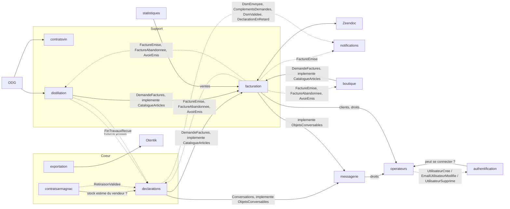

# Contextes : première analyse

> **Document provisoire.** Tout ce qui suit (contextes, descriptions, agrégats, relations, ordre) est une première lecture du CDC. Il **devra être réinterprété, raffiné, complété ou corrigé à chaque implémentation de contexte**.
>
> À chaque contexte, on procède ainsi :
> 1. avant de commencer : relire ses sources, contester la fiche ci-dessous ;
> 2. à la fin : corriger la fiche, la context map et l'ordre, et noter la révision dans le journal en fin de fichier.
>
> Un package par contexte : `fr.bnia.<contexte>.<couche>` (ADR-002). Les chapitres « back-office » et « portail » du CDC sont des écrans sur ces contextes, pas des contextes.

Chemins : tous les liens sont relatifs à `docs/`. `BO` = chapitre 4 du CDC (back-office), `Portail` = chapitre 5, `C.n` = annexe C, `AGI` = spec de reprise de données.

## 1. Ordre d'implémentation (révisé)

**Principe.** Les zones d'ombre du CDC (voir [analyse-interfaces-externes.md](analyse-interfaces-externes.md)) se situent presque toutes à la **frontière** des contextes : un tiers, un format de fichier, un document modèle. Le **noyau** d'un contexte (agrégats, règles de gestion, états, contrôles) est presque toujours spécifiable avec le CDC seul. L'architecture hexagonale permet donc de :

- démarrer un contexte par son **noyau**, ses ports de sortie étant branchés sur des adapters simulés ;
- reporter sa **bordure** (adapter réel, format exact, mise en page fidèle) à l'arrivée de la réponse du BNIA, sans toucher au noyau.

Statut : **A** = démarrable sans aucune réponse ; **B** = noyau démarrable, bordure en attente.
« Parallélisable avec » : contextes indépendants l'un de l'autre, confiables à des agents différents en même temps.

| # | Contexte | Type | Statut | Dépend de | Parallélisable avec | Bordure en attente |
|---|---|---|---|---|---|---|
| 1 | `referentiels` | Générique | A | : | : | Valeurs initiales réelles (reprise AGI) |
| 2 | `operateurs` | Support | A | 1 | : | Dérogations -40 % vol (Q-OPE-2) ; valeurs réelles des types tiers (Q-REF-1) |
| 3 | `authentification` (ex-`acces`) | Générique | A | 2 (« l'utilisateur peut-il se connecter ? ») | : | Fournisseur d'e-mail (SMTP ; Mailpit en dev) |
| 4 | ~~`cotisation`~~ | : | : | : | : | Supprimé le 2026-10-12, réparti entre 5, 8 et 9 (voir §2) |
| 5 | `declarations` | Cœur | B | 2 ; 8 (partie publiée de `facturation`, une fois révisé par les lots de la spec 08) | 7 | Validation des hypothèses par le BNIA (Q-DEC-1 à 22) ; format XML/JSON (différé) |
| 6 | `contratsarmagnac` | Cœur | A (contrat achat seul) | 2, 5 (stock estimé) | 7 | Aucune (vision du 2026-10-23) ; à confirmer par le BNIA : Q-CA-1 à 11 ; implémenté le 2026-10-23 |
| 7 | `exportation` | Cœur | B | 1, 2 | 5, 6 | Otentik, mise en page des certificats, matrice ventes export |
| 8 | `facturation` | Support | B | 2 (ports `Clients` et droits, implémentés dans son infra) | : | Zeendoc (API, états) ; validation des hypothèses par le BNIA (Q-FAC-1 à 8) |
| 9 | `distillation` | Support | B | 2, 5, 8 (implémente `CatalogueArticles`, appelle `DemandeFactures`) | 10 | Transport ODG (TimeTonic) |
| 10 | `contratsvin` | Support | B | 2, passerelle ODG de 9 | 9 | Transport ODG ; pluri-annuels et propositions vin en arbitrage |
| 11 | `notifications` | Générique | A | événements de 5 à 10 ; canal push appelé par 6 (`bnia-notifications-api`, ADR-024) | 12, 13, 14 | Canal e-mail ; canal push implémenté le 2026-10-24 (spec 11) |
| 12 | `statistiques` | Support | A | données de 5 à 8 | 11, 13, 14 | : |
| 13 | `boutique` | Générique | A | 1, 8 | 11, 12, 14 | : |
| 14 | `contenus` | Générique | A | : | à tout moment | Reprise armagnac.fr (agence) |
| 15 | `messagerie` | Générique | A | 2 (droits) ; 5 et 8 (implémentent `ObjetsConversables`) | 6, 7 | Validation des hypothèses par le BNIA (Q-MSG-1 à 5) |

Les étapes 1 à 5 peuvent démarrer **maintenant**.

**Ce qui change par rapport à la première version**

- `exportation` ne dépend ni de `declarations` ni de `facturation` : les justificatifs d'une demande de certificat sont des pièces déposées avec la demande (C.7.1.2), pas des objets d'un autre contexte. Je l'avais lié à tort. Il peut démarrer dès `operateurs`, en parallèle de 4 à 6.
- `declarations` passe avant `contratsarmagnac` (décision du 2026-10-12) : il porte l'estimation des stocks, dont le contrat lit le stock estimé du vendeur (révisé par la spec 06 le 2026-10-23) ; le contrat l'informe par événements. Le contexte `stocks` envisagé le même jour n'a pas été retenu : l'estimation n'a pas de donnée propre, elle se calcule depuis les DSM, les contrats et les fins de travaux.
- `contratsarmagnac` se limite au contrat achat Armagnac ; pluri-annuels et propositions sont hors périmètre du prototype (vision du 2026-10-23).
- `distillation` et `contratsvin` restent tard : leur seule bordure est l'ODG, dont le calendrier est le moins maîtrisable (bascule Innovagro vers TimeTonic sans date).
- Les contextes A passent avant les contextes B quand leurs dépendances le permettent, pour laisser du temps aux réponses.
- `messagerie` (15) est ajouté pour la démonstration au BNIA (analyse du 2026-10-17), absent du CDC : seconde **lib en aval**, appelée par les contextes métier qui lui décrivent leurs objets. Implémentable dès maintenant, après `facturation` : son lot 1 révise `declarations`, son lot 6 `facturation`.
- `facturation` devient une **lib en aval** (analyse du 2026-10-14) : les sources (`declarations`, `distillation`, `boutique`) appellent sa partie publiée et implémentent son port `CatalogueArticles` ; elle ne lit plus ni `declarations` ni `referentiels`. La révision de `declarations` et d'`operateurs` est livrée par les lots de la spec 08.

### 1.1 Bordures en attente

Chaque bordure est suivie à part, avec l'étape où elle devient nécessaire. **L'ordre des « étapes » est aussi l'ordre dans lequel il faut relancer le BNIA.**

| Bordure | Contexte | Nécessaire à l'étape | Ce qui la débloque | En attendant |
|---|---|---|---|---|
| ~~Matrice d'import DSM~~ | `declarations` | 5 | Levée le 2026-10-13 : la matrice négociant sert pour tous (§4.4.10 p.28), colonnes producteur grisées (§4.4.3.2 p.25) ; le modèle producteur reçu, à 14 colonnes, est distinct du format unique (spec 05, H-DEC-2) | — |
| Signature électronique | `declarations` | Hors périmètre du prototype (décision du 2026-10-12) | Niveau de signature, signataire, fournisseur | Validation de la DSM sans signature |
| ~~Contrôle du stock du vendeur à la validation d'un contrat~~ | `declarations`, `contratsarmagnac` | 5, 6 | Tranché le 2026-10-23 : stock estimé, seul contrôle (spec 06, RG-CA-12, H-CA-7) ; confirmation du BNIA (Q-CA-7) | Refus à la saisie et à l'approbation du vendeur, et à la retiraison |
| Format XML/JSON, logiciels opérateurs | `declarations`, `exportation` | Après 5 et 7 (différé §9.4) | Périmètre exact (format seul ou connecteurs ?) | Hors périmètre initial |
| Matrice ventes export | `exportation` | 7 | Annexe E (`ENVOI_VENTES_EXPORT.xlsx`) | Colonnes décrites en §4.7.3.1 |
| Mise en page des certificats | `exportation` | 7 | Annexe E (`CERTIF EXPORT*.pdf`) | Contenu décrit en §4.8.4, gabarit libre |
| Otentik / CEV | `exportation` | 7 | Contact douanes, documentation, environnement de test | Port `PlateformeCev`, adapter simulé |
| Zeendoc | `facturation` | 8 | API, compte de test, liste des états | Port de dépôt, adapter simulé ; dépôt manuel = repli (§9.1). Prototype : transmission à la demande et règlements de démonstration, sans traitement planifié (spec 08, 2026-10-17) |
| Mise en page des factures | `facturation` | 8 | Libre : un nouveau modèle est demandé (§4.9.8) | Gabarit libre, mentions obligatoires de 2026 (spec 08, RG-FAC-15) |
| Questions au BNIA de la spec 08 | `facturation` | 8 | Réponses du BNIA (et de son comptable) à Q-FAC-1 à 8 | Hypothèses H-FAC-1 à 6 |
| ODG | `distillation`, `contratsvin` | 9, 10 | TimeTonic ou intégrateur : canal, format, date | Endpoint d'ingestion interne, adapter simulé |
| Pluri-annuels et propositions | `contratsvin` (`contratsarmagnac` : hors périmètre, vision du 2026-10-23) | 10 | Arbitrage BNIA | Exclus |
| Taux réels de cotisation | `distillation` | 9 | Levée en partie le 2026-10-14 : 0,40 €/hl de vin (facture `FACTURE-CVO_DISTILLATION_2026000249.pdf`, récapitulatif du BNIA) ; part assujettie à confirmer ; levée pour `declarations` le 2026-10-13 (60 €/hlAP, 20 % non assujettis, facture `FACTURE-CVO-Armagnac_2026000700.pdf`) | Paramètres de démonstration |
| Questions au BNIA de la spec 05 | `declarations` | 5 | Réponses du BNIA à Q-DEC-1 à 22 | Hypothèses H-DEC-1 à 21 |
| Questions au BNIA de la spec 15 | `messagerie`, `declarations` | 15 | Réponses du BNIA à Q-MSG-1 à 5 (intérêt et forme de la messagerie, confidentialité des conversations libres, notes internes, observation générale, conversation d'une facture) | Hypothèses H-MSG-1 à 5 |
| Vues AGI | tous | 2 puis chaque étape | Accès AGI, types de données | Champs de la spec AGI |
| Vues AGI manquantes (marques, circuits, produits commercialisés, médailles, membres BNIA) | `referentiels`, `operateurs` | Reprise | AGI (Q-REF-6, Q-OPE-4) | Identifiants InteGraal non traduits |
| Dérogations Armagnac -40 % vol | `operateurs` | 2 (reprise) | Réponse du BNIA (Q-OPE-2) | Non construites |
| Fournisseur d'e-mail (invitations, codes de connexion, réinitialisations, changements d'e-mail) | `operateurs`, `authentification` | 3 | Choix du fournisseur par le BNIA | SMTP ; Mailpit en dev |
| Volumétrie, hébergement | transverse | Avant tout déploiement | BNIA | Hypothèses documentées |

Priorité de relance : matrice producteur au format unique et contrôle du stock du vendeur d'abord (étapes 5 et 6, les plus proches), puis Otentik, Zeendoc, ODG.
## 2. Les contextes

### 1. `referentiels`
Données de référence stables, administrées par le BNIA, lues par les autres contextes : géographie (zones commerciales, pays, régions), qualification (titres, labels, types de visite, langues, centres d'intérêt), présentation et commercialisation (marques, circuits de distribution, produits commercialisés, contenances), classes et taux de TVA, membres BNIA (ajout du 2026-10-06, spec 02). Une valeur inutilisée se supprime, une valeur utilisée se désactive (ADR-011).
Le **pays** porte sa zone commerciale (continent), un indicateur « membre de l'UE », la langue (`FR_EN`, `FR_ES`, `FR_IT`) et le niveau de détail (`CUMUL_DEGRE`, `DETAIL_COMPTE_AGE`, `DETAIL_MILLESIME`) du certificat export, et l'âge minimum à l'export. La **région** porte un indicateur « en région délimitée ». La **contenance** est un volume en litres.
Hors du contexte : taux de cotisation (`declarations` et `distillation`), destinataires export et types tiers (`exportation`), articles de facturation (chaque source, par le port `CatalogueArticles` de `facturation`, spec 08), type d'opérateur (`operateurs`). Les classes et taux de TVA sont lus par les sources de factures pour leurs articles, plus par `facturation`.
**Agrégats possibles :** `ClasseTva` avec ses `TauxTva` (sans chevauchement de périodes) ; une classe par liste de valeurs.
**Relations :** seul contexte lu directement par tous les autres, à travers une **partie publiée en lecture seule** (`..referentiels.domain.partage`, `..referentiels.application.partage`) ; référence par identifiant technique ; le code se corrige (ADR-011).
**Spec :** [specs/01-referentiels](specs/01-referentiels/spec.md) (terminée, implémentée ; rouverte le 2026-10-06 pour `MembreBnia`, à implémenter)
**Sources :** [BO 4.11](source/cdc/4-back-office-bnia/11-parametrage-et-administration-generale.md) · [C.10](source/cdc/A-annexes/C10-parametrage-et-administration-generale.md) · [AGI 2.6](source/agi/2-vues-attendues-donnees-integraal/06-parametrage.md)

### 2. `operateurs`
Référentiel des producteurs, négociants et autres structures : identité, codification automatique, identifiants administratifs (CVI, SIRET, accise, identifiant ODG), périodicité et statut déclaratifs, production (région, appellations, alambics), diffusion des millésimes, autorisation statistique, présentation (marques, visites, labels, œnotourisme, médailles) ; contacts de chaque structure, avec leurs droits au portail.
Le **type d'opérateur** est une liste fermée propre au contexte (`PRODUCTEUR`, `NEGOCIANT`, `AUTRE`) : il pilote la forme du code, la périodicité, les colonnes de DSM et l'assiette de cotisation (C.1.1.1). Un `AUTRE` ne déclare pas. Les « types tiers » d'InteGraal en sont probablement l'ancien nom (Q-REF-1). Le code se corrige et n'est pas partagé avec l'ODG, qui rattache ses flux par l'identifiant ODG, puis par CVI ou SIRET. Un opérateur se supprime s'il n'est pas référencé, se désactive sinon. Une marque peut être créée dans `referentiels` depuis la fiche, au back-office comme au portail (§4.3.2.3). La région de l'opérateur donne la distinction « région Armagnac / hors région » (C.1.1.2).
**Personnes et accès** (révision du 2026-10-08, vision `specs/02-operateurs/Spécification fonctionnelle gestion des opérateurs, contacts et accès.md`) : dans un opérateur, une personne est soit un **contact** (sans compte), soit un **membre** : un **utilisateur** (identité dont il est propriétaire, e-mail unique) **rattaché** à l'opérateur avec un rôle fixe, `OBSERVATEUR`, `AGENT` ou `ADMIN`. Ses informations professionnelles sont dans une **fiche professionnelle** de l'opérateur, qui le suit de contact à membre. On devient membre en acceptant une **invitation**, qui prouve l'e-mail. Trois modules : Contacts (avec la fiche de l'opérateur), Accès, Paramétrage. Le **BNIA est un opérateur** de type `BNIA` ; un rôle tenu chez lui vaut pour tous les opérateurs. Les droits sont évalués à chaque requête. Un journal trace toutes les actions sur les personnes et les accès. Le portail offre une recherche restreinte des autres opérateurs (autre partie d'un contrat). Les données de présentation sont saisies sans flux vers l'annuaire public, hors périmètre (§1.4).
Hors du contexte : mot de passe, double authentification, sessions, journal des connexions (`authentification`) ; dernières déclarations et historique de la fiche (assemblés par l'écran) ; export « plus d'1 hl » (`statistiques`) ; dérogations -40 % vol (en attente, Q-OPE-2) ; reprise des données (hors périmètre du prototype).
**Agrégats :** `Operateur` (avec alambics, millésimes diffusables, appellations), `PresentationOperateur` (marques, circuits, visites, labels, œnotourisme, médailles) ; `Contact`, `FicheProfessionnelle`, `Rattachement`, `Invitation`, `Utilisateur`, un agrégat chacun, règles collectives dans les cas d'usage avec index uniques et verrou sur l'opérateur (A-OPE-6) ; journal hors agrégat.
**Relations :** lu par presque tous à travers une **partie publiée en lecture seule** (`..operateurs.domain.partage`, `..operateurs.application.partage.OperateursLecture`), comme `referentiels` (A-OPE-1) ; fournit à tous les droits d'un utilisateur sur un opérateur, et à `authentification` l'état de connexion d'un utilisateur ; publie `UtilisateurCree`, `EmailUtilisateurModifie`, `UtilisateurSupprime`, écoutés par `authentification` dans la même transaction (A-AUT-1). Droits vérifiés dans les cas d'usage (A-OPE-7).
**Spec :** [specs/02-operateurs](specs/02-operateurs/spec.md) (terminée, implémentée ; révisée le 2026-10-08, réimplémentée)
**Révisions demandées par la spec 08** (lot 1, livrées par ses lots) : n° de TVA intracommunautaire sur la fiche ; indicateurs « facturable » et « certifiable », chacun nommant ce qui manque, au lieu de « fiche incomplète » (RG-OPE-02) ; acheteur d'un opérateur et recherche publiés pour le port `Clients` de `facturation` ; module « Facturation » du tableau rôles × modules, géré par le seul personnel du BNIA ; lien *Factures* sur la fiche.
**Sources :** [BO 4.3](source/cdc/4-back-office-bnia/03-gestion-des-operateurs.md) · [Portail 5.13](source/cdc/5-portail-operateur/13-gestion-des-contacts.md) · [C.1](source/cdc/A-annexes/C01-gestion-des-operateurs.md) · [AGI 2.1](source/agi/2-vues-attendues-donnees-integraal/01-referentiel-des-professionnels.md) · [AGI 3 §3.8](source/agi/3-vues-attendues-donnees-pro-armagnac-fr/01-vues-attendues-donnees-pro-armagnac-fr.md)
**Révisions demandées par la spec 15** (livrées par son lot 2, implémentées le 2026-10-17) : module « Messagerie » (`Module.MESSAGERIE`, conversations libres), géré par les trois rôles, `OBSERVATEUR` compris ; exception à RG-OPE-31 : une conversation libre n'est lue, côté opérateur, que par son auteur ; module Déclarations : « commentaires » remplacés par « notes internes ».
**Révisions demandées par la spec 05**, faites le 2026-10-13 dans la spec 02 : colonne « Déclarations » du tableau rôles × modules (`Module.DECLARATIONS`) ; onglet « Déclarations » de la fiche opérateur, fourni par `declarations` ; champ « périodicité » sans effet sur les DSM (à garder ou à retirer de l'écran) ; un producteur au statut `SOMMEIL` dans les données de démonstration.

### 3. `authentification` (ex-`acces`)
Preuve d'identité, sans métier (décision du 2026-10-08) : compte de connexion (identifiant = e-mail de l'utilisateur, mot de passe haché), double authentification par code e-mail pour tous (`000000` en dev et démo), navigateur de confiance 30 jours, mot de passe oublié, blocage de 30 min après 3 échecs, session, journal des connexions. Ni nom, ni droit, ni opérateur : utilisateurs, rattachements, rôles et invitations sont dans `operateurs`. Spring Security seul ; remplaçable (Keycloak…) sans toucher au métier.
Écarts assumés au CDC : pas de rôles composés ni de catalogue de droits (§4.2.1, §4.2.5), pas de population distincte d'utilisateurs BNIA (§4.2.2), pas de TOTP (§4.2.7).
**Agrégats possibles :** `CompteConnexion` ; code de vérification, réinitialisation et navigateur de confiance (attachés au compte) ; journal des connexions hors agrégat.
**Relations :** demande à `operateurs` si un utilisateur peut se connecter, à la connexion et à chaque requête ; il écoute ses événements pour créer (sans mot de passe), renommer et supprimer le compte (A-AUT-1) ; le premier mot de passe est posé par un second appel du formulaire d'acceptation (A-AUT-2). Session serveur Spring Session JDBC (A-AUT-3). Aucune clé étrangère vers `operateurs`.
**Spec :** [specs/03-authentification](specs/03-authentification/spec.md) (terminée, implémentée)
**Sources :** vision (spec 02) · [BO 4.2](source/cdc/4-back-office-bnia/02-gestion-des-acces.md) · [Portail 5.1](source/cdc/5-portail-operateur/01-acces-authentification-et-gestion-du-compte.md) · [C.2](source/cdc/A-annexes/C02-gestion-des-acces-et-habilitations.md) · [C.13](source/cdc/A-annexes/C13-comptes-et-acces-operateur.md) · [AGI 3 §3.8](source/agi/3-vues-attendues-donnees-pro-armagnac-fr/01-vues-attendues-donnees-pro-armagnac-fr.md)

### 4. ~~`cotisation`~~
Supprimé le 2026-10-12 (analyse du contexte, option B) : une fois l'affichage et la facturation de la cotisation rendus à leurs contextes, il ne restait qu'une table de paramètres et un calcul. Chaque élément va à son propriétaire naturel : l'assiette et le montant `CVO` à `declarations`, le montant fin de travaux à `distillation`, l'application de la TVA à `facturation`. Le CDC n'en fait pas un module à part (§4.4.9, §4.6.2, §4.9). `CVE` et `CVO` sont synonymes, interchangeables dans le CDC (décision du 2026-10-12).

### 5. `declarations`
Déclarations de stocks et mouvements. L'opérateur **initie** la DSM de la période qui suit sa dernière DSM validée (ou son **point de départ**, fixé par le BNIA), la remplit au format unique (5 onglets, 26 colonnes, colonnes grisées pour les producteurs) par saisie ou import Excel, y joint justificatifs et DRM, et l'envoie ; le BNIA l'**instruit** (commentaires, compléments demandés) et la **valide**, ce qui la fige (amendements, analyse du 2026-10-13). Les calculs bloquent l'envoi, les pièces la validation. Sans signature électronique (hors périmètre du prototype, décision du 2026-10-12). Les douanes ont confié au BNIA le suivi des stocks de chaque opérateur et peuvent lui en demander à tout moment un état des lieux (dire de l'utilisateur du 2026-10-12, absent du CDC).
Lit dans `operateurs` le type et le statut de déclaration de stock : seul `OUI` permet d'initier et rend une DSM attendue (H-DEC-10 ; sens des valeurs : Q-OPE-7). La périodicité découle du type, annuelle (1er avril - 31 mars) pour le producteur, mensuelle pour le négociant ; la périodicité de la fiche opérateur n'est pas lue, trimestre, semestre et changement de périodicité sont hors périmètre du prototype (décision du 2026-10-13). Un traitement planifié détecte les retards. Auteurs : identifiant de l'utilisateur et copie de son nom (§3) ; journal des actions en ajout seul.
Porte la **cotisation sur DSM** (reprise de `cotisation`, décision du 2026-10-12) : grille des taux `CVO` (€/hlAP, pourcentage exonéré de TVA, chaîne datée sans trou), administrée dans le menu Paramétrage ; assiette par colonne (14, 16 à 19, 21 à 25, colonnes grisées exclues) ; taux en vigueur à la fin de la période ; **détail** par ligne de facture (sorties France, sorties export, EDV pour un autre produit au marché intérieur et à l'export), calculé à la volée et figé par la facture.
Porte enfin le **suivi des stocks** : le **stock déclaré** (fin de la dernière DSM validée, par ligne), livré avec le contexte ; le **stock estimé**, livré avec `contratsarmagnac` (spec 06) puis complété par `distillation`, qui l'informent par événements dont les types sont dans sa partie publiée (ADR-013). Engagements, stock disponible et bilan prévisionnel abandonnés (spec 06, décision du 2026-10-23).
Publie `DsmEnvoyee`, `ComplementsDemandes`, `DsmValidee`, `DeclarationEnRetard` ; une partie en lecture (dernière DSM et stock déclaré pour la fiche opérateur). Calcule la TVA indicative avec les taux de `referentiels` (spec 05, A-DEC-4).
**Révision par la spec 08** (livrée par ses lots 1, 2 et 4) : porte UC-DEC-10 (facturer une DSM ou une sélection) et appelle `DemandeFactures` de `facturation` ; implémente `CatalogueArticles`, deux articles par ligne de cotisation (part assujettie S, part non assujettie E) ; écoute `FactureEmise`, `FactureAbandonnee` et `AvoirEmis`, types dans la partie publiée de `facturation` ; projection des factures enrichie (facturation demandée, facture annulée, montants nets des avoirs) ; ne publie plus la cotisation d'une DSM (`CotisationDsmVue`). Questions au BNIA reportées : Floc de Gascogne (colonne 15), acheteur qui relève du BNIA.
**Révision par la spec 15** (livrée par ses lots 1 et 2, implémentée le 2026-10-17) : **carnet de notes internes** du BNIA sur la DSM et ses lignes (`NoteInterne`, signée et datée, jamais vue de l'opérateur), qui remplace la note de contrôle d'une ligne, le commentaire de contrôle d'un justificatif et le commentaire interne ; `Commentaire` retiré : les échanges vont à la conversation de la DSM dans `messagerie`. L'infra implémente `ObjetsConversables` (type `DSM`) et le port `Messagerie` du core sur `Conversations` (motif des compléments déposé, protégé ; conversation supprimée avec le brouillon). Observation générale : un message ; note de transfert en région : supprimée (H-DEC-12 révisée).
**Révision par la spec 06** (`contratsarmagnac`, 2026-10-23) : reçoit `RetiraisonValidee` (remplace `ContratValide`, `ContratModifie`, `RetiraisonEffectuee`) et en tire des **mouvements de contrat** (achat de l'acheteur, vente du vendeur, référence au contrat sans clé étrangère) ; **stock estimé** par ligne de DSM (base : dernière DSM validée ou point de départ, vieillie ; plus les achats, moins les ventes), lu par `contratsarmagnac` et affiché au portail ; un mouvement s'**inscrit** dans la DSM de sa période (aussitôt si modifiable, sinon à l'initiation ; colonne 2 ou 3, 20 ou 21 ; pas d'inscription en colonne grisée) et en est le **justificatif** ; une DSM ne s'**envoie** qu'après la fin de sa période ; démonstration de Gascogne et des Landes reculée d'un mois.
**Agrégats :** `DeclarationStocksMouvements` (lignes, justificatifs, DRM), `PointDeDepartDeclaratif`, `GrilleCotisation` ; notes internes à part de la DSM ; le stock estimé est un modèle de lecture.
**Analyse :** [specs/05-declarations/analyse.md](specs/05-declarations/analyse.md) (terminée) · **Spec :** [specs/05-declarations/spec.md](specs/05-declarations/spec.md) (terminée, implémentée)
**Sources :** [BO 4.4](source/cdc/4-back-office-bnia/04-declarations-des-stocks-et-mouvements.md) · [Portail 5.4](source/cdc/5-portail-operateur/04-declarations-de-stocks-et-mouvements.md) · [C.3](source/cdc/A-annexes/C03-declarations-de-stocks-et-mouvements.md) · [Annexe B](source/cdc/A-annexes/B-comptes-d-age-et-mentions-de-vieillissement.md) · [Annexe E](source/cdc/A-annexes/E-exemples-de-fichiers.md) et [matrices DSM](source/fichiers-example/) · [AGI 2.2](source/agi/2-vues-attendues-donnees-integraal/02-declarations-de-stocks-et-mouvements.md)

### 6. `contratsarmagnac`
Contrat d'achat Armagnac entre deux opérateurs, un acheteur et un vendeur, sur de l'Armagnac en fût (vision et analyse du 2026-10-23, écart assumé au CDC). Une partie ouvre un projet au portail ; l'autre l'approuve, le modifie ou le refuse ; chaque modification est une version, montrée en écart à qui doit revalider. **Conclu** quand les deux parties ont approuvé la même version, sans validation du BNIA, qui consulte en lecture seule quel que soit son rôle. Sur un contrat conclu, l'acheteur déclare des **retiraisons** (datées de l'enlèvement), le vendeur les valide ; la dernière rend le contrat **exécuté**. Une partie seule l'annule ou le déclare sans plus de retiraison. Aucun type d'opérateur n'est exclu comme acheteur.
Lit dans `declarations` le **stock estimé** du vendeur, seul contrôle du contenu (à la saisie et à l'approbation du vendeur) et de chaque retiraison (refus sans chiffre pour l'acheteur) ; publie le seul événement `RetiraisonValidee`, dont le type est dans la partie publiée de `declarations`, qui en tire ses mouvements de contrat et préremplit la DSM (révision de la spec 05). Lit dans `operateurs` les parties (recherche restreinte), les droits (module « Contrats ») et les membres à prévenir ; envoie ses propres e-mails par un port. Porte les **mercuriales** du back-office (prix minimum, moyen pondéré, maximum, volumes, par millésime ou dénomination et compte d'âge), l'édition PDF au formulaire CA-05 allégé, les cartes des tableaux de bord et l'onglet « Contrats » de la fiche opérateur. Ni conversation ni notes internes (décision du 2026-10-23). Pluri-annuels et propositions d'engagement : hors périmètre du prototype.
**Agrégats :** `ContratAchatArmagnac` (versions, lignes, approbations, retiraisons) ; journal du contrat à part.
**Analyse :** [specs/06-contratsarmagnac/analyse.md](specs/06-contratsarmagnac/analyse.md) (terminée) · **Spec :** [specs/06-contratsarmagnac/spec.md](specs/06-contratsarmagnac/spec.md) (implémentée, 2026-10-23)
**Sources :** [vision du 2026-10-23](specs/06-contratsarmagnac/vision.md) · [BO 4.5 §4.5.1](source/cdc/4-back-office-bnia/05-contrats-d-achat-a-la-propriete.md) · [Portail 5.5](source/cdc/5-portail-operateur/05-contrats-armagnac.md) · [C.4](source/cdc/A-annexes/C04-contrats-d-achat-a-la-propriete.md) · [AGI 3 §3.1](source/agi/3-vues-attendues-donnees-pro-armagnac-fr/01-vues-attendues-donnees-pro-armagnac-fr.md)

### 7. `exportation`
Suivi des sorties export (saisie ou import Excel contrôlé) et certification de l'âge : demande depuis le portail, traitement par le BNIA, certificat PDF multilingue (simplifié ou détaillé selon le pays), raccordement CEV / Otentik. Les justificatifs d'une demande (facture, DRM, DAE) sont des pièces déposées avec la demande. Le pays (`referentiels`) donne la langue et le niveau de détail du certificat, ainsi que l'âge minimum autorisé (alerte non bloquante à la saisie, à l'import et au certificat : décision du 2026-10-06) ; la contenance (`referentiels`) entre dans le calcul du volume d'alcool pur.
Le contexte porte aussi les **destinataires export** (C.10.7) et leur qualification par **type tiers** (C.10.8.2), retirés de `referentiels` : tiers avec adresse et pays, fournis par l'opérateur dans sa demande et créés à l'import.
Le vendeur est retrouvé par son code opérateur à l'import ; la raison sociale et l'adresse de l'expéditeur sont lues dans `operateurs` et figées sur le certificat. Créateur d'un suivi, agent traitant : identifiant de l'utilisateur et copie de son nom (§3).
Échanges et notes (spec 15) : la demande de certificat est conversable dans `messagerie` ; son commentaire de traitement (C.7.1.1 p.122) est une note interne. À trancher dans sa spec : le suivi sortie export (commentaire et commentaire de dossier, C.6 p.119-120), conversable ou note interne.
**Agrégats possibles :** `SuiviSortieExport` (lignes), `DemandeCertificat`, `CertificatExport`, `Destinataire`.
**Sources :** [BO 4.7](source/cdc/4-back-office-bnia/07-suivi-des-sorties-export.md) · [BO 4.8](source/cdc/4-back-office-bnia/08-certification-export.md) · [Portail 5.7](source/cdc/5-portail-operateur/07-ventes-export.md) · [Portail 5.8](source/cdc/5-portail-operateur/08-certificats-export.md) · [C.6](source/cdc/A-annexes/C06-suivi-des-sorties-export.md) · [C.7](source/cdc/A-annexes/C07-certification-export.md) · [C.10.7](source/cdc/A-annexes/C10-parametrage-et-administration-generale.md) · [Annexe E](source/cdc/A-annexes/E-exemples-de-fichiers.md) · [AGI 2.5](source/agi/2-vues-attendues-donnees-integraal/05-contrats-export.md) · [AGI 2.6.10](source/agi/2-vues-attendues-donnees-integraal/06-parametrage.md)

### 8. `facturation`
**Lib en aval** (analyse du 2026-10-14) : les contextes métier lui demandent des factures, elle en fait des pièces légales. Elle reçoit des **demandes de facture** (origine opaque, client ou acheteur libre, lignes d'article), qui deviennent des **brouillons** que le BNIA modifie, abandonne ou émet, seuls ou en lot ; elle garantit la numérotation continue commune aux factures et aux avoirs, la pièce émise figée, la correction par avoir (de correction ou d'annulation, qui libère l'origine ; hors prototype), les mentions obligatoires de 2026, une catégorie de TVA par ligne et la TVA par catégorie et taux (EN 16931) ; elle édite le PDF au nouveau modèle, tient un journal par pièce, met les pièces à disposition au portail, les dépose dans Zeendoc et en relève l'état de règlement (simulé dans le prototype) ; elle consolide les ventes.
Elle ne connaît ni DSM, ni cotisation, ni commande : ni type de facture (remplacé par l'origine), ni catalogue (chaque source implémente le port `CatalogueArticles` qu'elle publie), ni facture manuelle (vente directe de `boutique`). Le vendeur (le BNIA) est paramétré chez elle. L'acheteur d'un client se lit par son port `Clients`, à la demande et à l'émission ; les droits par un port à elle ; les deux implémentés dans son infra sur la partie publiée d'`operateurs`. Référence aux sources et aux clients sans clé étrangère (`Origine`, `ClientRef`).
**Partie publiée :** `DemandeFactures` (cas d'usage appelé) et `DemandeFacture` ; `CatalogueArticles` et `Article` ; événements `FactureEmise`, `FactureAbandonnee`, `AvoirEmis` ; lecture des ventes (`LigneVendue`) pour `statistiques`.
**Agrégats :** `Facture` (sens `FACTURE` ou `AVOIR`, lignes article, informatives et groupes, suivi Zeendoc), `Numerotation`, `Vendeur` ; journal hors agrégat, en ajout seul. Pas d'agrégat `Transmission` dans le prototype (2026-10-17).
**Révision par la spec 15** (lot 6, implémentée le 2026-10-17) : une facture ou un avoir émis dont le client est un opérateur est conversable dans `messagerie` ; l'infra implémente `ObjetsConversables` (type `FACTURE`) ; sa lecture suffit au client pour écrire ; section *Messages* sur la pièce, au back-office et au portail.
**Analyse :** [specs/08-facturation/analyse.md](specs/08-facturation/analyse.md) (terminée) · **Spec :** [specs/08-facturation/spec.md](specs/08-facturation/spec.md) (implémentée le 2026-10-17 : lots 1, 2, 3, 5 ; lot 6 simulé ; lot 4, avoirs, hors prototype)
**Sources :** [BO 4.9](source/cdc/4-back-office-bnia/09-facturation-et-cotisations.md) · [Portail 5.10](source/cdc/5-portail-operateur/10-factures-et-paiements.md) · [Passerelles 6 §6.2](source/cdc/6-passerelles-et-interfaces/01-passerelles-et-interfaces.md) · [C.8](source/cdc/A-annexes/C08-facturation-et-cotisations.md) · [Annexe D](source/cdc/A-annexes/D-cartographie-des-interfaces-et-flux.md) · [AGI 2.3](source/agi/2-vues-attendues-donnees-integraal/03-factures.md) · [factures d'exemple](source/fichiers-example/)

### 9. `distillation`
Fins de travaux de distillation reçues de l'ODG, sans doublon en cas de retransmission, non modifiables côté BNIA et portail, rendues facturables. Porte la première passerelle ODG.
Porte aussi la **cotisation sur fin de travaux** (reprise de `cotisation`, décision du 2026-10-12) : montant en €/hl de vin distillé et pourcentage exonéré de TVA, datés (§4.11.2, C.10.3), et calcul de la cotisation de la déclaration (§4.6.2, §4.9.4).
La passerelle rattache chaque flux à une fiche par l'identifiant tiers ODG, puis par CVI ou SIRET, lus dans `operateurs` (le code BNIA n'est pas partagé avec l'ODG, spec 02).
Informe `declarations` du volume d'alcool pur produit pour le propriétaire, qui entre dans son stock estimé (décision du 2026-10-12), par l'événement `FinTravauxRecue`, type dans la partie publiée de `declarations` (spec 05 §5.2).
Facture une fin de travaux par la partie publiée de `facturation` : implémente `CatalogueArticles` (articles de cotisation, parts assujettie et non assujettie), appelle `DemandeFactures`, écoute ses événements (spec 08). À trancher dans sa spec : le payeur quand il diffère du déclarant (« code payeur », C.5.1.3 p.119).
**Agrégats possibles :** `DeclarationFinTravaux`.
**Sources :** [BO 4.6](source/cdc/4-back-office-bnia/06-declarations-de-fin-de-travaux-de-distillation.md) · [Passerelles 6 §6.1](source/cdc/6-passerelles-et-interfaces/01-passerelles-et-interfaces.md) · [C.5](source/cdc/A-annexes/C05-declarations-de-fin-de-travaux-de-distillation.md) · [AGI 3 §3.7](source/agi/3-vues-attendues-donnees-pro-armagnac-fr/01-vues-attendues-donnees-pro-armagnac-fr.md)

### 10. `contratsvin`
Contrats d'achat de vin de distillation reçus de l'ODG, consultés en lecture seule. Réutilise la passerelle ODG de `distillation`. Les pluri-annuels et propositions d'engagement vin, eux, sont **saisis dans le portail** (§5.6.2-5.6.3) et leur maintien est en arbitrage.
**Agrégats possibles :** `ContratVin` (reçu, immuable) ; `PluriAnnuelVin`, `PropositionEngagementVin` (saisis, si maintenus).
**Sources :** [BO 4.5 §4.5.2, 4.5.5, 4.5.6](source/cdc/4-back-office-bnia/05-contrats-d-achat-a-la-propriete.md) · [Portail 5.6](source/cdc/5-portail-operateur/06-contrats-vin.md) · [Passerelles 6 §6.1](source/cdc/6-passerelles-et-interfaces/01-passerelles-et-interfaces.md) · [C.4](source/cdc/A-annexes/C04-contrats-d-achat-a-la-propriete.md) · [AGI 3 §3.4-3.6](source/agi/3-vues-attendues-donnees-pro-armagnac-fr/01-vues-attendues-donnees-pro-armagnac-fr.md)

### 11. `notifications`
Centre de notifications du portail, messages aux contacts, relances, règles de destinataires.
Cible les personnes de `operateurs` (contacts et membres) par centre d'intérêt et par rôle (C.14).
Écoute `DsmEnvoyee`, `ComplementsDemandes`, `DsmValidee` et `DeclarationEnRetard` de `declarations` (analyse UC-DEC-11), et `FactureEmise` de `facturation` (avis de nouvelle facture, §5.12 p.77).
`contratsarmagnac` envoie ses propres e-mails aux parties par un port (spec 06), comme `operateurs` ; à reprendre ici le jour venu.
**Ouvert le 2026-10-24, réduit au canal push** ([spec 11](specs/11-notifications/spec.md), ADR-024) : lib en aval, comme `facturation` et `messagerie` ; module d'API `bnia-notifications-api` (`Notifications`), appelé par l'infra de `contratsarmagnac` (RG-CA-18) ; abonnements des appareils (Web Push), sans autre lecture. Le centre de notifications, les relances et les règles de destinataires restent à spécifier ; ils pourront écouter les événements ci-dessus.
Distincte de `messagerie` (spec 15) : une notification vient du système et vise un destinataire ; un message est écrit par une personne, sans destinataire. Un e-mail d'alerte de nouveau message relèvera d'ici. Le type et l'objet concernés (C.14.1.1) pourront reprendre la liste `TypeObjet` de `bnia-messagerie-api`.
**Agrégats possibles :** `Notification`, règles de destinataires.
**Sources :** [Portail 5.12](source/cdc/5-portail-operateur/12-notifications-et-relances.md) · [C.14](source/cdc/A-annexes/C14-notifications-et-relances.md)

### 12. `statistiques`
Restitutions en lecture seule : consolidation du marché, suivi des opérateurs, achats à la propriété, exportations par pays, classement des ventes. Accès nominatif réservé au BNIA ; le portail ne donne que des statistiques globalisées ou propres à la structure.
Porte l'export des opérateurs qui achètent ou vendent plus d'1 hl par an (§4.10.7). Les **mercuriales** (achats à la propriété, §4.10.4) sont dans `contratsarmagnac`, tirées des seuls contrats ; `statistiques` pourra les lire (spec 06). L'état des stocks à une date (§4.10.5) lit le stock déclaré, puis estimé, dans la partie publiée de `declarations`, que sa spec étendra (décision du 2026-10-13). Lit dans `operateurs` le type, la région, les appellations, la diffusion des millésimes (qui décide de l'usage des données d'un opérateur) et l'accès aux statistiques du portail. Lit les ventes publiées par `facturation` (CVO facturée sur DSM et sur fin de travaux, §4.10.3 p.48 ; spec 08, RG-FAC-31).
**Agrégats possibles :** aucun, des modèles de lecture.
**Sources :** [BO 4.10](source/cdc/4-back-office-bnia/10-statistiques-et-restitutions.md) · [Portail 5.11](source/cdc/5-portail-operateur/11-statistiques.md) · [C.9](source/cdc/A-annexes/C09-statistiques-et-restitutions.md)

### 13. `boutique`
Offre de produits aux opérateurs, commandes passées depuis le portail, traitement jusqu'à la facturation. Porte aussi, depuis l'analyse `facturation` (2026-10-14), les **articles libres** (PLV, goodies, ventes diverses, sans photo, non publiés ; §4.9.2, C.8.2.1), les **ventes directes**, qui remplacent la facture manuelle (§4.9.6), et le **répertoire des clients libres** (tiers `Client` de C.8.1.1). Expose ses articles par le port `CatalogueArticles` de `facturation`, demande les factures par `DemandeFactures` et passe la commande à « facturée » sur `FactureEmise`. À décider dans sa spec : la saisie d'un acheteur sans client dans un brouillon, que `facturation` n'offre pas encore (spec 08, RG-FAC-11 révisée le 2026-10-15 : l'acheteur d'un brouillon ne se modifie pas).
**Agrégats possibles :** `Produit` (et catégories), `Commande`, `VenteDirecte`, `Client`.
**Sources :** [BO 4.13](source/cdc/4-back-office-bnia/13-boutique-et-gestion-des-commandes.md) · [Portail 5.9](source/cdc/5-portail-operateur/09-boutique-et-commandes.md) · [C.12](source/cdc/A-annexes/C12-boutique-et-commandes.md) · [BO 4.9.2](source/cdc/4-back-office-bnia/09-facturation-et-cotisations.md) · [C.8.2](source/cdc/A-annexes/C08-facturation-et-cotisations.md)

### 14. `contenus`
Contenus diffusés dans le portail : actualités et catégories, ressources documentaires, photothèque, interlocuteurs et horaires du BNIA.
**Agrégats possibles :** `Actualite`, `Ressource`, `Photo`, avec leurs catégories.
**Sources :** [BO 4.12](source/cdc/4-back-office-bnia/12-gestion-des-contenus-portail.md) · [Portail 5.3](source/cdc/5-portail-operateur/03-contenus-portail-et-ressources.md) · [C.11](source/cdc/A-annexes/C11-gestion-des-contenus.md)

### 15. `messagerie`
Ajouté pour la démonstration au BNIA (analyse du 2026-10-17), absent du CDC, qui n'a que des champs « commentaire » épars (C.3 p.107, C.4 p.113, C.7 p.122) et le contact du BNIA (§5.2.2 p.61). Porte **tous les échanges écrits entre le BNIA et un opérateur**, sans destinataire nommé : la **conversation d'un objet métier** (au plus une par objet, née au premier message, supprimée avec l'objet), partagée par l'opérateur, écrite depuis la page de l'objet ou la messagerie ; la **conversation libre** ouverte par un utilisateur du portail, vue de lui seul dans son opérateur (lecture seule pour le BNIA après son départ), avec pièces jointes (PDF, PNG, JPEG, `.xlsx`). Lu / non lu par message et par côté ; afficher une conversation la lit ; « marquer non lu ». Compteur « x nouveaux messages » des deux tableaux de bord, écran unifié, recherche sans casse ni accents. Objets conversables : DSM, facture émise ; contrat d'achat et demande de certificat avec leur contexte.
Ne porte ni l'objet métier (type, identifiant, libellé seulement), ni les notifications du système (`notifications`), ni les notes internes du BNIA (carnet de chaque contexte métier), ni les e-mails.
**Lib en aval** (ADR-021, ADR-023) : module **`bnia-messagerie-api`** : `Conversations` (appelée par les contextes métier : déposer un motif, supprimer la conversation d'un objet, non lus), `ObjetsConversables` (implémentée par leur infra : opérateur et libellé d'un objet). Droits lus dans `operateurs` par un port implémenté dans son infra ; chaque type d'objet a son module (DSM : Déclarations ; facture : Facturation, dont la lecture suffit pour écrire) ; module « Messagerie » pour les conversations libres. Référence à l'objet opaque, sans clé étrangère (`ObjetMetier`, ADR-011 amendé le 2026-10-17).
**Agrégats :** `Conversation` (sujet : `ObjetMetier` ou `SujetLibre`), `Message` (racine à part : écrire ou lire ne verrouille pas la conversation).
**Analyse :** [specs/15-messagerie/analyse.md](specs/15-messagerie/analyse.md) (terminée) · **Spec :** [specs/15-messagerie/spec.md](specs/15-messagerie/spec.md) (terminée, implémentée le 2026-10-17 : lots 1 à 6)
**Sources :** aucune section dédiée ; points d'appui : [BO 4.1](source/cdc/4-back-office-bnia/01-accueil-dashboard-bnia.md) · [Portail 5.2](source/cdc/5-portail-operateur/02-tableau-de-bord-portail.md) · [C.3](source/cdc/A-annexes/C03-declarations-de-stocks-et-mouvements.md) · [C.4](source/cdc/A-annexes/C04-contrats-d-achat-a-la-propriete.md) · [C.7](source/cdc/A-annexes/C07-certification-export.md) · [C.14](source/cdc/A-annexes/C14-notifications-et-relances.md)

## 3. Éléments transverses (non contextes)

- **Tableaux de bord** : [BO 4.1](source/cdc/4-back-office-bnia/01-accueil-dashboard-bnia.md), [Portail 5.2](source/cdc/5-portail-operateur/02-tableau-de-bord-portail.md). Compositions de lecture sur plusieurs contextes ; à traiter une fois les contextes agrégés disponibles. La fiche opérateur (dernière DSM, historique des DSM, factures, contrats, §4.3.3) est une composition du même type, enrichie à chaque étape (décision du 2026-10-06, spec 02) ; `declarations` y fournit l'onglet « Déclarations » (spec 05 §6.1), `facturation` un lien *Factures* vers son historique filtré sur le client (spec 08, RG-FAC-27). `messagerie` fournit aux deux tableaux de bord la carte « x nouveaux messages » (spec 15, RG-MSG-11). `contratsarmagnac` branche les cartes « Contrats à approuver » et « Contrats en attente d'approbation » (portail), « Contrats en attente d'approbation » (back-office), et l'onglet « Contrats » de la fiche opérateur (spec 06, RG-CA-25).
- **Reprise de données** : [CDC 7](source/cdc/7-recuperation-de-donnees/01-recuperation-de-donnees.md) et la spec AGI. Piste : analyser la correspondance des vues AGI **pendant l'implémentation de chaque contexte** plutôt qu'à la fin.
- **Zones partagées** (décidé le 2026-10-06 avec la spec `referentiels`, [ADR-008](adr/008-referentiels-partie-publiee-en-lecture.md) et [ADR-009](adr/009-noyau-commun-du-domaine.md)) :
  - **`commun.domain`** : concepts et règles transverses du glossaire, pas des données : `CompteDAge` d'abord, puis `Millesime`, `Campagne`, `MentionCommerciale`, `VolumeAlcoolPur` (entré avec `declarations`, A-DEC-8) au fil des besoins. Import libre. `Millesime` et `Appellation` y entrent avec `operateurs` (A-OPE-4 de la spec 02).
  - **`referentiels`, partie publiée** : lecture seule des données administrées (vues, énumérations, `ReferentielsLecture`). Exception à l'isolement des contextes, étendue le 2026-10-06 à **`operateurs`** (`OperateursLecture`, ADR-012) ; les autres ne communiquent que par ports et événements.
  - **Événements entre contextes** : Spring `ApplicationEvent`, synchrones, écoutés dans la transaction de l'émetteur ; types définis dans la partie publiée du contexte dont l'autre dépend, pour éviter tout cycle ; adapters dans `adapter.evenement` (ADR-013). Ceux de `operateurs` avec `acces` n'ont plus d'objet (2026-10-08).
- **Droits** (décidé le 2026-10-08, spec 02 §3.2.7) : rôles fixes `OBSERVATEUR`, `AGENT`, `ADMIN`, portés par le rattachement d'un utilisateur à un opérateur et lus dans `operateurs` à chaque requête ; un rôle de l'opérateur BNIA vaut pour tous les opérateurs. Chaque nouveau contexte ajoute un module, c'est-à-dire une colonne au tableau rôles × modules, que sa spec déclare (lecture et gestion par rôle). Le module « Facturation » (spec 08) est, après le Paramétrage, le second dont la gestion est réservée au personnel du BNIA. Le module « Contrats » (spec 06) est l'inverse : géré par les seules parties, il est en lecture seule pour l'opérateur BNIA, quel que soit son rôle (exception au rôle BNIA valant partout).
- **Auteur d'une action** (décidé le 2026-10-08) : un utilisateur est supprimé avec son dernier rattachement ; un contexte qui enregistre un auteur stocke son identifiant **sans clé étrangère** et une copie de son nom à l'instant de l'action. Exception à ADR-011 (A-OPE-8 de la spec 02).
- **Espaces** : une seule connexion ; l'opérateur actif décide de l'espace, back-office (opérateur BNIA) ou portail (autre opérateur).
  - **Référence entre contextes** : par identifiant technique, avec clé étrangère ; le code d'une valeur se corrige ([ADR-011](adr/011-referentiels-identifiant-technique-et-code-modifiable.md), qui remplace la référence par code métier du 2026-10-06). Exceptions proposées par la spec 08 : l'origine d'une facture et son client (`Origine`, `ClientRef`), opaques, sans clé étrangère (amendement d'ADR-011 à écrire).
- **Décidé en phase E de la spec 05** (2026-10-13, ADR à écrire) : **stockage de documents** commun, port `StockageDocuments` dans `bnia-commun-core`, `DocumentDepose` dans `commun.domain`, adapter PostgreSQL `bytea` (A-DEC-5) ; **traitement planifié** par un adapter `adapter.planification` qui n'appelle qu'un cas d'usage, horloge injectée, idempotence en base (A-DEC-7) ; **production de documents** : `fastexcel` pour l'Excel, OpenHTMLtoPDF et Thymeleaf pour le PDF, dans un adapter `adapter.document` (A-DEC-9) ; `VolumeAlcoolPur` dans `commun.domain` (A-DEC-8, amendement d'ADR-009). ~~Pas de port implémenté par un contexte aval : `declarations` tient une projection des factures alimentée par événements (A-DEC-4).~~ Remplacé par la spec 08 (2026-10-14) : `facturation`, lib en aval, publie un cas d'usage appelé par ses sources (`DemandeFactures`) et un port qu'elles implémentent (`CatalogueArticles`), en plus de ses événements ; nouvelle forme de partie publiée, module d'API (ADR-021). La projection des factures dans `declarations` demeure, alimentée par les événements de `facturation`.
- **Décidé en phase E de la spec 08** (2026-10-14, ADR-021, ADR-022, ADR-011 amendé) : principe d'**architecture hexagonale stricte et de modularisation Maven**. `facturation` publie un module **`bnia-facturation-api`** (cas d'usage appelé, port implémenté par les sources, types, événements) ; le core d'une source n'en dépend pas, il a son propre port, implémenté dans son infra par un adapter sur l'API (A-FAC-1). Port technique **`Transactions`** dans `bnia-commun` (exécuter dans une nouvelle transaction), pour l'émission en lot (A-FAC-6). Références opaques `Origine` et `ClientRef` sans clé étrangère (A-FAC-8).
- **Décidé en phase E de la spec 15** (2026-10-17, ADR-023, ADR-011, 018 et 021 amendés) : `messagerie`, seconde lib en aval, publie **`bnia-messagerie-api`** (cas d'usage appelé `Conversations`, port implémenté par les contextes métier `ObjetsConversables`) ; le core d'un contexte métier a son propre port (`Messagerie` pour `declarations`). Référence opaque `ObjetMetier` sans clé étrangère. **Notes internes** du BNIA tenues par chaque contexte métier, distinctes des messages. `StockageDocuments` accepte, au choix de l'appelant, PDF, PNG, JPEG et `.xlsx`.
- **Décidé en phase E de la spec 06** (2026-10-23, ADR-011, 016 et 017 amendés) : `contratsarmagnac` lit directement les parties publiées d'`operateurs` et de `declarations` (ADR-017, sans port de passe-plat) ; `declarations` tient les **mouvements de contrat** (référence opaque au contrat, **sans clé étrangère** : ADR-011 amendé) et le **stock estimé**, calculé à la lecture ; le module « Contrats » est en lecture seule pour l'opérateur BNIA, appliqué par les cas d'usage du contexte (ADR-016 amendé) ; versions du contrat en tables relationnelles.
- **Passerelles** : [CDC 6](source/cdc/6-passerelles-et-interfaces/01-passerelles-et-interfaces.md) et [annexe D](source/cdc/A-annexes/D-cartographie-des-interfaces-et-flux.md). ODG, Zeendoc, Otentik et signature sont vus comme des adapters derrière des ports, dans le contexte qui les utilise.

## 4. Ébauche de context map

À lire comme une hypothèse de départ. `operateurs` et `referentiels` sont consultés par presque tous (non dessinés), et `notifications` comme `statistiques` écoutent ou lisent les autres. Lectures principales de `referentiels` : `operateurs` (régions, titres, langues, marques…), `exportation` (pays, contenances), les sources de factures, `declarations`, `distillation` et `boutique` (taux de TVA à une date, pour leurs articles). Ces lectures passent par la partie publiée de `referentiels`, sans port côté consommateur. Seule écriture venue d'ailleurs : la création d'une marque depuis la fiche opérateur, par l'écran. `operateurs` est lu par presque tous, par sa partie publiée en lecture seule (A-OPE-1), et fournit à tous les droits d'un utilisateur. `authentification` demande à `operateurs` si un utilisateur peut se connecter ; son compte est créé, renommé et supprimé par les événements de `operateurs` (A-AUT-1), sans dépendance inverse. `contratsarmagnac` et `distillation` dépendent de `declarations`, qui porte l'estimation des stocks : ils l'informent par événements, et le contrat y lit le stock estimé du vendeur ; `declarations` ne les lit pas (décision du 2026-10-12). `facturation` est une lib en aval (spec 08) : `declarations`, `distillation` et `boutique` lui demandent des factures par sa partie publiée et implémentent son port `CatalogueArticles` ; elle les informe des factures émises, abandonnées et des avoirs par événements ; elle ne lit qu'`operateurs` (clients, droits), par des ports implémentés dans son infra ; `statistiques` lit ses ventes. `notifications` écoute les événements de `declarations` et `FactureEmise`. `messagerie` est une lib en aval (spec 15) : `declarations` l'appelle (motif des compléments, suppression avec le brouillon) et lui décrit ses DSM, `facturation` ses pièces émises, par `ObjetsConversables` ; elle ne lit qu'`operateurs` (droits).

## 5. Interrogations laissées ouvertes

À trancher à l'étape indiquée, pas avant. Celles marquées **(nous)** peuvent être tranchées sans le BNIA, par hypothèse de travail.

- ~~**TVA** : classes et taux dans `referentiels` ou dans `facturation` ?~~ Tranché le 2026-10-06 : dans `referentiels`.
- ~~**Produits de la facturation manuelle** : placés dans `boutique`, alors que le CDC les décrit en facturation (§4.9.2, C.8.2). Faut-il un seul catalogue (boutique et facturation manuelle) ou deux ? `facturation` (étape 8) en a besoin pour les factures manuelles : le catalogue doit-il exister avant, en avançant une partie de `boutique` ? *(étapes 8 et 13)* **(nous)**~~ Tranché le 2026-10-14 (analyse `facturation`) : pas de catalogue dans `facturation` ; chaque source expose ses articles par `CatalogueArticles` ; articles libres et ventes directes dans `boutique` ; rien à avancer de `boutique`, `declarations` est la seule source du prototype jusqu'à l'étape 9.
- **Facture provisionnelle** (§4.2.5.1 p.16, annexe E p.140) : jamais décrite ; source et solde inconnus. *(BNIA)* Q-FAC-3
- **Forfait de 1 500 €** des opérateurs satellites et des metteurs en bouteilles à façon (récapitulatif du BNIA, 2026-10-14) : assujettis, fréquence, part assujettie, contexte qui le facture. *(BNIA)* Q-FAC-4
- **Floc de Gascogne** (19 €/hlAP, colonne 15) et **acheteur qui relève du BNIA** : absents du CDC, à reporter dans la révision de la spec 05. *(BNIA)*
- **Type tiers et type d'opérateur** : la liste « types tiers » est probablement l'ancien type de la fiche professionnel d'InteGraal (AGI 2.1.1). Le type d'opérateur est tranché (`PRODUCTEUR`, `NEGOCIANT`, `AUTRE`, spec 02) ; seule sa reprise reste suspendue à Q-REF-1. *(reprise, étape 7)*
- ~~**Lecture d'un opérateur par les autres contextes**~~ : tranché le 2026-10-06, partie publiée en lecture seule comme `referentiels` (A-OPE-1 de la spec 02).
- **Statut de déclaration de stock** : effet sur `declarations` fixé le 2026-10-13 (spec 05, H-DEC-10 : seul `OUI` initie ; reprise par un nouveau point de départ). Reste le sens de « sommeil » et « clôturé ». *(BNIA)* Q-OPE-7
- ~~**Taux de cotisation** : le CDC cible décrit un montant unique par type de cotisation, l'ancien système avait des taux par colonne.~~ Tranché le 2026-10-13 : un montant unique en €/hlAP, une assiette par colonne (spec 05, H-DEC-1 et H-DEC-2).
- **Pays** : la cible porte une langue et un niveau de détail de certificat, et un âge minimum (spec `referentiels`). Restent inexpliqués les champs CA et CA1 à CA5 de la vue AGI, sans doute les modèles de certificat autorisés. *(reprise)* Q-REF-2
- **Pluri-annuels et propositions d'engagement** : maintien en arbitrage au BNIA. *(étape 10 ; hors périmètre du prototype pour l'étape 6, vision du 2026-10-23)*
- ~~**États de la DSM** : deux versions dans le CDC (§4.4.2 et C.3.1.1).~~ Tranché le 2026-10-13 : états d'instruction (`BROUILLON` à `VALIDEE`) ; « à facturer » et « facturée » lus dans `facturation` (analyse `declarations`).
- ~~**Contrôles de la DSM** : C.3.2.4 donne des contrôles croisés visibles (assemblages/coupes, passage sous bois/sous verre), mais la formule complète du stock de fin n'est pas écrite. *(étape 5)* **(nous)** La matrice négociant reçue le 2026-10-12 la donne, par ligne : `26 = 1 + 2 + 3 + Σ(4..9) − Σ(10..25)`, en rouge si négatif. Elle marque aussi l'assiette de cotisation par colonne (14, 16, 17, 18, 19, 21, 22, 23, 24), dont la colonne 14, absente du §4.4.9.~~ Tranché le 2026-10-13 : formule du stock de fin, contrôles croisés Σ6 = Σ12 et Σ5 = Σ11, stock de fin négatif bloquant l'envoi (spec 05, RG-DEC-17 et 18, H-DEC-7).
- ~~**Rattachement des lignes d'achat et de vente à un contrat « exécuté »** (§4.4.7) : la règle de blocage de la DSM est à réécrire.~~ Tranché le 2026-10-23 (spec 06) : plus de rattachement ni de blocage ; les retiraisons validées s'inscrivent dans la DSM de leur période et en sont le justificatif (RG-CA-22, 23).
- ~~**Contrôle du stock du vendeur à la validation d'un contrat** : absent du CDC.~~ Tranché le 2026-10-23 (spec 06) : le stock estimé est le seul contrôle, à la saisie et à l'approbation du vendeur et à chaque retiraison, sans validation BNIA (RG-CA-12, 13). *(BNIA)* Q-CA-7
- **Achat d'un producteur** : aucun type d'opérateur n'est exclu comme acheteur, mais les colonnes d'achat d'une DSM producteur sont grisées ; l'achat compte dans son stock estimé sans s'inscrire dans sa DSM (spec 06, H-CA-5). *(BNIA)* Q-CA-5
- **Envoi d'une DSM avant la fin de sa période** : interdit depuis le 2026-10-23 (spec 06, RG-CA-24, révision de RG-DEC-20), pour qu'une retiraison de la période en cours trouve toujours sa DSM modifiable. *(BNIA)* Q-CA-4
- **Niveaux de détail du certificat** : deux niveaux en §4.8.5 (simplifié, détaillé), trois valeurs en C.7.2.1 (cumul par degré, détail comptes d'âge, affichage millésime). ~~*(étape 7)*~~ Tranché le 2026-10-06 : le pays porte les trois valeurs de C.7.2.1 (spec `referentiels`).
- **Périodicités trimestrielle et semestrielle, changement de périodicité** (§4.4.10, C.1.1) : hors périmètre du prototype (décision du 2026-10-13, spec 05 §2.2) ; à rouvrir avec le BNIA. *(après le prototype)*
- **Parties publiées de `referentiels`, `operateurs` et `declarations`** : paquets `partage` dans le core, importés par le core des autres contextes ; elles ne suivent pas le principe d'hexagonale stricte et de module d'API retenu pour `facturation` (A-FAC-1, 2026-10-14). Les aligner, ou garder les deux formes ? *(après la spec 08)* **(nous)**
- **Volumes export** présents à deux endroits (colonnes 22 à 25 de la DSM et suivis sortie export) : pas de rapprochement demandé par le CDC. *(étapes 7 et 12)* **(nous)**

## Journal des révisions

| Date | Contexte | Changement |
|---|---|---|
| 2026-10-05 | : | Première analyse, avant toute implémentation. |
| 2026-10-05 | ordre | Ordre révisé à la lumière des zones d'ombre : distinction noyau / bordure, statuts A et B, backlog des bordures. `exportation` remonté en 7 (indépendant de `declarations` et `facturation`). `contratsarmagnac` limité au contrat achat. `contratsvin` corrigé (pluri-annuels et propositions saisis dans le portail). |
| 2026-10-06 | `referentiels` | Spec 01 rédigée. Destinataires et types tiers déplacés vers `exportation` ; produits de la facturation manuelle vers `boutique` (à raffiner) ; TVA confirmée dans `referentiels`. Type d'opérateur : liste fermée de `operateurs`. Attributs du pays, de la région et de la contenance précisés. Zones partagées décidées (§3) : `commun.domain` pour les concepts transverses (`CompteDAge`…), partie publiée en lecture seule pour `referentiels`, référence par code métier. |
| 2026-10-06 | `referentiels` | Spec 01 terminée. ADR-008 et ADR-009 rédigés. Prochaine étape : implémentation de `referentiels`, puis spec de `operateurs`. |
| 2026-10-06 | : | ADR-010 : un module Maven par contexte (`bnia-<contexte>`), couches en packages vérifiées par ArchUnit ; plus de module d'intégration global, chaque intégration vit dans son contexte. Implémentation de `referentiels` commencée (lot 1 : zones commerciales). |
| 2026-10-06 | `referentiels` | Contexte implémenté (lots 1 à 7) : treize référentiels, partie publiée `ReferentielsLecture`, écrans du menu Paramétrage, données de démonstration (profil `demo`). Prochaine étape : spec de `operateurs`. |
| 2026-10-06 | `referentiels` | ADR-011 : référence par identifiant technique au lieu du code métier ; code (et volume des contenances) modifiable, toujours unique ; suppression d'une valeur inutilisée, désactivation sinon. Spec 01, ADR-008, glossaire et `CLAUDE.md` mis à jour. |
| 2026-10-06 | `operateurs` | Spec 02 rédigée (phases A à C). Type `PRODUCTEUR`, `NEGOCIANT`, `AUTRE`. Contact par opérateur, droits portail sur le contact, compte unique par e-mail dans `acces` (écart à C.13.2) ; événements entre `operateurs` et `acces`. Dernières déclarations et historique de la fiche : composition de lecture. Export « plus d'1 hl » vers `statistiques`. Annuaire public : hors périmètre, plus une bordure. Nouvelles bordures : dérogations -40 % vol, vues AGI manquantes. `MembreBnia` ajouté à `referentiels` (spec 01 rouverte). Fiches `acces`, `contratsarmagnac`, `declarations`, `exportation`, `facturation`, `distillation`, `notifications`, `statistiques` complétées. |
| 2026-10-06 | `operateurs` | Spec 02, phase E : partie publiée en lecture seule pour `operateurs` (extension de l'exception d'ADR-008) ; événements Spring synchrones, types dans la partie publiée du contexte dont l'autre dépend ; `Millesime` et `Appellation` dans `commun.domain`. |
| 2026-10-06 | `operateurs` | Spec 02 terminée (validée). Prochaine étape : ADR de la spec 02, puis implémentation de `MembreBnia` dans `referentiels` et de `operateurs`. |
| 2026-10-06 | `operateurs` | ADR-012 (partie publiée de `operateurs`, agrégats) et ADR-013 (événements entre contextes) ; ADR-008 et ADR-009 amendés ; CLAUDE.md mis à jour. |
| 2026-10-06 | `operateurs` | Contexte implémenté (lots 1 à 9) : `MembreBnia` dans `referentiels` ; `Millesime` et `Appellation` dans `commun.domain` ; agrégats `Operateur` (identité, déclaratif, production, diffusion, contacts et droits au portail) et `PresentationOperateur` ; journal des contacts ; événements publiés et écoutés (ADR-013), sans consommateur tant que `acces` n'existe pas ; partie publiée `OperateursLecture` ; export Excel ; écrans du back-office (menu Opérateurs) et du portail (« Mon entreprise », « Contacts », recherche d'opérateur) sur un opérateur de démonstration ; données de démonstration. Prochaine étape : spec de `acces`. |
| 2026-10-08 | : | ADR-014 : chaque contexte devient un module parent `bnia-<contexte>` avec deux sous-modules, `bnia-<contexte>-core` (`domain`, `application`, Java pur garanti à la compilation) et `bnia-<contexte>-infra` (adapters). Idem pour `bnia-commun` et `bnia-systeme`. |
| 2026-10-08 | `authentification`, `operateurs` | Spec 03 commencée d'après la vision du 2026-10-08 (phases A à C). `acces` remplacé par `authentification`, preuve d'identité sans métier (double authentification par e-mail pour tous, Spring Security seul). Personnes et accès dans `operateurs` (spec 02 en révision) : contact ou membre, utilisateur, fiche professionnelle, rattachement, invitation ; rôles fixes `OBSERVATEUR`, `AGENT`, `ADMIN` et modules ; BNIA opérateur de type `BNIA`, ses rôles valant partout ; l'opérateur actif décide de l'espace. Fiches `operateurs`, `authentification`, `declarations`, `contratsarmagnac`, `exportation`, `facturation`, `notifications` ; éléments transverses (droits, auteur d'une action, espaces) ; context map ; bordure e-mail. Reprise des données hors périmètre du prototype. |
| 2026-10-08 | `authentification`, `operateurs` | Spec 03 terminée (phases D à G : architecture A-AUT-1 à 4 et A-OPE-6 à 9 ; hypothèses et questions tranchées ; glossaire). Révision de la spec 02 validée, à réimplémenter. Prochaine étape : ADR, puis implémentation conjointe de `authentification` et de la révision de `operateurs`. |
| 2026-10-08 | `authentification`, `operateurs` | ADR-015 (authentification, contexte d'infrastructure) et ADR-016 (personnes et accès dans `operateurs`) ; ADR-011, 012 et 013 amendés ; `CLAUDE.md` mis à jour. Prochaine étape : implémentation (skill `implementation`) de `authentification` et de la révision de `operateurs`, dans ce worktree. |
| 2026-10-12 | `cotisation` | Analyse du contexte : `cotisation` supprimé (option B). Assiette et montant `CVO` à `declarations`, montant fin de travaux à `distillation`, application de la TVA à `facturation`. Dépendances vers 4 retirées. `CVE` et `CVO` synonymes. |
| 2026-10-12 | `declarations`, `contratsarmagnac` | Matrices DSM reçues (annexe E). Les douanes ont confié au BNIA le suivi des stocks par opérateur. Un contexte `stocks` est envisagé puis écarté : l'**estimation des stocks** (par compte d'âge et millésime ; stock estimé, engagements, stock disponible, bilan prévisionnel) va dans `declarations`, informé par événements de `contratsarmagnac` et `distillation`. « Exécuté » = toutes les retiraisons effectuées. `declarations` passe en 5, avant `contratsarmagnac` (6), qui lit le bilan prévisionnel du vendeur et refuse un contrat non couvert (à confirmer par le BNIA). Analyse `declarations` commencée (`specs/05-declarations`). |
| 2026-10-13 | `declarations` | Analyse terminée ; spec 05 rédigée jusqu'à la phase C (hypothèses H-DEC-1 à 21, chacune avec sa question au BNIA ; RG-DEC-01 à 42 ; huit lots incrémentaux). L'opérateur initie, le BNIA instruit et valide ; point de départ fixé par le BNIA ; périodicité tirée du type (trimestre, semestre et changement hors périmètre du prototype) ; cotisation détaillée par ligne de facture, lue par `facturation` ; stock déclaré livré, stock estimé en contrat d'interface avec 6 et 9. Fiches 2, 5, 6, 8, 9, 11, 12, bordures, éléments transverses, context map et interrogations mis à jour. |
| 2026-10-13 | `declarations` | Spec 05, phase E : décisions A-DEC-1 à 9. Factures des DSM en projection locale alimentée par `FactureEmise` et `AvoirEmis` (au lieu d'un port implémenté par `facturation`) ; stockage de documents commun (PostgreSQL) ; premier traitement planifié ; `VolumeAlcoolPur` dans `commun.domain` ; Excel `fastexcel`, PDF OpenHTMLtoPDF. Fiches 5 et 8, éléments transverses et context map mis à jour. ADR à écrire en phase H. |
| 2026-10-13 | `declarations` | Spec 05 terminée. Prochaine étape : ADR de la spec 05 (stockage de documents, traitement planifié, production de documents, amendement d'ADR-009), révision de la spec 02, puis implémentation par lots (skill `implementation`) dans ce worktree. |
| 2026-10-14 | `declarations` | Contexte implémenté (lots 1 à 8) : DSM au format unique, saisie, import et éditions Excel et PDF, instruction et validation, pièces et DRM, cotisation CVO et projection des factures, échéances, retards (traitement planifié, `DeclarationEnRetard`), nouveau point de départ après interruption, stocks déclarés et leur export ; partie publiée `DeclarationsLecture` (cotisation, dernière DSM, stock déclaré). Prochaine étape : tour d'écran en `dev,demo`, fusion dans `main`, puis spec de `contratsarmagnac` (6). |
| 2026-10-14 | `facturation` | Analyse terminée (doc publié) ; spec 08 rédigée jusqu'à la phase D (RG-FAC-01 à 33, six lots, H-FAC-1 à 6, Q-FAC-1 à 8). `facturation` devient une lib en aval : sources (`declarations`, `distillation`, `boutique`) appelant `DemandeFactures` et implémentant `CatalogueArticles` ; plus de lecture de `declarations` ni de `referentiels` ; ports `Clients` et droits sur `operateurs`. Révisions de `declarations` et d'`operateurs` livrées par les lots de la spec 08. Fiches 1, 2, 5, 8, 9, 11, 12, 13, ordre, bordures, éléments transverses, context map et interrogations mis à jour ; interrogation des produits de la facturation manuelle tranchée. |
| 2026-10-14 | `facturation` | Spec 08, phase E : décisions A-FAC-1 à 10. Principe d'hexagonale stricte et de modularisation Maven ; module `bnia-facturation-api` ; port `Transactions` dans `bnia-commun`. Éléments transverses et interrogations mis à jour. |
| 2026-10-14 | `facturation` | Spec 08 terminée (phases F à H : questions adressées au BNIA, relecture, glossaire). Prochaine étape : ADR de la spec 08, puis implémentation par lots dans le worktree `facturation`. |
| 2026-10-15 | `facturation` | Lot 2 implémenté (brouillons) : édition d'ensemble, date de l'opération et acheteur non modifiables, lignes reçues de la source verrouillées (RG-FAC-11, 17 révisées) ; abandon (`FactureAbandonnee`, reçu par `declarations`) ; émission en lot (port `Transactions`, ADR-022) ; notes. Fiche `boutique` : saisie d'un acheteur libre à décider dans sa spec. |
| 2026-10-15 | `facturation` | Lot 3 implémenté (portail) : factures et avoirs émis de l'opérateur, détail et PDF, consultations journalisées côté client (RG-FAC-28). |
| 2026-10-17 | `facturation` | Contexte implémenté : lots 1, 2, 3 et 5 ; lot 6 (Zeendoc) réduit à une simulation de démonstration (transmission d'une sélection de factures émises au back-office, « Transmis », « Payé » en démonstration, état au back-office et au portail) ; lot 4 (avoirs) hors prototype (décision du 2026-10-17). `declarations` n'écoute donc pas `AvoirEmis` (révision de la spec 05 limitée aux lots 1 et 2). Prochaine étape : tour d'écran en `dev,demo`, puis fusion dans `main`. |
| 2026-10-17 | `messagerie` | Analyse terminée (doc publié) et spec 15 terminée (phases A à H) : contexte n° 15, ajouté pour la démonstration ; lib en aval, module `bnia-messagerie-api` (`Conversations`, `ObjetsConversables`) ; conversations d'objet (DSM, facture émise) et libres, lu / non lu par côté, compteur des tableaux de bord, écran unifié, recherche ; RG-MSG-01 à 17, six lots, H-MSG-1 à 5. Notes internes du BNIA dans chaque contexte métier (carnet de `declarations` au lot 1). Fiches 2, 5, 6, 7, 8, 11, ordre, bordures, éléments transverses et context map mis à jour. ADR-023 ; ADR-011, 018 et 021 amendés. Prochaine étape : implémentation par lots dans le worktree `facturation`. |
| 2026-10-17 | `messagerie` | Contexte implémenté (lots 1 à 6, les lots 1 et 2 ensemble) : module `bnia-messagerie` (`-api`, `-core`, `-infra`), schéma `messagerie` ; carnet de notes internes de `declarations` et retrait de `Commentaire` ; conversations de la DSM et de la facture émise, conversations libres et pièces jointes (stockage étendu à PNG, JPEG, `.xlsx`), lu / non lu par côté, nouveaux messages aux deux tableaux de bord, écran « Messagerie » avec recherche ; `Module.MESSAGERIE`. Révisions des specs 02, 05 et 08 faites. Prochaine étape : tour d'écran en `dev,demo`, puis fusion de la branche `contexte/facturation` dans `main`. |
| 2026-10-23 | `contratsarmagnac`, `declarations` | Vision de l'utilisateur (écart assumé au CDC) ; analyse terminée (doc publié) ; spec 06 rédigée jusqu'à la phase C : conclusion par les parties sans validation BNIA (lecture seule), versions et écart, retiraisons datées de l'enlèvement, stock estimé seul contrôle (engagements, disponible et bilan prévisionnel abandonnés), DSM préremplie par les retiraisons validées qui la justifient, DSM envoyée après la fin de sa période, mercuriales ; ni conversation ni notes internes. Révisions annoncées : spec 02 (module « Contrats »), spec 05 (mouvements de contrat, stock estimé, inscription, justificatif, envoi, démo). |
| 2026-10-23 | `contratsarmagnac` | Spec 06 terminée (phases D à H) : A-CA-1 à 8 (lecture directe des parties publiées, ADR-017 ; versions en tables relationnelles ; stock estimé et mouvements de contrat dans `declarations` ; e-mails par un port) ; H-CA-1 à 11 et leurs questions au BNIA ; ADR-011, 016 et 017 amendés. Trois lots : négociation et conclusion ; retiraisons et DSM préremplie ; PDF et mercuriales. |
| 2026-10-23 | `contratsarmagnac`, `declarations`, `operateurs` | Contexte implémenté (lots 1 à 3) : module `bnia-contratsarmagnac`, schéma `contratsarmagnac` ; négociation par versions, écart, conclusion ; retiraisons, annulation, clôture ; `RetiraisonValidee` ; PDF au formulaire CA-05 allégé ; mercuriales ; e-mails, journal, cartes, onglet de la fiche opérateur ; démonstration (projet d'Henri, vingt contrats exécutés). Révisions faites : spec 02 (`Module.CONTRATS`, `IdentiteLegaleVue`), spec 05 (stock estimé, mouvements de contrat, inscription et justificatif, envoi après la fin de période, démonstration reculée d'un mois). Prochaine étape : tour d'écran en `dev,demo`, puis fusion de la branche `contexte/contratsarmagnac` dans `main`. |
| 2026-10-24 | `notifications`, `contratsarmagnac`, `operateurs` | Contexte `notifications` ouvert, réduit au canal push, pour la soutenance (spec 11, ADR-024) : lib en aval, module `bnia-notifications-api`, schéma `notifications` ; `contratsarmagnac` y envoie les neuf faits de RG-CA-18 par son port `EnvoiNotifications` ; `PersonneVue.utilisateur` publié par `operateurs`. Fiche 11 et ordre mis à jour. |
