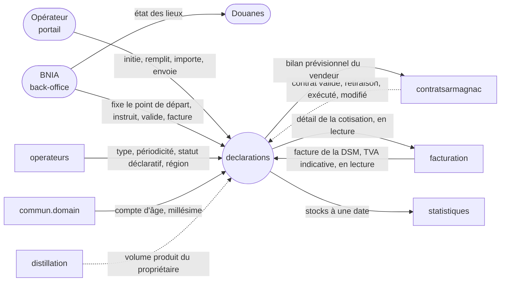
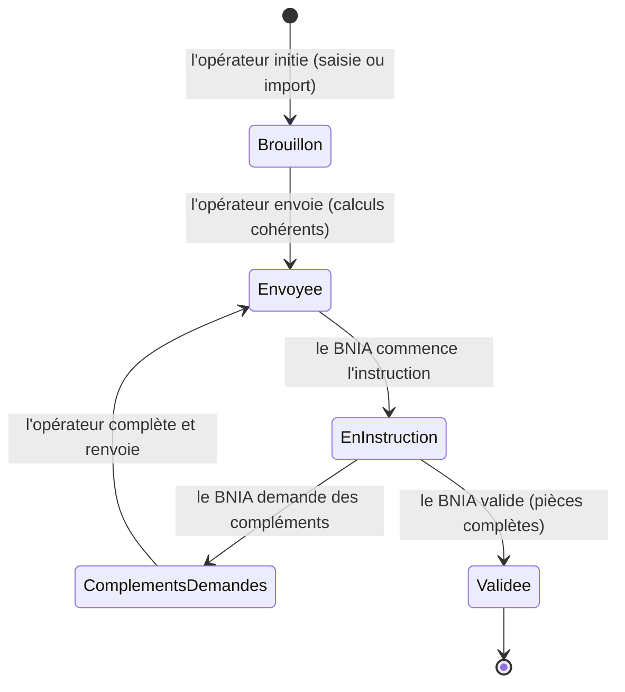
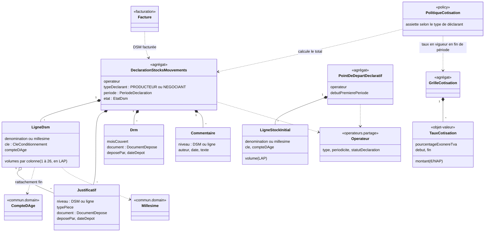
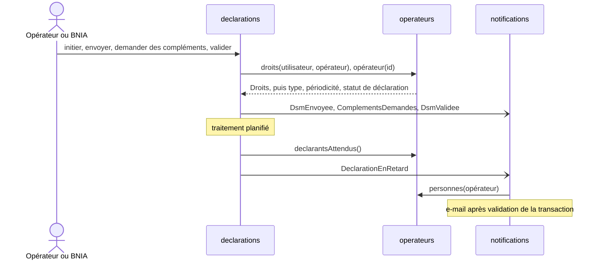
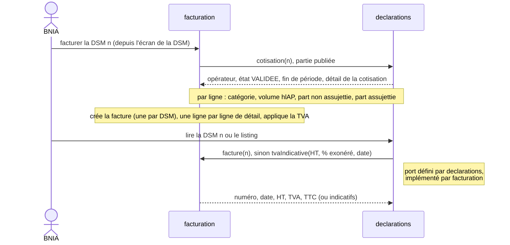
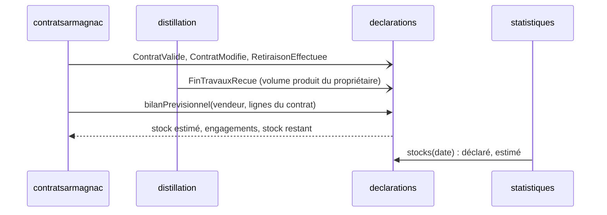

# Analyse : declarations

Statut : terminée, 2026-10-13 · Sources : §4.4 p.22-29, §5.4 p.64-66, C.3 p.107-112,
§4.11.2 p.52, C.10.3 p.128, AGI 2.2 p.8-9,
§4.5.1 p.30-31, §4.6 p.36,
§4.10 p.47, §4.10.5 p.49, annexe B p.98-99, C.5.1 p.118-119, annexe E p.140 ; matrices
`docs/source/fichiers-example/20261005_DI_ModeleDSM-*.xlsx`, facture `FACTURE-CVO-Armagnac_2026000700.pdf` ; dire de l'utilisateur des 2026-10-12 et 13 · Doc publié : https://claude.ai/code/artifact/a514d4e0-0279-403e-959e-9ae399e45c39

## 1. Cadrage

Les douanes ont confié au BNIA la responsabilité du suivi des stocks d'Armagnac de chaque opérateur, et
peuvent lui demander à tout moment un état des lieux (dire de l'utilisateur, absent du CDC). Le contexte
porte ce suivi, en deux piliers.

**La DSM** : l'opérateur l'initie pour la période qui suit sa dernière DSM validée, selon sa
périodicité (§4.4.2 p.22), et la remplit au portail, par saisie ou import Excel (§5.4.2-5.4.4 p.64),
avec ses justificatifs et, s'il est producteur, ses DRM (§4.4.5-4.4.6 p.25-26). Il l'envoie au BNIA,
qui l'instruit puis la valide (§4.4.7 p.26-27 ; amendement, décision du 2026-10-13, voir §2). Sa
cotisation se calcule ici, et elle devient facturable (§4.4.9 p.27, décision du 2026-10-12).

**L'estimation des stocks** (amendement proposé, décisions du 2026-10-12) :

- **Base** : le stock de fin de la dernière DSM validée, vieilli au 1er avril (annexe B p.98), au grain
  défini à l'étape 3.
- **Stock estimé** : cette base, plus les entrées connues depuis (achats des contrats exécutés, fins
  de travaux du propriétaire), moins les ventes des contrats exécutés. Un contrat est **exécuté** quand
  toutes ses retiraisons ont été effectuées.
- **Stock disponible** : le stock estimé moins les **engagements**, c'est-à-dire les ventes validées
  non exécutées.
- **Usages** : l'état des lieux pour les douanes, l'état des stocks des statistiques (§4.10.5 p.49),
  et le **bilan prévisionnel** qu'un nouveau contrat lit avant sa validation (à confirmer par le
  BNIA, le CDC étant muet).

Il ne contient pas :

- le contrat, ses retiraisons, et ce qu'il fait du bilan (alerte, refus, modification) :
  `contratsarmagnac` ;
- la fin de travaux (`distillation`) et la facture (`facturation`) ;
- l'envoi des relances (`notifications`) et les indicateurs (`statistiques`) ;
- la signature électronique de la DSM (§5.4.9 p.66), hors périmètre du prototype (décision du
  2026-10-12) ;
- le format XML/JSON pour les logiciels des opérateurs, différé (§9.4).

**Confrontation avec l'existant**

| CDC (page)                                                                             | Existant (ADR, spec, code)                                                                                                                       | Correspond ? | Proposition                                                                                                                                                                                                                                          |
|----------------------------------------------------------------------------------------|--------------------------------------------------------------------------------------------------------------------------------------------------|--------------|------------------------------------------------------------------------------------------------------------------------------------------------------------------------------------------------------------------------------------------------------|
| État des stocks « à partir des DSM » (§4.10.5 p.49) ; rien sur le stock du vendeur     | `contextes.md` : fiche `declarations` sans estimation des stocks                                                                                 | non          | Ajouter l'estimation des stocks (stock estimé, engagements, stock disponible, bilan prévisionnel) à la fiche. Nouveaux termes au glossaire                                                                                                           |
| Ligne d'achat ou de vente rattachée à un contrat exécuté (§4.4.7 p.27)                 | `contextes.md` §1 et §4 : `declarations` dépend de `contratsarmagnac` et le lit (« contrat exécuté ? »)                                          | non          | Sens inversé : `contratsarmagnac` publie ses événements, dont les types sont dans la partie publiée de `declarations` (ADR-013), et lit le bilan prévisionnel. `declarations` passe avant `contratsarmagnac` dans l'ordre (5 et 6)                   |
| Signature électronique de la DSM par l'opérateur (§5.4.8-5.4.9 p.66)                   | `contextes.md` : bordure « Signature électronique », port `SignatureService`                                                                     | non          | Décidé : hors périmètre du prototype ; la bordure de `contextes.md` devient « hors périmètre »                                                                                                                                                       |
| « Exécuté » : validé par les parties et le BNIA, volumes couvrant la DSM (§4.4.7 p.27) | Analyse `contratsarmagnac` (branche `contexte/contratsarmagnac`) : calculé dans `declarations`, relatif à une DSM ; glossaire : `ContratExecute` | non          | Décidé : exécuté = toutes les retiraisons effectuées, un état du contrat. Analyse `contratsarmagnac` (dépendance à `declarations`, retiraisons, refus, modification) et glossaire à revoir ; la règle de blocage de la DSM sera réécrite à l'étape 3 |

## 2. Cas d'usage

Acteurs, nommés comme le CDC : le **BNIA** (back-office) et l' **opérateur** (producteur ou négociant,
au portail). Les douanes n'ont pas d'accès : le BNIA leur transmet l'état des lieux.

**Instruction d'une DSM** (amendement, décision du 2026-10-13). Le CDC fait générer la DSM par le BNIA (§4.4.2 p.22) et
valider par l'opérateur (§5.4.8 p.66), et laisse le BNIA la saisir ou la corriger (§5.4.3 p.64, C.3.3 p.111). On retient
à la place : l'opérateur initie, remplit et envoie, et lui seul
modifie la DSM ; le BNIA instruit et valide. Une fois validée, la DSM n'est plus modifiable.

Contrôles du §4.4.7 p.26-27, répartis (décision du 2026-10-13) : la cohérence des stocks, des totaux
et de la reprise bloque l' **envoi** ; les justificatifs et DRM manquants bloquent la **validation** par
le BNIA, qui les réclame pendant l'instruction. Le contrôle des contrats exécutés est livré avec
`contratsarmagnac`.

### 2.1 Connaître les stocks

Deux états, chacun avec son sens métier (décision du 2026-10-13) : le **stock déclaré**, dernier état
que l'opérateur a déclaré et que le BNIA a validé, et le **stock estimé**, l'état reconstitué à ce jour.

> **UC-DEC-1** En tant que BNIA, je peux lire le stock déclaré d'un opérateur ou de tous, c'est-à-dire
> le stock de fin de leur dernière DSM validée, ligne par ligne, avec la fin de période
> qu'il date, afin de répondre aux douanes sur ce qui a été déclaré. (dire de l'utilisateur, §4.10.5
> p.49)

> **UC-DEC-2** En tant que BNIA, je peux établir le stock estimé d'un opérateur ou de tous à une date :
> le stock déclaré vieilli, plus les entrées et moins les sorties des contrats et de la distillation
> survenues depuis, afin de répondre aux douanes sur l'état actuel. Livré avec `contratsarmagnac` et
> `distillation`. (dire de l'utilisateur, annexe B p.98, décisions du 2026-10-12 et du 2026-10-13)

### 2.2 Déclarer

> **UC-DEC-3** En tant que BNIA, étant donné un opérateur qui déclare et qui n'a encore aucune DSM, je
> peux fixer son **point de départ déclaratif** (début de sa première période, stock initial ligne par
> ligne), afin qu'il puisse initier sa première DSM. (terme nouveau ; amendement, décision
> du 2026-10-13)

> **UC-DEC-4** En tant qu'opérateur, étant donné ma dernière DSM validée par le BNIA ou mon point de
> départ, je peux initier ma DSM de la période suivante, avec un stock de début qui reprend le stock de
> fin précédent. Je la remplis sur le format unique (colonnes hors de mon périmètre grisées), j'y joins
> justificatifs et, si je suis producteur, mes DRM, et j'y reviens tant qu'elle est en brouillon.
> (§4.4.2-4.4.3 p.22-25, §4.4.5-4.4.6 p.25-26, §5.4.2-5.4.7 p.64-66, amendé)

> **UC-DEC-5** En tant qu'opérateur, je peux importer le modèle Excel du BNIA pour pré-remplir ma DSM,
> afin de ne pas ressaisir ce que mon logiciel produit déjà. (§4.4.10 p.28, §5.4.4 p.64)

> **UC-DEC-6** En tant qu'opérateur, étant donné une DSM aux calculs cohérents, je peux l'envoyer au
> BNIA, puis la renvoyer une fois les compléments demandés apportés. Tant qu'un contrôle bloque, j'en
> vois le motif au niveau de la DSM, de l'onglet ou de la ligne. (§4.4.7 p.26-27, §5.4.8 p.66, amendé)

### 2.3 Instruire et facturer

> **UC-DEC-7** En tant que BNIA, je peux consulter les DSM et les filtrer (à instruire, compléments
> demandés, en retard, absentes…), afin de suivre la campagne et relancer les opérateurs. (§4.4.1 p.22,
> §4.4.8 p.27)

> **UC-DEC-8** En tant que BNIA, étant donné une DSM envoyée, je peux l'instruire : la commenter, et
> demander des justificatifs complémentaires, ce qui rend la main à l'opérateur. (§4.4.5 p.25-26, C.3.3
> p.111, amendé)

> **UC-DEC-9** En tant que BNIA, étant donné une DSM en instruction dont les pièces sont complètes, je
> peux la valider, ce qui la fige et permet à l'opérateur d'initier la suivante. (§4.4.7 p.26-27, amendé)

> **UC-DEC-10** En tant que BNIA, étant donné une DSM validée, je peux déclencher sa facturation sur le
> détail de cotisation calculé, puis retrouver la facture émise depuis la DSM. Porté et livré par
> `facturation` (étape 4). (§4.4.9 p.27-28)

### 2.4 Être notifié

> **UC-DEC-11** En tant qu'opérateur ou BNIA, je suis notifié automatiquement dès qu'une DSM attend mon
> action : l'opérateur quand il est en retard de déclaration (traitement planifié), quand le BNIA
> demande des compléments et quand il valide ; le BNIA quand une DSM est envoyée ou renvoyée. Ces
> notifications s'ajoutent aux relances manuelles. Envoi par `notifications`. (§4.4.8 p.27, décision
> du 2026-10-13)

Hors analyse : bilan prévisionnel du vendeur lu par un contrat, et alimentation du stock estimé par
les contrats et les fins de travaux, livrés avec `contratsarmagnac` et `distillation` (décision du
2026-10-13) ; administration de la grille de cotisation par le BNIA (§4.11.2) ; historique des DSM (§4.4.1), édition Excel et PDF (§4.4.4), remplacement d'une DRM,
journal des actions (§4.4.10), import depuis un logiciel opérateur (différé, §9.4), envoi des relances
(`notifications`), état des stocks des statistiques (`statistiques`).

**Confrontation avec l'existant**

| CDC (page)                                                                 | Existant (ADR, spec, code)                                                                                                                                  | Correspond ? | Proposition                                                                                                                                                                                                                                                                                                          |
|----------------------------------------------------------------------------|-------------------------------------------------------------------------------------------------------------------------------------------------------------|--------------|----------------------------------------------------------------------------------------------------------------------------------------------------------------------------------------------------------------------------------------------------------------------------------------------------------------------|
| Opérateur qui remplit ; BNIA qui contrôle et facture (§4.4, §5.4)          | ADR-016, spec 02 §3.2.7 : rôles `OBSERVATEUR`, `AGENT`, `ADMIN` par module ; un rôle BNIA vaut pour tous les opérateurs                                     | non          | Nouveau module « Déclarations » : `OBSERVATEUR` lecture, `AGENT` et `ADMIN` gestion ; l'envoi relève de la gestion, comme le reste (RG-OPE-31, décision du 2026-10-13). Réservés à l'opérateur BNIA, comme RG-OPE-32 : point de départ, instruction, validation, facturation, état des stocks de tous les opérateurs |
| — (amendement : point de départ fixé par le BNIA à l'ajout d'un opérateur) | Spec 02 : la fiche opérateur porte périodicité et statut de déclaration, modifiables par le BNIA seul (RG-OPE-36) ; rien sur une date ou un stock de départ | non          | Le point de départ appartient à `declarations` (le stock est le sien), saisi par le BNIA depuis la fiche de l'opérateur après sa création ; `operateurs` ne change pas                                                                                                                                               |
| Génération de la DSM par le BNIA (§4.4.2 p.22)                             | `contextes.md` §5 : « incohérences de périodicité signalées à la génération » ; spec 02 : périodicité lue pour la « génération »                            | non          | Remplacer « génération » par « initiation par l'opérateur » dans `contextes.md` et la spec 02                                                                                                                                                                                                                        |
| Relances (§4.4.8 p.27) ; rien sur les notifications à chaque étape | `contextes.md` §11 : `notifications` (relances, centre de notifications), à l'ordre 11, après `declarations` | non | `declarations` publie les événements (DSM envoyée, compléments demandés, DSM validée, opérateur en retard), le retard étant détecté par un traitement planifié de `declarations`, qui connaît les périodes attendues ; `notifications` s'y abonnera. D'ici là, aucun envoi |

## 3. Objets du domaine

| Objet | Nature | Rôle (UC servis) | Invariants |
|---|---|---|---|
| `DeclarationStocksMouvements` | agrégat | UC-1, 4 à 10 | Au plus une DSM non validée par opérateur. Période = celle qui suit la dernière DSM validée (ou le point de départ), de la durée de la périodicité courante : ni chevauchement ni trou (§4.4.2 p.22). Type de déclarant figé à l'initiation. Modifiable par l'opérateur seulement en brouillon ou compléments demandés ; figée une fois validée. Envoi : calculs cohérents ; validation : justificatifs et DRM présents (décisions du 2026-10-13). Ne porte ni montants de cotisation ni état de facturation : c'est la facture qui référence la DSM (clé étrangère, ADR-011), et `facturation` garantit une seule facture par DSM (décision du 2026-10-13) |
| `LigneDsm` | entité | UC-4 à 6 | Unique sur (dénomination ou millésime, clé, compte d'âge) (§4.4.3 p.23). Col. 1 = col. 26 de la ligne correspondante de la DSM précédente (ou du stock initial) ; col. 26 calculée (§4.4.3.1 p.23-24). Colonnes grisées vides pour un producteur (§4.4.3.2 p.24-25). Compte d'âge borné à `20+` (§4.7 p.39). **Proposé** : millésime pour `MB`, `MV`, dénomination pour `NB`, `NV` (« millésime » ou « assemblage », annexe A p.96) |
| `Justificatif`, `Drm` | entités | UC-4, 8, 9 | Justificatif rattaché à la DSM ou à une de ses lignes, déposant et date tracés (§4.4.5 p.25-26). Producteur : une DRM par mois de la période (§4.4.6 p.26). Le fichier n'est qu'une référence (`DocumentDepose` : clé, nom, type, taille) vers un stockage de documents commun à tous les contextes, port dans `commun` (ADR à écrire en spec : stockage objet S3/MinIO ou `bytea`) |
| `Commentaire` | entité | UC-8 | Porte l'échange d'instruction, y compris la demande de compléments (décision du 2026-10-13). **Proposé** : remplace la note de contrôle de ligne (C.3.2.1 p.108) et le résultat et commentaire de contrôle d'un justificatif (C.3.3.1 p.111) |
| `PointDeDepartDeclaratif` | agrégat | UC-3, 4 | Un par opérateur qui déclare ; modifiable tant que sa première DSM n'est pas validée (proposé) |
| `GrilleCotisation` | agrégat (taux : objets-valeurs) | UC-10 | Taux `CVO` en €/hlAP et pourcentage exonéré de TVA, datés, sans chevauchement, administrés par le BNIA (§4.11.2 p.52, C.10.3 p.128). Même forme que `ClasseTva` (spec 01) |
| `PolitiqueCotisation` | policy (sans état) | UC-10 | Assiette = colonnes soumises selon le type de déclarant (§4.4.9 p.27-28), en hlAP, × taux en vigueur à la **fin de période** de la DSM (décision du 2026-10-13). Produit le **détail de la cotisation**, ligne par ligne comme la facture d'exemple : commerce de l'Armagnac (sorties France, sorties export) et EDV pour un autre produit (marché intérieur, export), chacune avec son volume en hlAP, sa part non assujettie et sa part assujettie à la TVA (facture `FACTURE-CVO-Armagnac_2026000700.pdf` : 12 + 48 = 60 €/hlAP). Correspondance des colonnes aux lignes : en spec. Calcule le HT à la volée tant que la DSM n'est pas facturée, et le transmet à `facturation`, qui le fige sur la facture (C.10.3 p.128 : la correction d'un taux est sans effet sur une facture émise) |
| Read model de la DSM | modèle de lecture | UC-4 à 10 | État d'instruction, « à facturer » ou « facturée », HT, TVA et TTC (§4.4.1 p.22, §4.4.3 p.23). Facturée : montants de la facture. Sinon : HT de `PolitiqueCotisation`, TVA et TTC **indicatifs** demandés à `facturation`, responsable des règles de TVA (décision du 2026-10-13 ; mécanismes à l'étape 4) |
| Stock déclaré, stock estimé | modèles de lecture | UC-1, 2 | Calculés, sans donnée propre : le stock déclaré lit la col. 26 des dernières DSM validées ; le stock estimé, livré plus tard, l'agrège et y ajoute les mouvements reçus de `contratsarmagnac` et `distillation` (grain ci-dessous) |

**Grain des stocks** (décision du 2026-10-13, option B ; à revoir avec le BNIA). Une ligne `M` porte
un millésime, une ligne `N` (assemblage) une dénomination et pas de millésime ; le contrat, lui, ne porte
pas la clé B/V (§4.5.1.2 p.30). D'où deux niveaux :
- **stock déclaré** : à la ligne de DSM (millésime ou dénomination, clé, compte d'âge), tel que déclaré ;
- **stock estimé** : agrégé au grain des contrats, millésime pour les lignes `M`, « assemblage » et
  compte d'âge pour les lignes `N`, fût et bouteille confondus.

Le mode de calcul du stock estimé et le grain des lignes de contrat restent à revoir avec le BNIA.

**Vieillissement** (dire de l'utilisateur du 2026-10-13) : seul le fût vieillit. Au 1er avril, le compte
d'âge d'une ligne `MB` ou `NB` augmente de 1 (annexe B p.98), celui d'une ligne `MV` ou `NV` ne change
pas. La reprise du stock de début apparie donc les lignes après vieillissement.

**Confrontation avec l'existant**

| CDC (page) | Existant (ADR, spec, code) | Correspond ? | Proposition |
|---|---|---|---|
| États « En attente de saisie, À valider, À facturer, Facturée » (§4.4.2 p.22), ou avec « Validée » (C.3.1.1 p.107) | Glossaire `EtatDsm` : `EN_ATTENTE_DE_SAISIE` → `A_VALIDER` → `A_FACTURER` → `FACTUREE` (⚠ deux versions) | non | `EtatDsm` = états d'instruction de l'étape 2 (`BROUILLON`, `ENVOYEE`, `EN_INSTRUCTION`, `COMPLEMENTS_DEMANDES`, `VALIDEE`). « À facturer » et « facturée » ne sont pas des états de l'agrégat : le read model les tire de `facturation` (décision du 2026-10-13). Lève l'ambiguïté du glossaire |
| Compte d'âge qui évolue chaque 1er avril (annexe B p.98) | Glossaire `CompteDAge` : « incrémenté chaque 1er avril », sans distinction fût ou bouteille | non | Préciser : seul le fût vieillit (dire de l'utilisateur du 2026-10-13). `CompteDAge` (`commun.domain`) ne change pas : le vieillissement d'une ligne est une règle de `declarations` |
| Période proposée par le système à la création (§4.4.2 p.22) | Glossaire `PeriodeDeclaration` : « le portail ne remplit qu'une DSM créée au préalable par le BNIA » | non | Réécrire : période déduite de la dernière DSM validée ou du point de départ |
| Ligne d'achat ou de vente rattachée à un contrat exécuté (§4.4.7 p.27) ; exécuté = toutes retiraisons effectuées (décision du 2026-10-12) | Glossaire `ContratExecute` : condition pour valider une DSM | non | **Proposé** : un contrat étalé sur plusieurs périodes bloquerait chaque DSM jusqu'à sa dernière retiraison. Rattacher plutôt la ligne aux **retiraisons effectuées dans la période**, dont les volumes couvrent la ligne. Contrôle livré avec `contratsarmagnac` |

## 4. Flux entre contextes

`declarations` ne dépend que de `operateurs` et de `commun` ; les autres contextes dépendent de lui
(ADR-013 : types d'événements dans sa partie publiée). Aucun cycle.

### 4.1 Déclarer, instruire, notifier (UC-3 à 9, 11)

Les droits suivent ADR-016 (module « Déclarations »). Le type de déclarant est lu à l'initiation et figé
(étape 3). Tant que `notifications` n'existe pas, les événements partent sans écouteur (ADR-013).

### 4.2 Facturer et afficher la cotisation (UC-7, 10)

**Proposé** : UC-10 est porté par `facturation`, qui crée la facture et garantit l'unicité ; l'écran de
la DSM ne fait que l'appeler. Livré avec `facturation`. Le read model obtient la facture par un port que
`declarations` définit et que `facturation` implémente (décision du 2026-10-13) : la dépendance garde son
sens. Tant que `facturation` n'existe pas, un adapter par défaut répond « aucune facture, pas de TVA ».

### 4.3 Stocks (UC-1, 2 ; contrats et distillation, livrés plus tard)

Les types des événements de `contratsarmagnac` et `distillation` vivent dans la partie publiée de
`declarations`, qui les enregistre comme mouvements du stock estimé. Les retiraisons servent aussi au
contrôle des lignes d'achat et de vente (étape 3).

**Confrontation avec l'existant**

| CDC (page) | Existant (ADR, spec, code) | Correspond ? | Proposition |
|---|---|---|---|
| Facture de la DSM et TTC visibles dans la DSM (§4.4.3 p.23, §4.4.9 p.28) | ADR-008, 012 : un contexte lit la partie publiée de celui dont il dépend ; aucun port défini par un contexte et implémenté par un autre | non | Nouvel ADR (ou amendement d'ADR-008) : port de lecture défini par le contexte amont, implémenté par le contexte aval, avec adapter par défaut tant que l'aval n'existe pas |
| Facturation déclenchée depuis la DSM (§4.4.9 p.28) | `contextes.md` §8 : la facture « reçoit de `declarations` le montant, le taux et le pourcentage exonéré » | non | `facturation` lit dans la partie publiée de `declarations` le **détail** de la cotisation (une ligne de facture par ligne de détail, facture d'exemple), pas un montant unique ; UC-10 porté et livré par `facturation` |
| DSM en retard ou absente (§4.4.8 p.27) ; notification automatique (décision du 2026-10-13) | Aucun traitement planifié dans l'application | non | Premier traitement planifié : un adapter qui appelle un cas d'usage de `declarations` ; mécanisme à fixer en spec |
| — | `contextes.md` §1 : `declarations` dépend de 2, « événements de 6 et 9 simulés en attendant » | non | Rien à simuler : UC-2 et le contrôle des retiraisons sont livrés avec 6 et 9. Retirer la mention |

## Récapitulatif des décisions

**Amendements au CDC**

| CDC dit | On retient | Motif | Page |
|---|---|---|---|
| Rien sur le suivi des stocks pour les douanes ni sur le stock du vendeur | Stock déclaré, stock estimé, stock disponible, bilan prévisionnel (décisions du 2026-10-12 et 13) | Responsabilité confiée par les douanes (dire de l'utilisateur) ; contrôle du stock du vendeur | §4.10.5 p.49 |
| Le BNIA génère la DSM | L'opérateur l'initie, après validation de la précédente ou depuis le point de départ fixé par le BNIA | Pas de geste du BNIA à chaque période | §4.4.2 p.22 |
| L'opérateur valide sa DSM ; le BNIA peut la saisir et la corriger | L'opérateur envoie et seul modifie ; le BNIA instruit (commentaires, compléments) et valide | Workflow d'instruction du BNIA | §5.4.3, 5.4.8 p.64-66, C.3.3 p.111 |
| Tous les contrôles bloquent la validation | Les calculs bloquent l'envoi, les pièces bloquent la validation | Le BNIA réclame les pièces pendant l'instruction | §4.4.7 p.26-27 |
| Signature électronique de la DSM | Hors périmètre du prototype | Fournisseur, coût, signataire inconnus | §5.4.9 p.66 |
| Exécuté : volumes du contrat couvrant la DSM | Exécuté : toutes les retiraisons effectuées ; une ligne d'achat ou de vente se rattache aux retiraisons de la période | Un contrat étalé bloquerait chaque DSM | §4.4.7 p.27 |
| Relances seulement | Notifications automatiques à chaque prise de main et en cas de retard | Chacun sait quand agir | §4.4.8 p.27 |
| Note de contrôle de ligne, pointage des justificatifs | Commentaire d'instruction | Un seul fil d'échange | C.3.2.1 p.108, C.3.3.1 p.111 |
| États « en attente de saisie… facturée », en deux versions | États d'instruction ; « facturée » lu dans `facturation` | Nouveau workflow ; la facture fait foi | §4.4.2 p.22, C.3.1.1 p.107 |
| Total HT / TTC de la DSM | Read model : HT calculé, TVA et TTC indicatifs puis ceux de la facture | La TVA relève de la facture | §4.4.3 p.23 |
| Facturation déclenchée depuis la déclaration | Cas d'usage porté par `facturation` | Elle crée la facture et garantit l'unicité | §4.4.9 p.28 |
| Compte d'âge +1 chaque 1er avril | Seul le fût vieillit (`MB`, `NB`) | Pratique de la filière | annexe B p.98 |
| Stock « par compte d'âge et millésime » | Stock déclaré à la ligne ; stock estimé au millésime ou à l'assemblage et compte d'âge (à revoir avec le BNIA) | Un assemblage n'a pas de millésime ; le contrat ne porte pas la clé B/V | §4.4.3 p.23, §4.5.1.2 p.30 |

**Révisions de l'existant**

| Concerné | Ce qui change | Motif |
|---|---|---|
| `contextes.md` §1, §5 | Fait (étape 1) : ordre 5 avant 6, estimation des stocks, signature hors périmètre. À faire : « génération » → initiation par l'opérateur, retirer « événements simulés », point de départ, instruction | Étapes 1, 2 et 4 |
| `contextes.md` §8 | `facturation` lit le détail de la cotisation et implémente le port de lecture de la facture | Étape 4 |
| Analyse `contratsarmagnac` | Exécuté = toutes les retiraisons ; dépendance à `declarations` ; événements | Étapes 1 et 3 |
| Glossaire | Réviser `EtatDsm`, `PeriodeDeclaration`, `CompteDAge`, `ContratExecute`, `SignatureDsm` ; ajouter stock déclaré, stock estimé, stock disponible, engagements, bilan prévisionnel, point de départ déclaratif, grille de cotisation | Étapes 1 à 3 |
| Spec 02 §3.2.7, `Module` (`operateurs.partage`) | Module « Déclarations » ; « génération » → initiation | Étape 2 |
| ADR-008 (ou nouvel ADR) | Port de lecture défini par le contexte amont, implémenté par l'aval, adapter par défaut | Étape 4 |
| Nouvel ADR, ADR-009 | Stockage de documents commun (port dans `commun`, `DocumentDepose` dans `commun.domain`) | Étape 3 |
| Spec | Premier traitement planifié (retards) | Étape 4 |

## Révisions en cours de spec

Désaccords découverts en rédigeant la spec 05, soumis à l'utilisateur et tranchés (le doc publié n'est
pas republié).

| Date | Point de l'analyse | Révision | Spec |
|---|---|---|---|
| 2026-10-13 | Période « de la durée de la périodicité courante » (§3) | Périodicité fixée par le type : annuelle (1er avril - 31 mars) pour le producteur, mensuelle pour le négociant ; trimestre, semestre et changement de périodicité hors périmètre du prototype | §2.2, H-DEC-5, RG-DEC-03 |
| 2026-10-13 | Point de départ : « un par opérateur » (§3) | Un point de départ en vigueur ; un nouveau peut être fixé après une interruption (sommeil, clôture), sans DSM en cours | H-DEC-10, H-DEC-14, RG-DEC-09 |
| 2026-10-13 | « Lui seul modifie la DSM » (§2) | Exceptions : le BNIA dépose et supprime pièces et DRM pendant l'instruction (§4.4.6 p.26) et peut supprimer un brouillon | H-DEC-16, H-DEC-18, RG-DEC-22, RG-DEC-28 |
| 2026-10-13 | C.10.3 cité p.127 | Page corrigée : p.128 | — |
| 2026-10-13 | Facture lue par un port défini par `declarations` et implémenté par `facturation`, avec adapter par défaut (§4.2) | Projection locale des factures alimentée par `FactureEmise` et `AvoirEmis` (types dans la partie publiée de `declarations`, ADR-013) ; TVA indicative calculée avec les taux de `referentiels` ; pas d'ADR nouveau | A-DEC-4, RG-DEC-34 |
