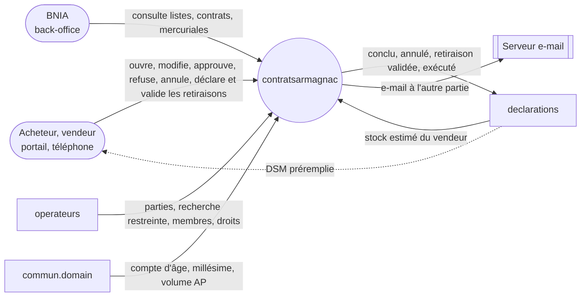
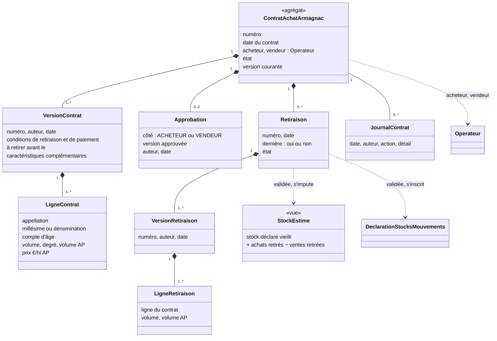
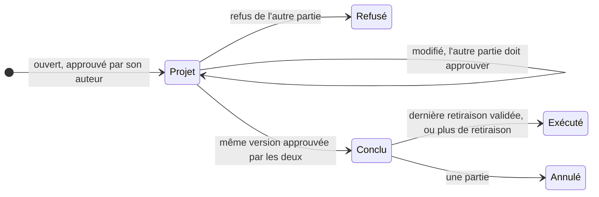
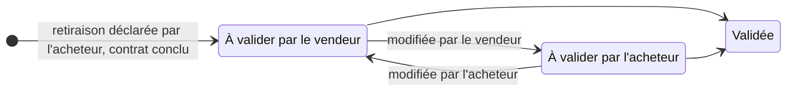
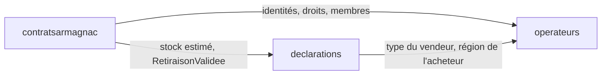
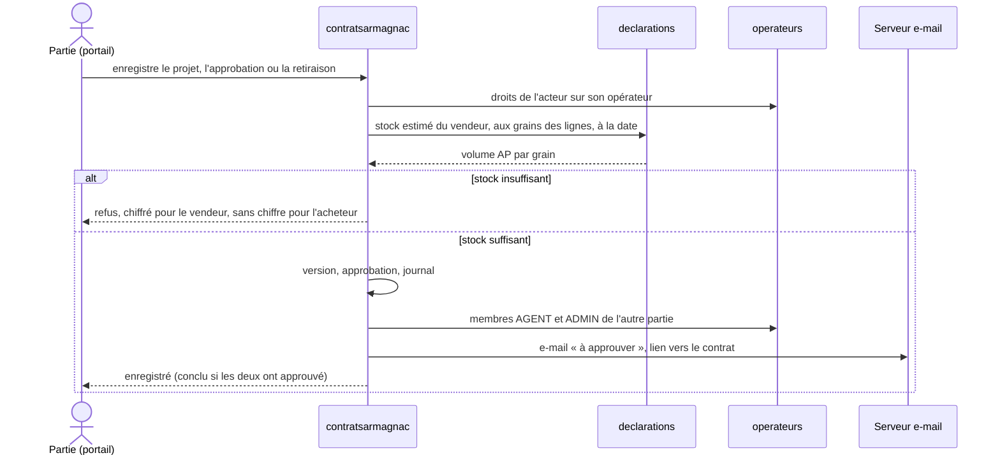
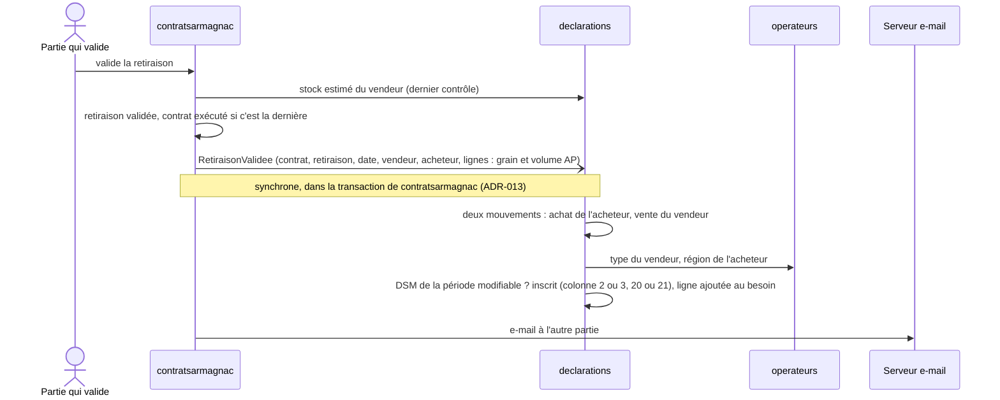

# Analyse : contratsarmagnac

Statut : terminée, 2026-10-23 · Sources : [vision du 2026-10-23](vision.md) (prime sur le CDC, écart assumé),
exemple de contrat CA-05 ; CDC §4.5 p.30-33, §5.5 p.67-68, C.4.1 p.112-115 ; liens : §4.4.7 p.27, §4.10.4
p.48, §5.2 p.61 ; AGI 3.1 p.16-17 · Doc publié : [Analyse : contratsarmagnac](https://claude.ai/artifact/VmwKPkqffZreoaiWrevvqv)

## 1. Cadrage

La livraison tient le **contrat d'achat Armagnac** entre deux opérateurs, un acheteur et un vendeur, sur de
l'Armagnac en fût (C.4.1.1.2 p.113, CA-05 §2), et **ce que le contrat met en mouvement : le stock estimé et
la DSM préremplie**. Tout se fait au portail, d'abord sur téléphone ; le BNIA consulte.
- **Négociation** : une partie ouvre un projet, l'autre l'approuve, le modifie ou le refuse ; chaque
  modification est montrée à celui qui doit revalider. **Conclu** quand les deux ont approuvé le même contenu.
- **Retiraisons** : l'acheteur les déclare, le vendeur les valide, jusqu'à l'**exécution**. Une partie seule
  peut annuler le contrat ou le clore sans plus de retiraison.
- **Stock estimé** : stock de la dernière DSM validée, vieilli, plus les achats retirés, moins les ventes
  retirées. Seul contrôle d'un projet et d'une retiraison.
- **DSM préremplie** : une retiraison validée s'inscrit en achat chez l'acheteur et en vente chez le vendeur,
  dans la DSM de sa période, aussitôt si elle est modifiable, sinon à son initiation.
- **Mercuriales** au back-office : par compte d'âge, millésime ou dénomination, prix minimum, moyen pondéré,
  maximum et volumes.

Hors de la livraison : pluri-annuels, propositions d'engagement et contrats vin ; échéancier, rattachement,
préavis, visa et mentions finales du formulaire (vision) ; fins de travaux dans le stock estimé
(`distillation`, terme nul aujourd'hui). Aucune facture ne naît d'un contrat.

**Le fil de la démonstration**, sur les comptes existants (`docs/demo.md`). Jeanne Durand
(`admin@producteur.fr`, Maison Durand, Condom) vend ; sa dernière DSM lui laisse environ 8,2 hl AP de `MB`
2015. Henri Castex (`admin@negociant.fr`, Armagnacs de Gascogne) achète. Sur son téléphone, Jeanne ouvre un
projet de 30 hl à 47 % vol. (14,1 hl AP) : bloqué par son stock estimé, elle le ramène à 15 hl. Henri reçoit
l'e-mail et modifie le prix ; Jeanne voit la modification et approuve : conclu. Henri déclare une retiraison,
Jeanne la valide : leurs stocks estimés bougent. La vente s'inscrit dans le brouillon annuel de Durand,
l'achat dans le mois de Gascogne (en compléments demandés), sur une ligne `MB` 2015 ajoutée. Au back-office,
la mercuriale du millésime 2015 apparaît.

## 2. Cas d'usage

Deux acteurs, comme dans le CDC : l'**opérateur**, qui agit pour son opérateur actif comme acheteur ou vendeur
(§5.5.2 p.67), et le **BNIA**, au back-office, en lecture seule. Le fil de la démonstration parcourt les UC 1
à 7 et 9.

> **UC-CA-1** En tant qu'opérateur, je peux ouvrir un projet de contrat en me désignant acheteur ou vendeur
> et en choisissant l'autre partie ; vendeur, mes lignes sont contrôlées sur mon stock estimé. (§5.5.2 p.67)

> **UC-CA-2** En tant que partie, étant donné un projet à approuver, je vois les modifications depuis ma
> dernière approbation, puis j'approuve, je modifie ou je refuse ; vendeur, je n'approuve que ce que mon stock
> couvre. (§5.5.3 p.67 amendé)

> **UC-CA-3** En tant qu'acheteur, étant donné un contrat conclu, je peux déclarer une retiraison, dernière ou
> non, dans le reste à retirer et couverte par le stock du vendeur, dont le refus ne me dit pas le chiffre.
> (C.4.1.1.1 p.113 amendé)

> **UC-CA-4** En tant que vendeur, je peux valider une retiraison, ou la modifier et la renvoyer à l'acheteur ;
> validée, elle s'impute sur nos stocks estimés. (§4.4.7 p.27 amendé)

> **UC-CA-5** En tant que partie, étant donné un contrat conclu, je peux l'annuler ou le déclarer sans plus de
> retiraison ; l'autre partie est notifiée. (vision)

> **UC-CA-6** En tant qu'opérateur, je peux consulter mon stock estimé à côté de mon stock déclaré, afin de
> savoir ce que je peux vendre. (ajout)

> **UC-CA-7** En tant qu'opérateur, je trouve les retiraisons validées de la période déjà inscrites dans ma
> DSM, afin de ne pas les ressaisir. (§4.4.7 p.27 amendé)

> **UC-CA-8** En tant qu'opérateur, je peux lister mes contrats par état, ouvrir l'un d'eux avec ses
> retiraisons et son journal, et l'éditer en PDF au formulaire CA-05 allégé. (§5.5.1 p.67, §4.5.1.4 p.31)

> **UC-CA-9** En tant que BNIA, je peux consulter tous les contrats, leurs retiraisons et leur journal.
> (§4.5.1.1 p.30 amendé)

> **UC-CA-10** En tant que BNIA, je peux consulter les mercuriales d'une période. (§4.10.4 p.48 amendé)

Hors analyse : retrait d'un projet par son auteur, numérotation, recherche, commentaire, conversation du
contrat, export des mercuriales.

## 3. Objets du domaine

Un seul agrégat porte négociation, conclusion et retiraisons : le reste à retirer et les approbations sont
des invariants du contrat entier. Le stock estimé et la DSM préremplie relèvent de `declarations`.

| Objet | Nature | Invariants |
|---|---|---|
| `ContratAchatArmagnac` | agrégat | Modifiable en projet seulement ; une modification crée une version, approuvée par son auteur seul ; conclu quand les deux approbations portent sur la version courante. Conclu : autant de retiraisons que nécessaire |
| `VersionContrat` | entité | Ajout seul ; les modifications montrées sont l'écart entre la version approuvée par une partie et la courante. Une date facultative « à retirer avant le », sans effet sur le stock |
| `LigneContrat` | valeur | En bois : millésime (grain `MB`) ou dénomination (grain `NB`). Compte d'âge d'un millésime calculé (RG-DEC-12 : 2009 donne 16 en 2026-2027). Volume AP = volume × degré |
| `Retiraison` | entité | Dans le reste à retirer (validées et en cours déduites) ; couverte par le stock estimé du vendeur ; validée quand les deux côtés ont approuvé la même version ; dernière : contrat exécuté |
| `StockEstime` | vue, `declarations` | Par ligne de DSM (clé, millésime ou dénomination, compte d'âge) : faits confirmés seuls, une vente conclue n'est pas déduite |
| `DeclarationStocksMouvements` | agrégat existant | Achat en colonne 2 (vendeur producteur) ou 3 (négociant), vente en 20 ou 21 (région de l'acheteur), ligne ajoutée au besoin |

## 4. Flux entre contextes

`declarations` garde une copie des retiraisons validées (mouvements de contrat) pour le stock estimé et la
DSM ; `contratsarmagnac` lit le stock estimé et publie le seul événement `RetiraisonValidee`, sans cycle.

L'initiation d'une DSM, la consultation du stock estimé, les mercuriales et le PDF ne traversent aucune
frontière ; l'annulation et la clôture n'émettent rien.

## Amendements au CDC

| CDC dit | On retient | Motif | Page |
|---|---|---|---|
| Le BNIA valide en dernier, même sans les parties, et peut invalider | Conclusion par l'accord des deux parties ; le BNIA consulte, en lecture seule quel que soit son rôle | Les parties s'engagent, le BNIA observe (vision) | §4.5.1 p.30, §4.5.1.3 p.31, §5.5.3 p.67 |
| Contrat saisi par le BNIA ou par un opérateur | Saisi au portail par une partie | Idem | §4.5 p.30 |
| Saisie validée non modifiable ; correction par le BNIA | Modifiable par chaque partie avant conclusion, versions et écart montré ; après, annulation ou clôture unilatérale | Négocier sans intermédiaire | §5.5.6 p.68 |
| Retiraison : texte « conditions et calendrier » | Objet déclaré par l'acheteur, validé par le vendeur, contrôlé ; plusieurs par contrat ; une date prévue facultative | Suivre le stock entre deux DSM | C.4.1.1.1 p.113 |
| Exécuté : trois validations et volumes couvrant la DSM | Dernière retiraison validée, ou clôture sans plus de retiraison | Plus de validation BNIA | §4.4.7 p.27 |
| Aucun contrôle du stock du vendeur | Stock estimé, seul contrôle, au projet, à l'approbation et à la retiraison ; faits confirmés seuls (décision du 2026-10-23) | Ne pas engager ni livrer plus qu'on a | — |
| Lignes d'achat et de vente de la DSM rattachées aux retiraisons | Retiraisons validées inscrites dans la DSM de leur période | Pas de ressaisie ; effet démo | §4.4.7 p.27 |
| Consolidation des achats : volumes des DSM, valeur des contrats | Mercuriales au back-office, tirées des seuls contrats | Prix réels du marché | §4.10.4 p.48 |
| Pluri-annuels, propositions d'engagement | Hors périmètre | Vision ; en discussion au BNIA | §4.5.3-4.5.4 p.32-33, §5.5.4-5.5.5 p.67-68 |
| Formulaire : échéancier, rattachement à un pluri-annuel, préavis, visa du BNIA, courtier aux signatures, mentions finales | Retirés | Vision | CA-05 |
| Acheteur : négociant, bouilleur de profession, coopérative | Aucune restriction de type | Souplesse du prototype | CA-05 §1 |
| — | Consultation du stock estimé par l'opérateur (UC-CA-6) | Le montrer bouger | ajout |

## Révisions de l'existant

| Concerné | Ce qui change | Motif |
|---|---|---|
| `contextes.md` §1 et §6 | Conclusion par les parties ; événement `RetiraisonValidee` seul | Plus de validation BNIA |
| Glossaire | `ContratAchatArmagnac` : états projet, conclu, exécuté, annulé, refusé (`ContratExecute` revu) ; nouveaux : `Retiraison`, `StockEstime`, `Mercuriale` | Nouveau cycle de vie |
| Spec 02 §3.2.7, RG-OPE-32 | Colonne « Contrats » : `OBSERVATEUR` lit, `AGENT` et `ADMIN` gèrent ; exception : lecture seule pour l'opérateur BNIA | Le BNIA consulte |
| Spec 05 §5.2 | Stock estimé livré ici, sans les fins de travaux ; engagements, disponible et bilan prévisionnel abandonnés ; grain = ligne de DSM, bois et verre distincts, sans appellation (le verre servira aux exports des négociants, hors contexte) ; Q-DEC-26 close | Faits confirmés seuls |
| Spec 05 RG-DEC-13 et 14 | Une retiraison validée s'inscrit dans la DSM de sa période et ajoute au besoin la ligne de son grain (`AJOUT`, corrigeable) | DSM préremplie |
| Spec 05 A-DEC-1, `DeclarationsLecture` (ADR-017) | Événements reçus : `RetiraisonValidee` seul ; lecture ajoutée : stock estimé d'un opérateur à une date | Flux de l'étape 4 |
| ADR-011 | Le mouvement de contrat référence la retiraison sans clé étrangère, comme `Origine` | `declarations` ne connaît pas `contratsarmagnac` |
| ADR-013 (conséquence, sans révision) | L'échec de l'inscription dans la DSM annule la validation de la retiraison | Contrat et DSM jamais divergents |
| Fiche 12 `statistiques`, fiche 11 `notifications` | Mercuriales ici ; e-mails par un port propre, comme `operateurs` | Contexte autonome |
| Ancienne analyse `04-contratsarmagnac` (2026-10-12) | Abandonnée | Vision du 2026-10-23 |
