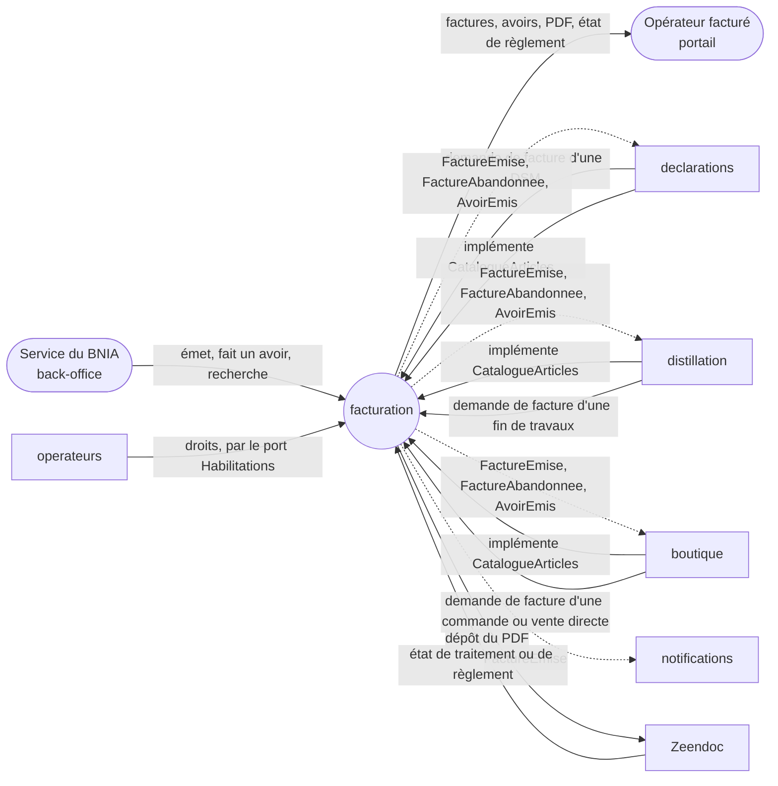
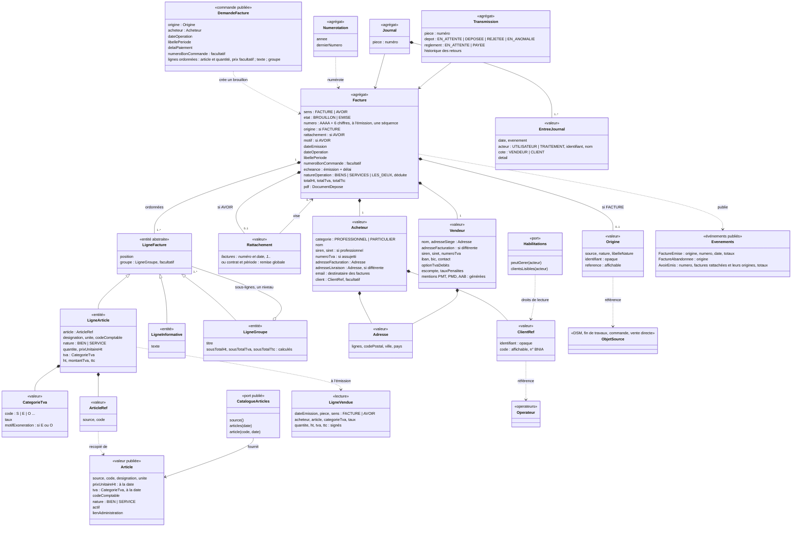
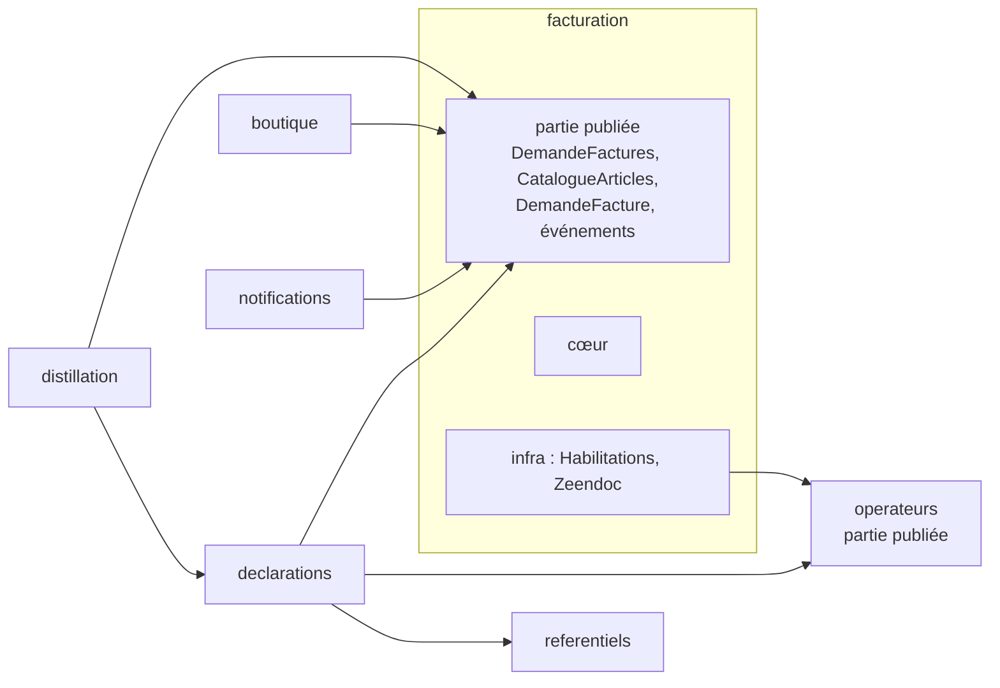
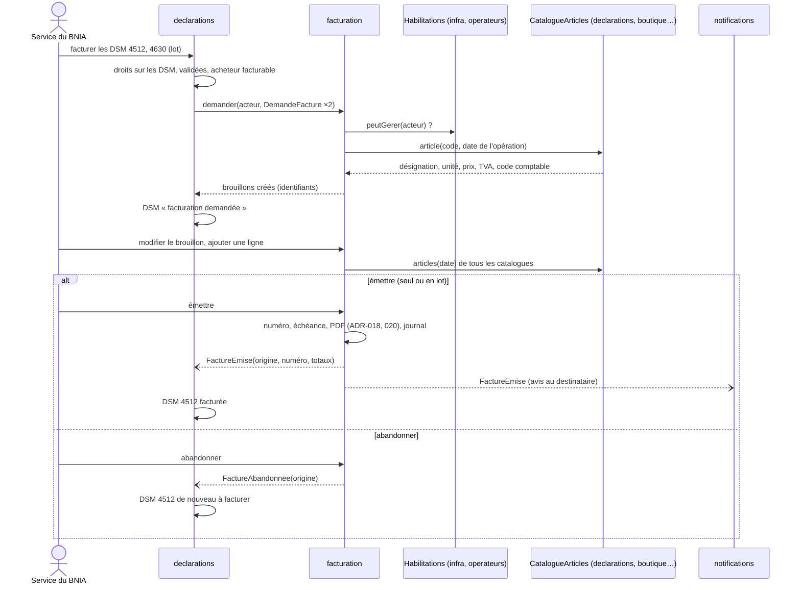
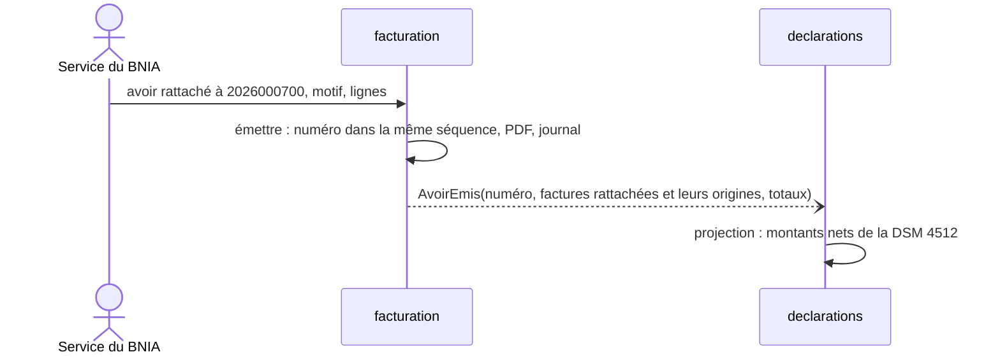
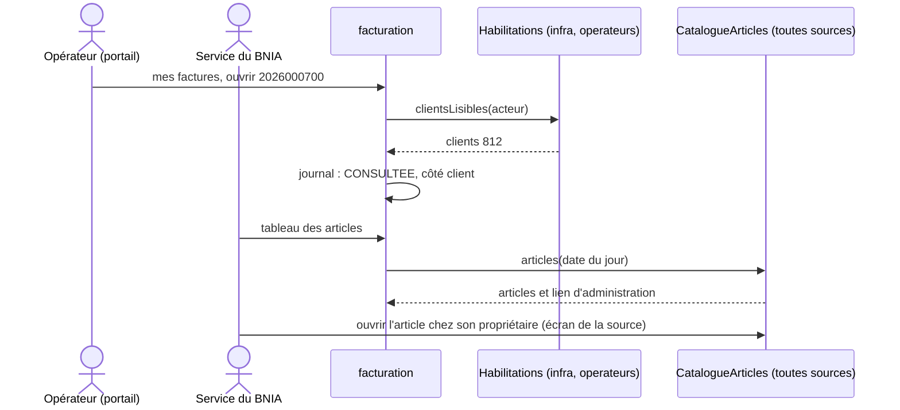
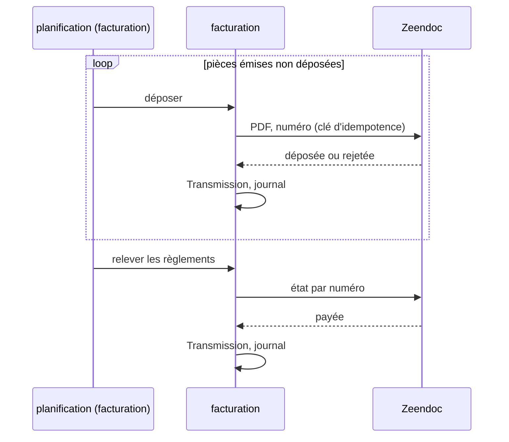

# Analyse : facturation

Statut : terminée, 2026-10-14 ·
Sources : §4.9 p.44-46, §5.10 p.74, §6.2 p.83, C.8 p.123-126, §4.2.5 p.15-16, §4.4.9-4.4.10 p.27-28,
§4.6.2 p.36, §4.11.1-4.11.3 p.52, §4.13 p.57-58, C.5.1.3 p.119, C.10.3 p.128, C.12 p.134, annexes D
p.138-139 et E p.140, AGI 2.3 p.9-10 ; factures d'exemple
`docs/source/fichiers-example/FACTURE-CVO-Armagnac_2026000700.pdf`, `FACTURE-CVO_DISTILLATION_2026000249.pdf`,
`FACTURE_CVO-PROVISION_202603-00002.pdf` ; récapitulatif des cotisations transmis par le BNIA
(2026-10-14, « récap BNIA ») · Doc publié : https://claude.ai/code/artifact/9a9ff0e7-259c-4e5b-b71f-64ba9995d0e0

## 1. Cadrage

Le BNIA vit de la cotisation interprofessionnelle (`CVO`) et vend quelques articles aux opérateurs.
`facturation` est le **service en aval** qui transforme ce que lui envoient les contextes métier en pièces
légales (décision du 2026-10-14) : il reçoit des **demandes de facture** (origine, acheteur, lignes), en garantit les
invariants (numérotation continue, facture émise jamais modifiée ni supprimée, correction par avoir),
édite le PDF selon un nouveau modèle, le met à disposition au portail, le dépose dans Zeendoc et restitue
l'état de règlement (§4.9 p.44, §4.9.8 p.46, §6.2 p.83). Il ne connaît ni DSM, ni cotisation : une
ligne lui arrive avec son article, qui porte sa désignation, son unité, son prix et sa catégorie de TVA,
et sa quantité. La plateforme reste la source des factures ; Zeendoc diffuse par e-mail, passe en
comptabilité et en facturation électronique (annexe D p.139, §6.2.1 p.83).

**Qui s'en sert** : les contextes métier, qui demandent les factures ; le service du BNIA, au back-office
(émission, avoirs, recherche) ; l'opérateur facturé, au portail, en consultation (§5.10 p.74) ; Zeendoc.

**Ce qu'il contient** : la facture et l'avoir (total ou partiel, §4.9.7 p.46), leur numérotation, leur PDF,
leur dépôt dans Zeendoc. Le **vendeur** est toujours le BNIA. L'**acheteur** est recopié sur la facture,
avec un **client** opaque du système hôte (ici l'opérateur), ou sans pour un client libre (C.8.1.1 p.123 ;
décision du 2026-10-14). Chaque facture garde la référence de son objet d'origine (DSM, fin de travaux,
commande).

**Ce qu'il ne contient pas** (décisions du 2026-10-14) :
- le **déclenchement** : `declarations` facture les DSM (§4.4.9 p.28), `distillation` les fins de travaux
  (§4.6.2 p.36), `boutique` les commandes et les **ventes directes**, qui remplacent la facture manuelle
  (§4.9.6 p.45, amendement) ;
- les **articles** : chaque contexte métier possède les siens et les expose en implémentant le port
  **`CatalogueArticles`** que publie `facturation` (point d'extension d'une lib) : `declarations` un
  article par ligne de cotisation, à côté de son taux, `distillation` le sien, `boutique` ses articles et
  les articles libres (sans photo, non publiés). Un article est identifié par **(source, code)** ;
  `facturation` les agrège pour la saisie d'une ligne et pour le tableau de tous les articles
  (amendement à §4.9.2 p.44, C.8.2 p.124) ;
- le calcul des cotisations, les taux de TVA (`referentiels`), l'avis de nouvelle facture
  (`notifications`, §5.12 p.77), l'encaissement (§5.10.3 p.74) et l'export comptable (§4.9.8 p.46).

**Les cotisations** (récap BNIA ; la TVA à 20 % ne porte que sur la part assujettie) :

| Cotisation | Unité | Montant | Part assujettie | Due par | Calculée dans |
|---|---|---|---|---|---|
| Vin de distillation destiné à l'Armagnac | hl de vin | 0,40 € | 20 % | le déclarant de la distillation, à domicile ou chez un bouilleur | `distillation` |
| Commerce d'eaux-de-vie d'Armagnac, vrac ou bouteilles | hlAP | 60 € | 80 % | l'utilisateur s'il relève du BNIA, sinon le vendeur | `declarations` |
| Eaux-de-vie destinées à un autre produit que l'Armagnac | hlAP | 60 € | 80 % | idem | `declarations` |
| Eaux-de-vie destinées à l'AOP Floc de Gascogne | hlAP | 19 € | 80 % | le producteur | `declarations` (**absente** : colonne 15 hors assiette) |
| Opérateurs satellites et metteurs en bouteilles à façon | forfait | 1 500 € | ? | ? | ? |

Questions au BNIA, reportées dans la spec (décision du 2026-10-14) :
- **Floc de Gascogne** : absente du CDC ; confirmer qu'elle est facturée sur la colonne 15 de la DSM.
- **Acheteur qui relève du BNIA** : comment est-il facturé ? Sur quelle déclaration, quelle colonne,
  quand ? (la vente au négoce de la région, colonne 20, est hors assiette du vendeur).
- **Forfait de 1 500 €** : qui est satellite ou metteur en bouteilles à façon, à quelle fréquence, quelle
  part assujettie ?
- **Facture provisionnelle** : citée p.16 et en annexe E p.140, jamais décrite (l'exemple appelle d'office
  une cotisation calculée sur les DRM d'un opérateur qui n'a pas déclaré).
- **Part non assujettie** : hors champ de la TVA (catégorie O, qui ne se mêle à aucune autre sur une
  facture électronique EN 16931 : deux factures par objet facturé) ou exonérée (catégorie E avec motif :
  une facture) ? Prototype : E (décision du 2026-10-14).
- **Date de référence du prix et de la TVA** : date de l'opération (période de la DSM, campagne) ou date
  d'émission ? Prototype : date de l'opération (décision du 2026-10-14).

**Confrontation avec l'existant**

| CDC (page) | Existant (ADR, spec, code) | Correspond ? | Proposition |
|---|---|---|---|
| Facturation déclenchée depuis la DSM, la fin de travaux, la commande (§4.4.9 p.28, §4.6.2 p.36, §4.9.3-4.9.5 p.44-45) | `facturation` lit la cotisation dans la partie publiée de `declarations` et porte UC-DEC-10 ; `FactureEmise` et `AvoirEmis` sont dans `fr.bnia.declarations.domain.partage` (spec 05 A-DEC-4, ADR-017, `contextes.md` §4) | non | Décision du 2026-10-14 : sens inversé. Les contextes métier appellent la partie publiée de `facturation`, où vivent la demande de facture et les types `FactureEmise`, `FactureAbandonnee` et `AvoirEmis` ; `facturation` ne lit aucune de ses sources. Révision de A-DEC-4, de la partie publiée de `declarations` et de la carte des contextes |
| Référentiel produits dans le module facturation (§4.9.2 p.44, C.8.2 p.124) | Produits de la facturation manuelle dans `boutique`, « à raffiner » (`contextes.md` §2.13 et §5, spec 01) | non | Décision du 2026-10-14 : pas de catalogue dans `facturation`, qui publie le port `CatalogueArticles` ; chaque contexte métier l'implémente pour ses articles (articles de cotisation portés par leur ligne dans `declarations` et `distillation`, articles de la boutique et articles libres dans `boutique`). Identité (source, code), unicité garantie par chaque source. Forme d'intégration nouvelle (port de l'aval implémenté par l'amont) : ADR à écrire |
| Tiers facturé : `Opérateur BNIA` ou `Client` saisi (C.8.1.1 p.123) | Fiche « incomplète » sans adresse, code postal, ville, pays ou région, « pour facturer ou certifier » (spec 02, RG-OPE-02) | non | Décision du 2026-10-14 : acheteur recopié, client libre possible ; « incomplète » remplacé dans `operateurs` par **facturable** et **certifiable**, chacun nommant ce qui manque, « facturable » quand la fiche fournit un acheteur légalement complet (révision de RG-OPE-02) |

Priorité du prototype (dire de l'utilisateur du 2026-10-14, pour l'ordre des incréments de la spec) :
facturer les DSM, une par une ou en groupe, lister les factures et les ouvrir ; Zeendoc ensuite.

## 2. Cas d'usage

> **UC-FAC-1** En tant que contexte métier, étant donné un objet à facturer (DSM, fin de travaux,
> commande, vente directe), je peux demander une ou plusieurs factures, qui deviennent des
> **brouillons**, afin que le BNIA les émette sans ressaisie ; je suis informé de leur émission ou de leur
> abandon. (§4.9.3-4.9.6 p.44-46 ; décision du 2026-10-14)

> **UC-FAC-2** En tant que service du BNIA, étant donné un brouillon, je peux tout y modifier (acheteur,
> libellé de la période, lignes d'article choisies dans n'importe quel catalogue, lignes de texte libre et
> groupes, ajoutés, retirés ou réordonnés) ou l'abandonner, puis l'émettre, seul ou en
> lot, ce qui le numérote et fige son PDF. (§4.9.3 p.45, §4.4.10 p.28, §4.9.8 p.46 ; édition complète :
> décision du 2026-10-14)

> **UC-FAC-3** En tant que service du BNIA, je peux émettre un avoir rattaché à une ou plusieurs factures
> émises d'un acheteur, ou à un contrat et une période (remise globale), avec un motif et des lignes de
> n'importe quel article, pré-remplies au besoin depuis les factures visées, afin de les corriger, de les
> annuler ou d'accorder une remise. (§4.9.7 p.46 ; BOI-TVA-DECLA-30-20-20-20 §220 et §260 ; décision du
> 2026-10-14)

> **UC-FAC-4** En tant que service du BNIA, je peux retrouver une facture ou un avoir par numéro, nature
> d'origine, acheteur, période ou date, et en ouvrir le détail, le PDF et le journal. (§4.9.1 p.44 ;
> journal : décision du 2026-10-14)

> **UC-FAC-5** En tant qu'opérateur, je peux retrouver mes factures et avoirs, télécharger leur PDF, voir
> leur état de règlement et la référence de leur DSM, fin de travaux ou commande. (§5.10 p.74)

> **UC-FAC-6** En tant que service du BNIA, je peux voir dans un seul tableau tous les articles de tous
> les catalogues, avec leur source, et ouvrir chacun chez son propriétaire pour le modifier, afin
> d'administrer tous mes articles d'un même endroit. (§4.9.2 p.44 ; décision du 2026-10-14)

> **UC-FAC-7** En tant que traitement planifié (adapter Zeendoc), étant donné une facture ou un avoir
> émis, je dépose son PDF dans Zeendoc, en rejouant sans doublon un dépôt échoué, puis j'en relève l'état de
> règlement par son numéro. (§4.9.8 p.46, §6.2 p.83)

> **UC-FAC-8** En tant que service du BNIA, je peux consulter les ventes consolidées d'une période,
> avoirs déduits, triées et regroupées à la demande par article, acheteur ou taux de TVA, en tableau avec
> ruptures ou en graphique, et les exporter en Excel ou en PDF, afin de suivre mes recettes. (décision
> du 2026-10-14)

Reportés dans les contextes métier (décisions du 2026-10-14) : facturer les DSM, une par une ou en groupe
(`declarations`, UC-DEC-10) ; facturer une fin de travaux à son déclarant (`distillation`) ; facturer une
commande et saisir une vente directe (`boutique`) ; administrer ses articles et implémenter
`CatalogueArticles` (`declarations`, `distillation`, `boutique`).

Hors analyse : facture provisionnelle (question au BNIA), journal des
anomalies Zeendoc, compteur « DSM en attente de facturation » du tableau de bord
(§4.1 p.12), avis de nouvelle facture (`notifications`).

**Confrontation avec l'existant**

| CDC (page) | Existant (ADR, spec, code) | Correspond ? | Proposition |
|---|---|---|---|
| Module Facturation (`Lecture`, `Écriture`) et action `Facturer` sur les modules DSM et Boutique (§4.2.5.1 p.15-16) | Rôles fixes × modules, lecture ou gestion (ADR-016, spec 02 §3.2.7) ; `Module.DECLARATIONS` | non | Décision du 2026-10-14 : nouveau module **Facturation**, lu par tout rattachement actif (ses propres factures), géré par les rôles `AGENT` et `ADMIN` de l'opérateur BNIA. Demander une facture depuis une DSM ou une commande exige la gestion de ce module, vérifiée par la lib (port `Habilitations`, étape 4) ; le contexte métier vérifie ses droits sur son objet |
| Cotisation Floc de Gascogne, 19 €/hlAP (récap BNIA) | Colonne 15 hors assiette, montant `CVO` unique par DSM (spec 05, H-DEC-1 à 3, `GrilleCotisation`, `LigneCotisation`) | non | Sous réserve de la réponse du BNIA (absente du CDC), révision de `declarations`, à mener dans ce contexte : une cinquième ligne de cotisation, un taux et un article par ligne |
| Facture émise corrigée par avoir (§4.9.7 p.46) | Prototype : éditer et supprimer plutôt que figer | non | Décision du 2026-10-14 (obligation légale) : une facture **émise** ne se modifie ni ne se supprime, elle se corrige par avoir ; un brouillon se modifie entièrement et s'abandonne |

## 3. Objets du domaine

| Objet | Nature | Rôle (UC servis) | Invariants |
|---|---|---|---|
| `DemandeFacture` | commande publiée | UC-FAC-1 | Lignes ordonnées des trois sortes ; une ligne article se réduit à (article, quantité, prix facultatif) : la lib résout l'article par `CatalogueArticles` à la date de l'opération et le recopie ; un lot = une demande par objet (décision du 2026-10-14) |
| `Facture` | agrégat | UC-FAC-1 à 5 | Facture et avoir, qualifiés par leur `sens` (code 380 ou 381 et 262 ; décision du 2026-10-14). Facture : une origine, une seule fois en brouillon. Avoir : un rattachement et un motif obligatoires, lignes libres, avertissement si les avoirs dépassent les factures visées (décision du 2026-10-14). Brouillon : tout se modifie, il s'abandonne. Émise : numéro, date, échéance, vendeur et PDF figés ; ni modifiée ni supprimée, conservée dix ans (§4.9.7 p.46). Au moins une ligne ; une ligne en catégorie O exclut toute autre catégorie (EN 16931) ; acheteur légalement complet à l'émission ; indemnité de 40 € seulement pour un professionnel |
| `LigneFacture` | entité | UC-FAC-2, 3, 8 | Succession ordonnée de lignes article, informatives (texte libre) et groupes (titre, sous-total calculé, un niveau), sur les sous-types DETAIL, INFORMATION et GROUP d'EXTENDED-CTC-FR (XP Z12-012 §4.4.11 ; décision du 2026-10-14) ; au moins une ligne article, seules comptées dans les totaux. Ligne article : une catégorie de TVA par ligne (décision du 2026-10-14) : une cotisation devient deux articles, part assujettie (S) et part non assujettie (E au prototype). HT = quantité × prix, TVA = HT × taux, chaque montant arrondi au centime, totaux = sommes des arrondis (RG-DEC-33) |
| `Rattachement` | valeur | UC-FAC-3 | Une ou plusieurs factures émises du même acheteur (381, BR-FR-CO-05), ou un contrat opaque et une période (262, BR-FR-CO-03) ; jamais vide (BOFiP §220, §260) |
| `Acheteur`, `Vendeur` | valeurs | UC-FAC-1, 2, 5 | Mentions obligatoires (service-public F31808, economie.gouv.fr) : SIREN si professionnel, adresse de livraison si différente ; vendeur paramétré une fois (le BNIA), recopié à l'émission ; mentions d'indemnité de 40 €, de pénalités et d'escompte générées sur toute facture (BR-FR-05 : notes PMT, PMD, AAB) |
| `ClientRef`, `Habilitations` | valeur, port | UC-FAC-1 à 5 | Client opaque de l'hôte, sans clé étrangère (décision du 2026-10-14) ; le port, défini dans le cœur, dit qui gère les factures et de quels clients un acteur lit les factures ; l'adapter BNIA s'appuie sur les droits d'`operateurs` |
| `Origine` | valeur | UC-FAC-1, 4, 5 | Remplace le type de facture (décision du 2026-10-14) : `libelleNature` titre le PDF et sert de filtre, `reference` s'affiche (« DSM juillet 2026 ») ; `identifiant` opaque, rendu dans les événements |
| `Numerotation` | agrégat | UC-FAC-2, 3 | Une seule séquence pour factures et avoirs, par année, prise dans la transaction d'émission, sans trou ni doublon (BOI-TVA-DECLA-30-20-20-10) |
| `Journal` | agrégat | UC-FAC-4 | En ajout seul, séparé de la pièce : demandée, modifiée, abandonnée, émise, consultée, déposée, rejetée, payée, avoir émis, note ; la note est le commentaire interne du vendeur, jamais imprimé ni transmis, possible même sur une pièce émise ; piste d'audit fiable (CGI art. 289 VII). Le côté (vendeur ou client) est fixé par le cas d'usage et figé à l'écriture : une consultation côté client prouve la réception (décision du 2026-10-14) |
| `Transmission` | agrégat | UC-FAC-5, 7 | Une par pièce émise ; rejouer un dépôt n'en crée pas un second (§6.2.3 p.83) |
| `CatalogueArticles`, `Article` | port publié | UC-FAC-2, 6 | (source, code) unique ; prix et catégorie de TVA donnés à une date, résolus par la source ; `lienAdministration` ouvre l'article chez son propriétaire |
| `LigneVendue` | lecture | UC-FAC-8 | Alimentée à l'émission par les seules lignes article ; avoir en négatif, daté de son émission ; quantités sommées par article seulement |

**Confrontation avec l'existant**

| CDC (page) | Existant (ADR, spec, code) | Correspond ? | Proposition |
|---|---|---|---|
| Facture liée à sa DSM, sa fin de travaux, sa commande (C.8.3.1 p.124) | Référence entre contextes par identifiant `bigint` **avec** clé étrangère (ADR-011) | non | `Origine` et `ClientRef` sans clé étrangère : la lib ne connaît pas les tables de ses sources ni de son hôte. Nouvelle exception à ADR-011, à côté de l'auteur d'une action ; RG-OPE-25 ne protège plus l'opérateur facturé, la facture recopiant tout l'acheteur |
| Type de facture : `Cotisation DSM`, `Cotisation fin de travaux de distillation`, `Facture diverse`, `Commande boutique` (C.8.3.1 p.124) | Glossaire : même liste, « manuelle ou provisionnelle » | non | Décision du 2026-10-14 : pas de type ; la nature de l'origine et son libellé, fournis par la source, en tiennent lieu. Glossaire à réviser |
| Ligne de cotisation, part non assujettie et part assujettie (facture d'exemple) | Une `LigneCotisation` à deux parts, pourcentage dans la grille (spec 05 RG-DEC-33, H-DEC-20) ; classe de TVA de la `CVO` en question (Q-DEC-23) | non | Décision du 2026-10-14 : deux articles par ligne de cotisation, l'un assujetti (S), l'autre non (E) ; la catégorie de TVA portée par l'article répond à Q-DEC-23. Révision de `declarations` |
| Avoir sur tout ou partie d'une facture, reprenant son taux ou son exonération (§4.9.7 p.46) | Glossaire : avoir « manuel, ou sur tout ou partie d'une facture » | non | Amendement, décision du 2026-10-14 : avoir rattaché à une ou plusieurs factures ou à un contrat et une période, lignes libres (BOFiP §260, XP Z12-012) ; plus d'avoir « manuel » sans rattachement. Glossaire à réviser |
| Projection des factures de DSM (A-DEC-4) | `FactureEmise(dsm, numero, date, ht, tva, ttc)`, `AvoirEmis(...)` dans la partie publiée de `declarations` | non | Types déplacés dans la partie publiée de `facturation`, avec `Origine` au lieu de `dsm` ; `declarations` filtre sur sa source. Ajout de `FactureAbandonnee` |
| Cotisation lue par `facturation` (§4.9.3 p.45) | `CotisationDsmVue` publiée pour `facturation` (spec 05 §5.2) | non | Plus lue : `declarations` envoie une `DemandeFacture` ; la vue sort de la partie publiée si rien d'autre ne la lit |
| Tiers facturé (C.8.1.1 p.123) | Fiche opérateur : SIRET facultatif, ni numéro de TVA ni catégorie d'acheteur (spec 02, RG-OPE-06) | non | La lib exige un acheteur légalement complet ; `operateurs` dit « facturable » la fiche qui le fournit, dont un SIRET pour en tirer le SIREN (révision de RG-OPE-02) ; numéro de TVA intracommunautaire ajouté à la fiche ; `declarations` vérifie avant sa demande |

## 4. Flux entre contextes

`facturation` ne dépend que de `operateurs` (droits) et de `commun` ; ses sources dépendent de sa partie
publiée : `DemandeFactures` (cas d'usage appelé), `CatalogueArticles` (port à implémenter), les
événements. Les appels sont synchrones, dans la transaction de l'appelant (ADR-013).

**F1. Demander, compléter, émettre ou abandonner** (UC-FAC-1, 2 ; UC-DEC-10)

**F2. Corriger par avoir** (UC-FAC-3)

**F3. Consulter** (UC-FAC-5, 6)

**F4. Zeendoc** (UC-FAC-7 ; ADR-019)

**Confrontation avec l'existant**

| CDC (page) | Existant (ADR, spec, code) | Correspond ? | Proposition |
|---|---|---|---|
| Facturer depuis la DSM, la fin de travaux, la commande (§4.4.9 p.28, §4.6.2 p.36, §4.9.3-4.9.5 p.44-45) | Parties publiées **en lecture** seulement (ADR-008, 012, 017) | non | Partie publiée de `facturation` avec un cas d'usage appelé (`DemandeFactures`) et un port à implémenter par l'amont (`CatalogueArticles`) : nouvel ADR « `facturation`, lib en aval » |
| Droit de facturer (§4.2.5.1 p.15-16) | Droits lus dans `operateurs` par chaque cas d'usage (ADR-016) ; décision de l'étape 2 : vérifié par le cas d'usage source | non | La lib vérifie aussi, par son port `Habilitations` (`peutGerer`, `clientsLisibles`), implémenté dans son infra sur les droits d'`operateurs` ; la source vérifie ses droits sur son objet |
| Taux de TVA à une date (§4.11.1 p.52) | `facturation` lit les taux dans la partie publiée de `referentiels` (`contextes.md` §4) | non | Plus lus par `facturation` : chaque `CatalogueArticles` résout la TVA de ses articles |
| État de facturation d'une DSM | « À facturer » = validée et sans facture, dans la projection (RG-DEC-34, A-DEC-4) | non | Projection enrichie : facturation demandée (retour de `demander`), annulée par `FactureAbandonnee` ; montants nets des avoirs. Révision de RG-DEC-34 |
| Dépendances | `facturation` → `declarations` (`contextes.md` §4, A-DEC-4) | non | Sens inversé : `declarations`, `distillation`, `boutique`, `notifications` → `facturation` → `operateurs`. Aucun cycle (`distillation` → `declarations` inchangé) |

## Amendements au CDC

| CDC dit | On retient | Motif | Page |
|---|---|---|---|
| Facture manuelle saisie dans le module facturation | Vente directe saisie dans `boutique` | Une facture a toujours une origine | §4.9.6 p.45 |
| Référentiel produits du module facturation | Port `CatalogueArticles` implémenté par chaque contexte métier ; tableau agrégé en lecture | La lib ignore le métier ; chaque article vit avec sa règle | §4.9.2 p.44, C.8.2 p.124 |
| Type de facture en liste fermée | Nature et libellé de l'origine, fournis par la source | Une seule vérité, lib générique | C.8.3.1 p.124 |
| Facture émise, sans brouillon décrit | Brouillon entièrement modifiable (lignes article, texte, groupes), abandon, émission seule ou en lot | Le BNIA relit et complète avant envoi | §4.9.3 p.45 |
| Avoir sur tout ou partie d'une facture, reprenant son taux ; avoir manuel | Avoir rattaché à une ou plusieurs factures, ou à un contrat et une période ; lignes libres ; motif | BOFiP §220 et §260, XP Z12-012 (381, 262) | §4.9.7 p.46 |
| Part de cotisation non assujettie sur la même ligne | Deux articles par cotisation, une catégorie de TVA par ligne (E au prototype) | Un taux par ligne ; EN 16931 | facture d'exemple |
| — | Mentions obligatoires de 2026 (SIREN, adresse de livraison, nature d'opération), notes PMT, PMD, AAB | Décret 2022-1299, BR-FR-05 | — |
| — | Journal de la pièce, consultation côté client comprise ; ventes consolidées (UC-FAC-8) | Piste d'audit fiable (CGI art. 289 VII) ; suivi des recettes | — |

## Révisions de l'existant

| Concerné | Ce qui change | Motif |
|---|---|---|
| Nouvel ADR « `facturation`, lib en aval » | Partie publiée avec un cas d'usage appelé (`DemandeFactures`), un port implémenté par l'amont (`CatalogueArticles`) et les événements | Les parties publiées n'étaient qu'en lecture (ADR-008, 012, 017) |
| ADR-011 | Exceptions sans clé étrangère : `Origine` et `ClientRef` | La lib ne connaît pas les tables de ses sources ni de son hôte |
| Spec 05, A-DEC-4, partie publiée de `declarations` | `FactureEmise`, `AvoirEmis` déplacés dans `facturation`, avec `Origine` ; ajout de `FactureAbandonnee` ; `CotisationDsmVue` retirée si plus lue | Sens de dépendance inversé |
| Spec 05, RG-DEC-33, RG-DEC-34, Q-DEC-23 | Deux articles par ligne de cotisation (S et E) ; état « facturation demandée » ; montants nets des avoirs ; Floc de Gascogne sous réserve | Une catégorie de TVA par ligne ; flux F1 et F2 |
| Spec 02, RG-OPE-02, RG-OPE-25, §3.2.7 | « Incomplète » remplacé par facturable et certifiable ; numéro de TVA intracommunautaire sur la fiche ; plus de clé étrangère depuis la facture ; module Facturation | Acheteur légalement complet ; `ClientRef` opaque |
| `contextes.md` §2.8, §4 | `facturation` → `operateurs` seulement ; ne lit plus `declarations` ni `referentiels` | Lib en aval |
| Glossaire | Type de facture, avoir, fiche incomplète | Décisions des étapes 1 et 3 |

## Révisions en cours de spec

Désaccords découverts pendant la spec, tranchés par l'utilisateur ; le doc publié n'est pas republié.

| Date | Point de l'analyse | Révision | Motif |
|---|---|---|---|
| 2026-10-14 | `LigneFacture` : TVA par ligne, arrondie, totaux = sommes des arrondis (§3) | TVA calculée par catégorie et taux sur la somme des HT ; les lignes ne portent plus ni TVA ni TTC (spec RG-FAC-05) | EN 16931 BR-CO-17, bloquante |
| 2026-10-14 | Acheteur recopié par la source (§3) | Un acheteur client se lit par un port `Clients` de l'hôte, à la demande et de nouveau à l'émission ; seul un client libre se saisit (spec RG-FAC-11) | Fiche modifiée entre la demande et l'émission ; changer d'acheteur sans ressaisie |
| 2026-10-14 | Brouillon abandonné, journal « abandonnée » (§3) | Brouillon supprimé avec son journal ; la trace reste chez la source (spec RG-FAC-18) | Pas de pièce légale avant l'émission |
| 2026-10-14 | Avoir à lignes libres (§3) | En plus : avoir d'annulation, une facture, lignes reprises, qui libère l'origine (spec RG-FAC-23) | Refacturer une DSM corrigée (avoir `Total`, C.8.4.1 p.125) |
