# Facturation : décisions d'architecture (phase E)

Principe (2026-10-14) : architecture hexagonale stricte et modularisation Maven.

## A-FAC-1 : comment une source parle à `facturation`

### Option A (retenue le 2026-10-14) : module d'API ; ports et adapters des deux côtés

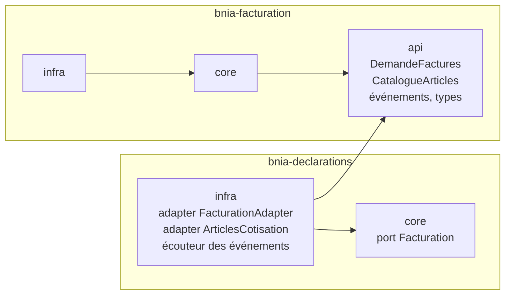

- Le core de `declarations` ne connaît que **son** port `Facturation`.
- Son infra fait le pont avec l'API de `facturation`.
- La frontière est garantie par Maven : `declarations` ne voit que `bnia-facturation-api`.

### Option B : module d'API appelé directement par le core de la source

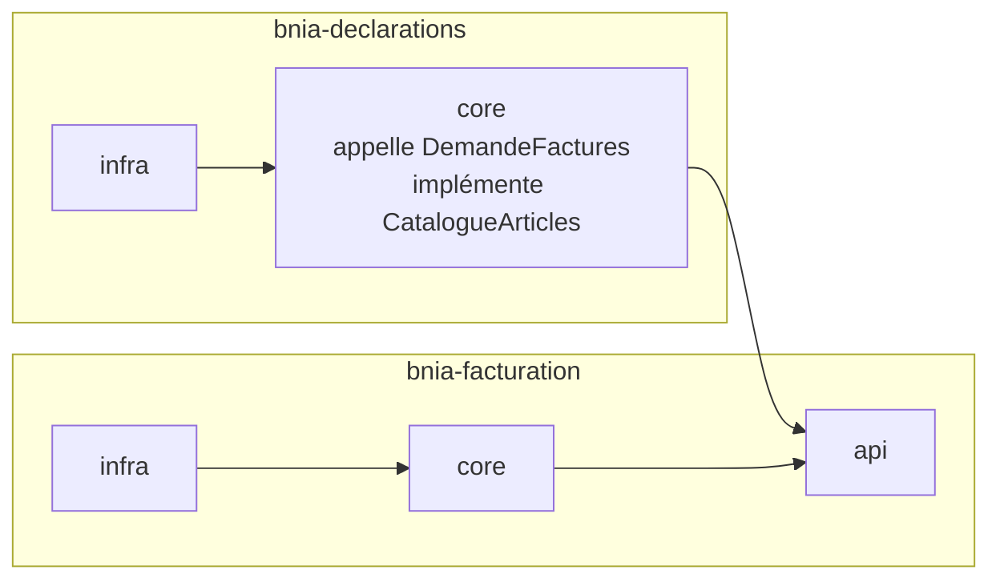

- Moins de code (pas de port ni d'adapter côté source).
- Le core de `declarations` dépend d'un autre contexte : l'hexagonale n'est plus stricte.

### Option C : paquets `partage` dans le core (forme actuelle d'ADR-012 et 017)

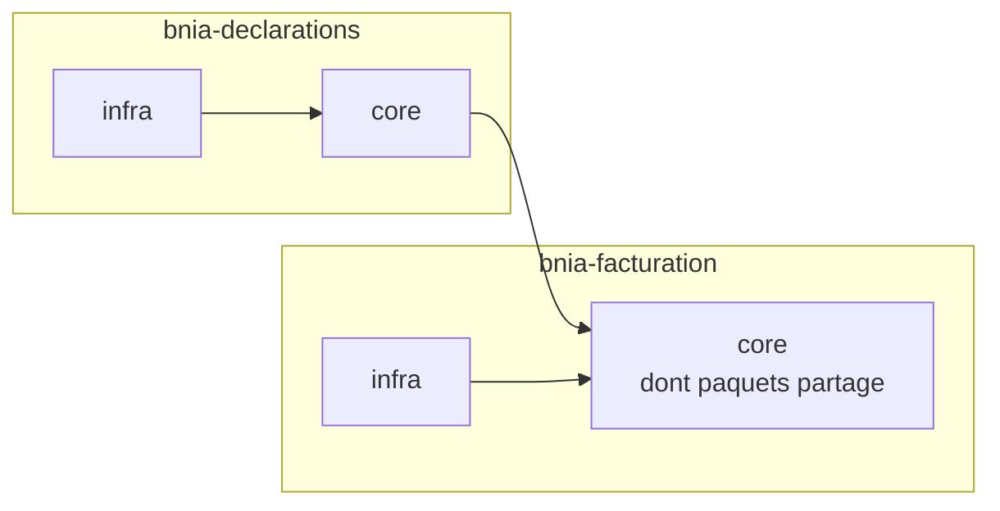

- Pas de module de plus.
- La frontière n'est garantie que par ArchUnit : tout le core de `facturation` est visible de la source.

### Côté `operateurs` (dans les trois options)

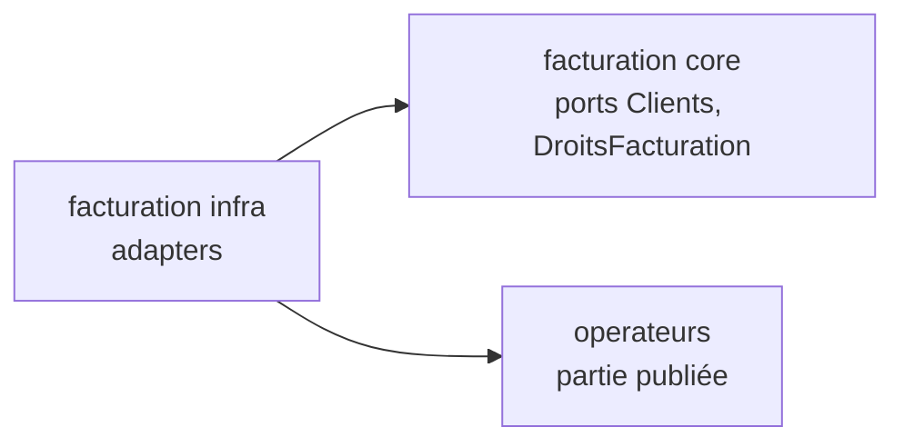

## A-FAC-2 : comment `facturation` trouve les catalogues

### Option A (retenue le 2026-10-14) : liste injectée

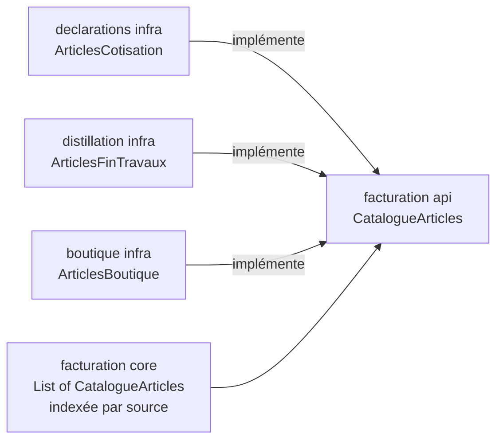

- Spring injecte tous les catalogues. Une nouvelle source n'a qu'à déclarer son adapter.
- Deux catalogues de même `source()` : refus au démarrage.

### Option B : registre explicite dans `bnia-boot`

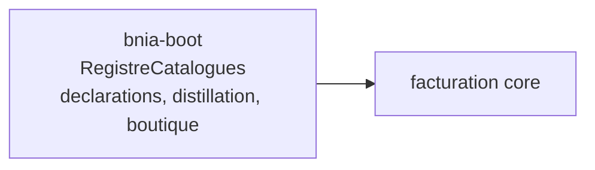

- La liste des sources se lit en un seul endroit.
- Une ligne de câblage à ajouter pour chaque nouvelle source.

### Option C : un catalogue composite dans `bnia-boot`

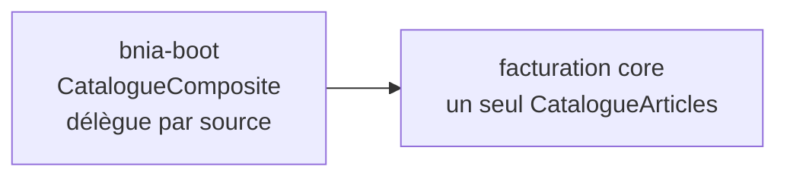

- `facturation` ne sait pas qu'il existe plusieurs sources.
- La logique de répartition par source se trouve dans `bnia-boot`.

## A-FAC-3 : où implémenter les ports de l'hôte (droits, clients)

Ports définis dans le core de `facturation` : `DroitsFacturation` (le nom `Habilitations` est déjà pris
dans `operateurs`) et `Clients`.

### Option A (retenue le 2026-10-14) : adapters dans l'infra de `facturation`

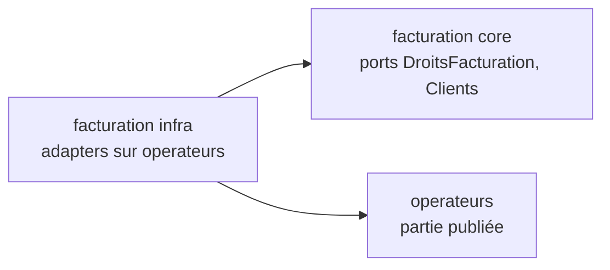

- Conforme à `CLAUDE.md` : l'intégration vit dans le contexte qui définit le port (analyse §4).
- `bnia-facturation-infra` dépend d'`operateurs`.

### Option B : adapters dans `bnia-boot`

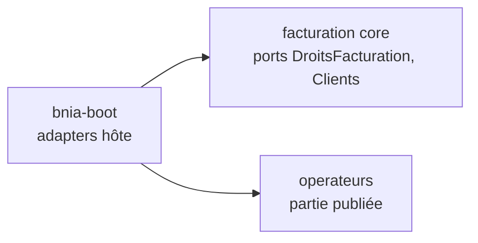

- `bnia-facturation` ne dépend de rien : une lib pure.
- `bnia-boot` porte du code d'intégration, pas seulement du câblage.

### Option C : adapters dans un module hôte dédié

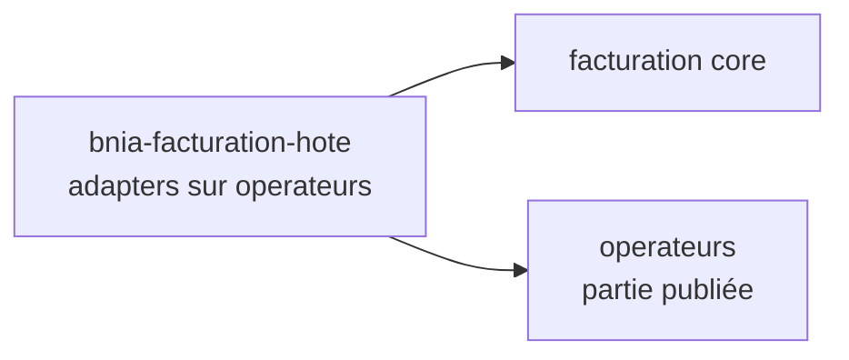

- Lib pure, et `bnia-boot` reste du câblage.
- Un module Maven de plus.

## A-FAC-4 : persistance des lignes de la pièce

Spring Data JDBC (ADR-004) ne gère pas l'héritage : les trois sortes de lignes (article, texte, groupe)
doivent se ranger autrement.

### Option A (retenue le 2026-10-14) : une table, une colonne `sorte`

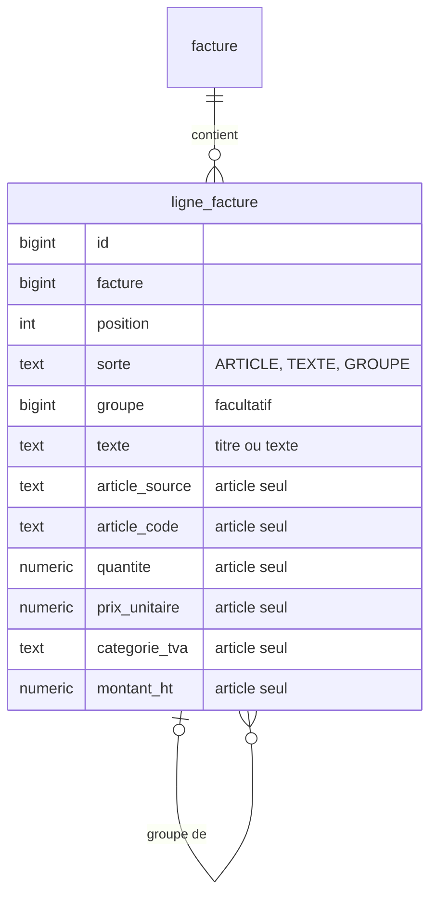

- Une seule collection dans l'agrégat ; l'ordre se lit d'une requête.
- Des colonnes vides selon la sorte, contrôlées par des contraintes `CHECK`.

### Option B : une table par sorte

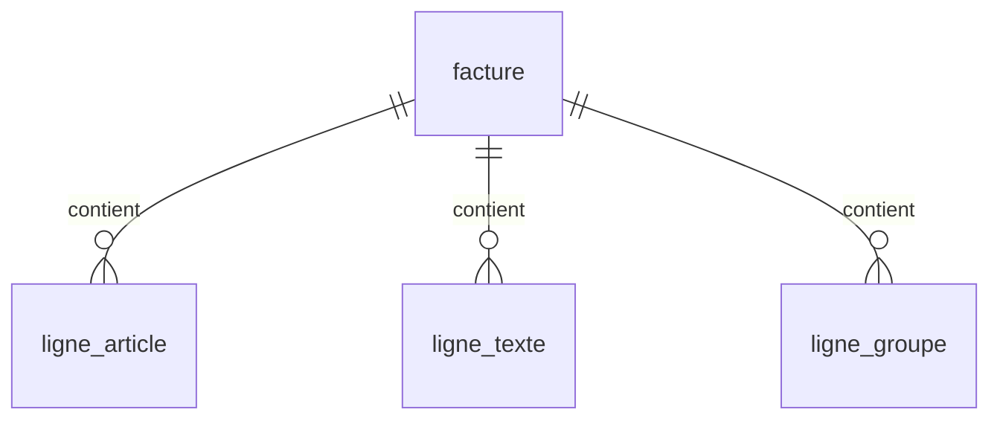

- Aucune colonne vide.
- La position est partagée entre trois tables : l'ordre se recompose à la lecture.

### Option C : lignes en `jsonb` dans la facture

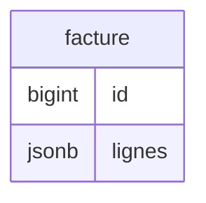

- Le plus simple à écrire.
- Les ventes consolidées (UC-FAC-8) doivent lire du JSON : SQL plus lourd.

## A-FAC-5 : numérotation sans trou (RG-FAC-12)

### Option A (retenue le 2026-10-14) : compteur verrouillé dans la transaction d'émission

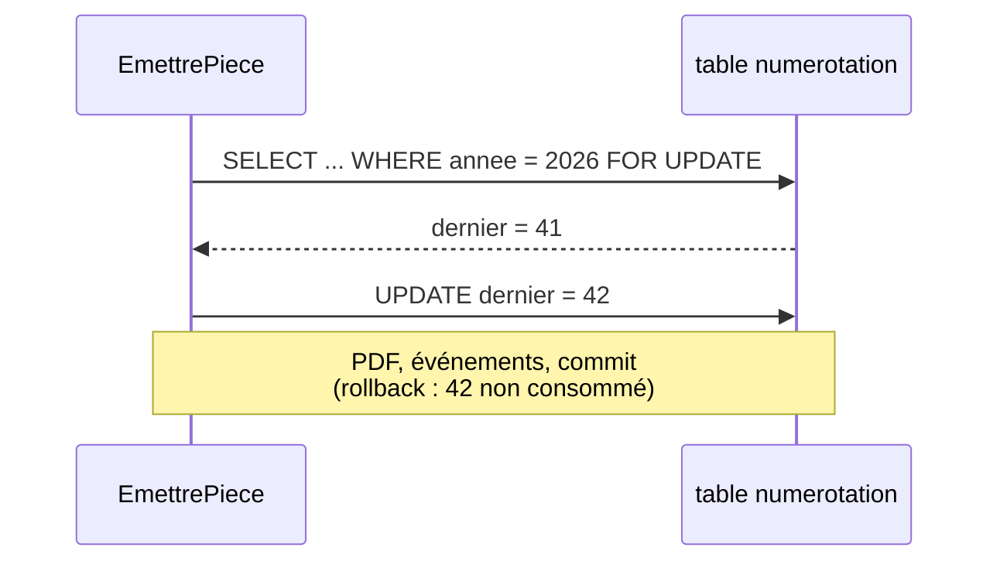

- Sans trou ni doublon, même en cas d'échec : tout est annulé ensemble.
- Les émissions concurrentes s'attendent les unes les autres (quelques millisecondes).

### Option B : séquence PostgreSQL

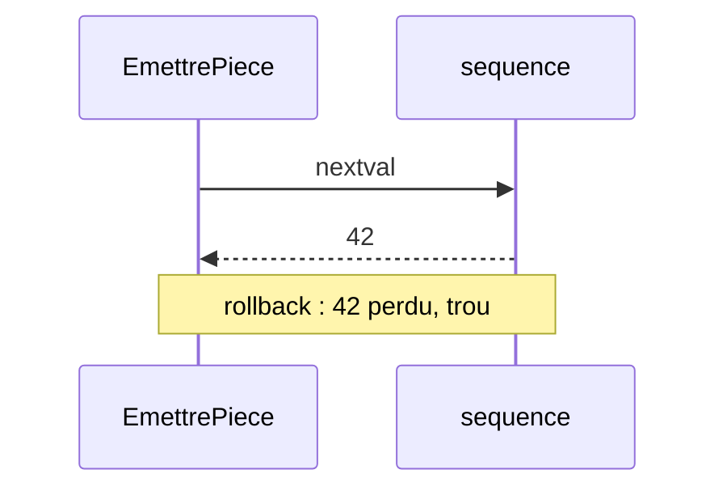

- Aucune attente.
- Un rollback laisse un trou : contraire à RG-FAC-12.

### Option C : max + 1 avec contrainte d'unicité

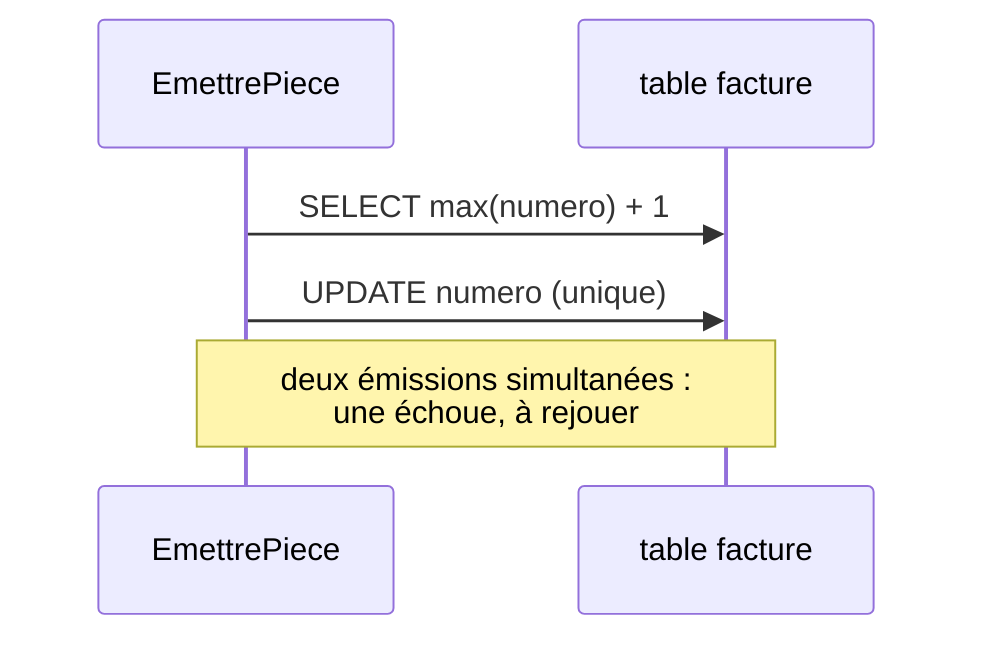

- Pas de table de plus.
- Collision possible en cas de concurrence, avec un rejeu à gérer.

## A-FAC-6 : émission en lot, une transaction par brouillon (RG-FAC-19)

Aujourd'hui, chaque méthode d'un `@UseCase` s'exécute dans une seule transaction (`UseCaseConfiguration`).

### Option A (retenue le 2026-10-14) : cas d'usage de lot et port `Transactions`

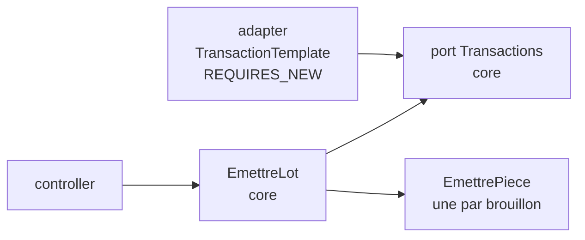

- Le compte rendu est produit par le cas d'usage ; le core reste Java pur.
- Un port technique de plus, dans `bnia-commun`.

### Option B : le controller boucle

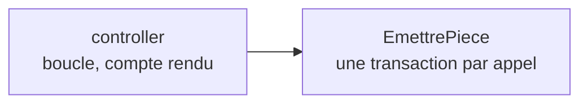

- Aucun code nouveau.
- Le compte rendu, une règle (RG-FAC-19), se retrouve dans l'adapter REST.

### Option C : cas d'usage de lot non transactionnel

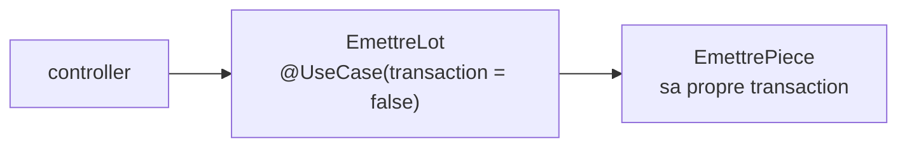

- Pas de port.
- Une exception à la règle « tout cas d'usage est transactionnel », à marquer dans `@UseCase`.
