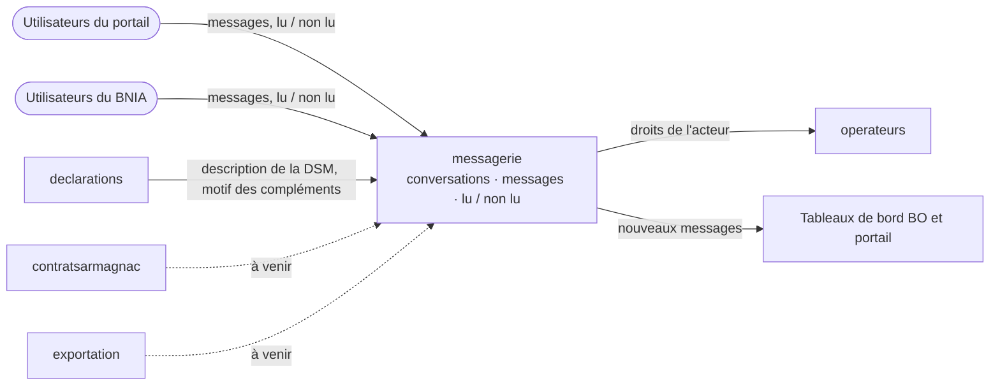
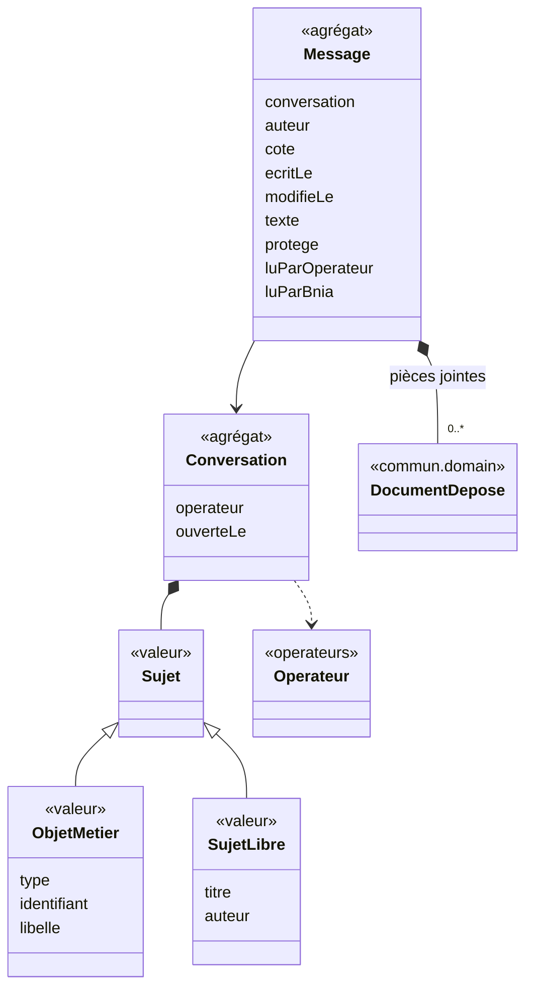
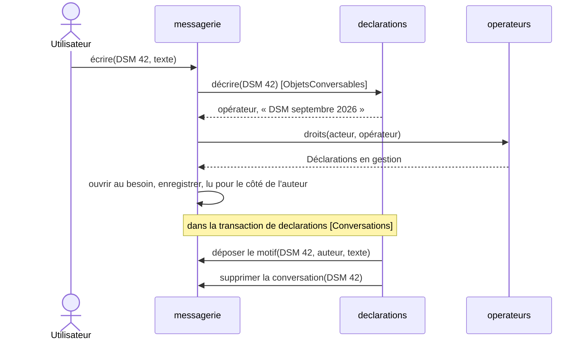
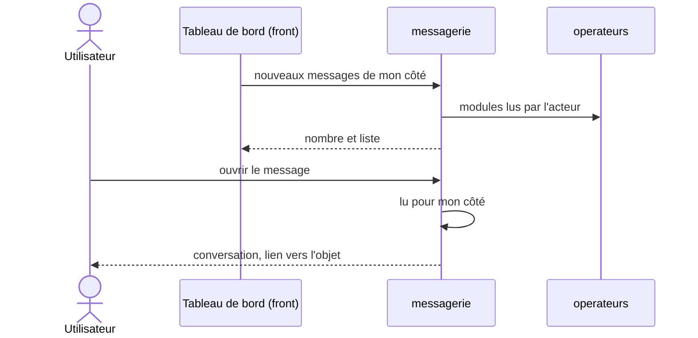

# Analyse : messagerie

Statut : terminée, 2026-10-17 · Sources : aucune section dédiée (contexte ajouté pour la démonstration) ;
points d'appui : §4.1 p.12, §4.4.5 p.26, §5.2.2 p.61, §5.12 p.77, C.3 p.107-111, C.4 p.113, C.7 p.122,
C.14 p.136 · Doc publié : https://claude.ai/code/artifact/557382d0-9ffa-45ce-bfe3-704f0ba1718f

## 1. Cadrage

**Raison d'être.** Le CDC n'a pas de messagerie : des champs « commentaire » épars (DSM C.3 p.107,
contrat C.4 p.113, certificat C.7 p.122) et un accès au BNIA « si besoin d'assistance » (§5.2.2 p.61).
Amendement : `messagerie` porte **tous les échanges écrits entre le BNIA et un opérateur**, sur un objet
métier ou un sujet libre.

**Deux côtés, sans destinataire nommé** : l'opérateur (ses utilisateurs du portail) et le BNIA. La
conversation d'un objet est partagée par tout l'opérateur ; une conversation libre, par son seul auteur
côté opérateur. Côté BNIA, tous voient tout.

**Contient** : conversations, messages, état lu / non lu par côté, compteur « x nouveaux messages » des
deux tableaux de bord. **Ne contient pas** : les notifications et relances du système (`notifications`,
§5.12 p.77) ; l'objet métier, dont elle ne connaît que type, identifiant et libellé ; les notes internes
du BNIA, carnet tenu par chaque contexte métier ; les e-mails.

| CDC (page) | Existant | Décision du 2026-10-17 |
|---|---|---|
| Aucune messagerie | `contextes.md` : 14 contextes | Contexte n° 15 `messagerie` |
| Lu / non lu des notifications (§5.12.1 p.77, C.14 p.136) | `notifications` (n° 11), non spécifié | Deux contextes : la notification vient du système et vise un destinataire ; le message est écrit par une personne, sans destinataire |

## 2. Cas d'usage

Tous viennent du besoin exprimé le 2026-10-17, sauf mention.

- **UC-MSG-1** Utilisateur du portail : j'ouvre une conversation libre avec le BNIA (titre, message,
  pièces jointes), que je suis seul à voir dans mon opérateur, afin d'obtenir de l'aide. (§5.2.2 p.61)
- **UC-MSG-2** Portail ou BNIA : j'écris dans la conversation d'un objet que je peux consulter (DSM,
  puis contrat, demande de certificat), depuis sa page ou depuis la messagerie. (C.3 p.107)
- **UC-MSG-3** Portail ou BNIA : je réponds dans une conversation libre, avec pièces jointes.
- ~~UC-MSG-4~~ Retiré : rien n'est caché à l'opérateur dans une conversation.
- **UC-MSG-5** `declarations` : je dépose le motif d'une demande de compléments dans la conversation de
  la DSM ; il ne se supprime pas. (RG-DEC-20, 25)
- **UC-MSG-6** Portail ou BNIA : mon tableau de bord compte les non lus de mon côté ; un clic ouvre leur
  liste (titre, première ligne, objet ou sujet). (§4.1 p.12, §5.2.2 p.61)
- **UC-MSG-7** J'ouvre un message : lu pour tout mon côté ; je vois la conversation et le lien vers son
  objet.
- **UC-MSG-8** Je marque un message non lu : il reste compté pour tout mon côté.
- **UC-MSG-9** Je retrouve mes conversations (BNIA : de tous les opérateurs, par opérateur, type
  d'objet ou sujet libre).
- **UC-MSG-10** Je cherche un mot dans les messages que je peux lire.

Hors analyse : conversation libre ouverte par le BNIA ; modifier ou supprimer son message ; pièces
jointes sur un objet ; clore une conversation ; e-mails d'alerte.

Droits d'une conversation d'objet : ceux du module de l'objet (lire l'objet pour la lire, le gérer pour
y écrire, RG-DEC-01).

| Besoin | Existant | Décision du 2026-10-17 |
|---|---|---|
| Tout utilisateur ouvre une conversation libre | `OBSERVATEUR` en lecture seule dans chaque module (spec 02 §3.2.7) | Module « Messagerie » (conversations libres), gestion pour les trois rôles |
| Conversation libre vue de son seul auteur | Tout rattachement `ACTIF` lit tout son opérateur (RG-OPE-31) | Exception, `ADMIN` compris ; après le départ de l'auteur, le BNIA seul la voit |
| Lu / non lu par côté | Aucun état de lecture | Par message et par côté, sans dire qui l'a lu ; lu pour le côté de l'auteur dès l'écriture |

## 3. Objets du domaine

| Objet | Nature | Invariants |
|---|---|---|
| `Conversation` | agrégat | Un sujet ; au plus une par objet métier ; naît au premier message ; supprimée avec son objet (RG-DEC-22) |
| `ObjetMetier` | valeur | Type en liste fermée, identifiant opaque, libellé (« DSM septembre 2026 ») d'où se déduit le lien |
| `SujetLibre` | valeur | Titre non vide ; auteur du portail |
| `Message` | agrégat | Texte non vide ; sur l'objet entier, jamais une de ses parties ; protégé : ne se supprime pas |
| `DocumentDepose` | valeur | Pièce jointe, en conversation libre seulement |

`Message` est une racine à part : écrire ou lire ne verrouille pas la conversation.

| CDC (page) ou besoin | Existant | Décision du 2026-10-17 |
|---|---|---|
| Référence à l'objet | Clé étrangère entre contextes (ADR-011), sauf `Origine` d'une facture | `ObjetMetier` opaque, comme `Origine` : amendement d'ADR-011 |
| Commentaire de DSM (C.3 p.107) | `Commentaire` : DSM ou ligne, `interne`, `motif` (spec 05 §3.2.4, code) | Message de la conversation de la DSM ; `motif` devient `protege`. Plus de commentaire de ligne ni interne. Glossaire : **Message** |
| Note de contrôle d'une ligne (§4.4.5 p.26, C.3 p.108), d'un justificatif (C.3 p.111) | Commentaires internes (RG-DEC-24) | **Note interne**, carnet de `declarations` sur la DSM et ses lignes, distinct à l'écran ; même principe pour C.4 et C.7 |
| Note de transfert en région (C.3.2.5 p.110) | Commentaire de ligne (H-DEC-12) | Supprimée : absente des matrices Excel |
| Observation générale (C.3.1.1 p.107) | Commentaire de la DSM (H-DEC-12) | Message de la conversation de la DSM |

## 4. Flux entre contextes

`messagerie` est une **lib en aval** (ADR-021) : elle ne connaît aucun contexte métier. Son module
`bnia-messagerie-api` publie `Conversations` (appelée par les contextes métier) et `ObjetsConversables`
(implémentée par eux). Les droits se lisent dans `operateurs` (ADR-012), chaque type d'objet ayant son
module (DSM : Déclarations).

Sans cycle : l'infra de `declarations` dépend de `bnia-messagerie-api` ; `messagerie`, de `operateurs`
seul. Pièces jointes : `StockageDocuments` (ADR-018).

| Besoin | Existant | Décision du 2026-10-17 |
|---|---|---|
| Ouvrir au premier message | Une source implémente un port de l'API (`CatalogueArticles`, ADR-021) | `ObjetsConversables`, implémenté par l'infra de `declarations` : second cas d'ADR-021 |
| Motif des compléments | `GererDsm` l'écrit en `Commentaire` ; `ComplementsDemandes` sans écouteur | Déposé par le port `Messagerie` de `declarations` ; l'événement reste pour `notifications` |
| Module « Messagerie » | `Module` de `operateurs` | `Module.MESSAGERIE` |

## Amendements au CDC

| CDC dit | On retient | Motif | Page |
|---|---|---|---|
| Rien sur une messagerie | Contexte `messagerie` : conversations d'objet et libres | Démonstration au BNIA | §5.2.2 p.61 |
| Commentaire et observation générale, champs de la DSM | Messages de sa conversation | Un seul fil d'échange | C.3 p.107 |
| Note de transfert en région, texte de la ligne | Supprimée | Absente des deux matrices | C.3.2.5 p.110 |

## Révisions de l'existant

| Concerné | Ce qui change | Motif |
|---|---|---|
| Spec 05, code `declarations` | `Commentaire` remplacé : messages dans `messagerie`, notes internes dans un carnet ; plus de commentaire de ligne (RG-DEC-24, 25, H-DEC-12) | Échange et note distincts |
| Spec 02, `operateurs` | `Module.MESSAGERIE` ; exception à RG-OPE-31 pour les conversations libres | Conversation libre privée |
| ADR-011 | Amendement : `ObjetMetier` sans clé étrangère | Objet de tout contexte |
| ADR-021 | Second cas de lib en aval (`bnia-messagerie-api`) | Aucun contexte métier connu |
| `contextes.md`, glossaire | Contexte n° 15 ; **Message**, **Note interne** ; « Commentaire » renvoie à Message | Vocabulaire |

## Écarts découverts en spec

| Date | Écart | Décision |
|---|---|---|
| 2026-10-17 | Objets conversables du prototype : seule la DSM existe, contrat et certificat attendent leur contexte (UC-MSG-2) | La **facture émise** est conversable aussi ; `facturation` implémente `ObjetsConversables`. Exception à la règle de droits (§2) : sur une facture, la lecture du module Facturation suffit pour écrire, ce module n'étant géré que par le BNIA (spec 15 §2.1) |
